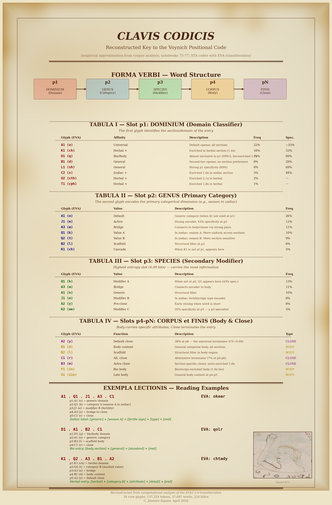

# Computational Analysis of the Voynich Manuscript

> Natural language, cipher, or artificial system? An investigation using information theory, machine learning, and computational statistics.

**Independent research project** | Corpus: STA1 2.0 (37,087 words, 157,254 glyphs, 166 distinct glyphs)

---

## A 5-minute introduction (no maths required) · Introducción en 5 minutos (sin matemáticas)

### English

The Voynich Manuscript is a 240-page illustrated book written around 1404–1438 in an alphabet nobody else has ever used. For 600 years scholars, codebreakers and amateurs have tried to read it, and **all of them have failed**. This project is a systematic computational attempt — and an honest report of where the text breaks down.

**What we did.** We treated every standard hypothesis as a testable prediction and we ran them all: that it is a natural language in disguise (Hebrew, Aramaic, Arabic, Tibbonid Hebrew, Judeo-Arabic, Ge'ez), that it is a classical cipher (substitution, polyalphabetic, transposition, nomenclature codes), that it is nonsense, that it is a constructed language. **Nineteen substitution models, five Semitic targets, three writing-system types** — all of them hit the same wall.

**What we found.**
- **The text is real.** It has a rigid internal structure that no random gibberish reproduces; in particular, glyphs are *position-locked* inside the word at a level twice as strong as any natural language we measured.
- **It is not a hidden natural language.** Every model that tries to map glyphs to letters of a real alphabet stalls at the same ceiling: a few valid roots and at most ~68 % valid bigrams.
- **It is a positional code.** What matters is the position of a glyph in the word, not the glyph's "letter value". This pattern matches a 17th-century theoretical category — Caramuel's *cifra ineffabilis* / philosophical pasigraphy — that traces back to Ramon Llull and to medieval Aristotelian/Kabbalistic combinatorics.
- **One folio is special.** Folio f57v ("the Venus ring") contains five glyphs that appear *nowhere else* in the manuscript — a private subalphabet whose iconography matches the *karacteres* described in the medieval astrological treatise *Picatrix*.
- **The grammar can be reconstructed.** Each Voynich word follows a fixed 5-slot template: **DOMINIUM** (domain) → **GENUS** (category) → **SPECIES** (specifier) → **CORPUS** (body) → **FINIS** (terminator). Visual glyph families correlate with their slot far more than chance allows (p = 0.0007). This is the **CLAVIS CODICIS** — the syntactic key.

**On the "meaningless hoax" hypothesis.** Several authors have argued that the manuscript is gibberish generated by a 15th-century device. We implemented every published candidate and measured its weighted Euclidean distance *d* to the Voynich fingerprint:
- **Cardan grille** (Rugg 2004; Rugg & Taylor 2017) — table-based shuffler: ***d* = 4.485** (worst of all 11 models tested); over-regular and over-predictable.
- **Self-citation algorithm** (Timm & Schinner 2020, 2024) — scribe copies and modifies earlier words: ***d* = 1.356**; produces a flat curve (bounce 0.120 vs Voynich 0.813).
- ***Polygraphia III*** (Hermes 2022) — Trithemius-style polygraphic substitution.
- **Naibbe verbose homophonic cipher** (Greshko 2025) — the closest of any published model, yet still ***d* = 1.028** (more than 2× the distance of our SilPart model, *d* = 0.445), with **zero positional MI** (vs 0.658 for the Voynich).

None of the four reproduces the full fingerprint. The two pre-radiocarbon "modern forgery" candidates (Wilfrid Voynich himself in 1912; the Elizabethan Kelley/Dee circle) are independently excluded by the parchment's C14 date of **1404–1438**.

**What this means.** The Voynich is not a meaningless hoax, not a natural language, and not a classical cipher. It is an *artificial categorial code*: each word is a structured address inside a classification system, like a library call number. We have recovered the **syntax** of that system; recovering the **semantics** still requires the original key book to surface in a library somewhere — which is the next stage of the project.

**A note on the CLAVIS CODICIS — what it is and what it is not.** The name means "Key of the Codex" in Latin, and the five slot labels (DOMINIUM, GENUS, SPECIES, CORPUS, FINIS) are also in Latin. This is a deliberate choice: they are *descriptive scholarly labels for positions*, not translations of any glyph. Latin matches both the medieval intellectual environment of the manuscript and Caramuel's Latin formalisation of *cifras ineffabiles*; using everyday English or Spanish words for the slots could be misread as a proposed meaning. **The CLAVIS CODICIS is a *syntactic* key, not a *semantic* one.** It tells you *which glyph can occupy which position* in a Voynich word, not *what any glyph means*. Recovering it is comparable to learning that English sentences follow Subject–Verb–Object without learning what "cat" or "runs" denotes: we now have the grammar of the code, but the dictionary that maps each slot value to a real-world referent (a plant, a star, a pharmaceutical ingredient) remains lost. **This work is not a decipherment of the Voynich Manuscript.** It is the most precise structural description of its encoding produced to date — the necessary scaffolding that any future decipherment will have to satisfy.

*For the technically inclined*: jump to [Key results](#key-results); the full evidence is in the 11 documentation parts, the 61 notebooks below, and the four peer-targeted papers — [Paper 1: Negative result](paper/arxiv/voynich_arxiv.pdf) · [Paper 2: Two-tier encoding](paper2/twotier_paper.pdf) · [Paper 3: Venus Ring of f57v](paper3/venusring_paper.pdf) · [Paper 4: Positional Role Grammar / CLAVIS CODICIS](paper4/rolegrammar_paper.pdf).

### Español

El Manuscrito Voynich es un libro ilustrado de 240 páginas escrito hacia 1404–1438 en un alfabeto que nadie más ha usado jamás. Durante 600 años, eruditos, criptógrafos y aficionados han intentado leerlo, y **todos han fracasado**. Este proyecto es un intento sistemático por vía computacional — y un informe honesto de dónde se rompe el texto.

**Lo que hicimos.** Tratamos cada hipótesis estándar como una predicción comprobable y las ejecutamos todas: que sea una lengua natural disfrazada (hebreo, arameo, árabe, hebreo tibbónida, judeo-árabe, ge'ez), que sea un cifrado clásico (sustitución, polialfabético, transposición, nomenclátor), que sea galimatías, que sea una lengua construida. **Diecinueve modelos de sustitución, cinco lenguas semíticas, tres tipos de sistema de escritura** — todos chocan contra el mismo muro.

**Lo que encontramos.**
- **El texto es real.** Posee una estructura interna rígida que ningún galimatías aleatorio reproduce; en concreto, los glifos están *fijados por posición* dentro de la palabra a un nivel el doble de fuerte que cualquier lengua natural que medimos.
- **No es una lengua natural escondida.** Todos los modelos que intentan asignar letras de un alfabeto real a los glifos se estancan en el mismo techo: unas pocas raíces válidas y, como máximo, ~68 % de bigramas válidos.
- **Es un código posicional.** Lo que importa es la posición del glifo en la palabra, no el "valor de letra" del glifo. Este patrón coincide con una categoría teórica del siglo XVII — la *cifra ineffabilis* / pasigrafía filosófica de Caramuel — cuyas raíces se remontan a Ramon Llull y a la combinatoria medieval aristotélico-cabalística.
- **Un folio es especial.** El folio f57v ("el anillo de Venus") contiene cinco glifos que *no aparecen en ningún otro lugar* del manuscrito — un subalfabeto privado cuya iconografía coincide con los *karacteres* descritos en el tratado astrológico medieval *Picatrix*.
- **La gramática puede reconstruirse.** Cada palabra Voynich sigue una plantilla fija de 5 ranuras: **DOMINIUM** (dominio) → **GENUS** (categoría) → **SPECIES** (especificador) → **CORPUS** (cuerpo) → **FINIS** (terminador). Las familias visuales de glifos se correlacionan con su ranura mucho más de lo que el azar permite (p = 0,0007). Esta es la **CLAVIS CODICIS** — la llave sintáctica.

**Sobre la hipótesis del "fraude sin sentido".** Varios autores han defendido que el manuscrito es galimatías generado por un dispositivo del siglo XV. Implementamos cada candidato publicado y medimos su distancia euclídea ponderada *d* a la huella estadística del Voynich:
- **Rejilla de Cardano** (Rugg 2004; Rugg & Taylor 2017) — barajador basado en tabla: ***d* = 4,485** (la peor de los 11 modelos testados); demasiado regular y demasiado predecible.
- **Algoritmo de autocitación** (Timm & Schinner 2020, 2024) — el escriba copia y modifica palabras anteriores: ***d* = 1,356**; produce una curva plana (bounce 0,120 frente a 0,813 del Voynich).
- ***Polygraphia III*** (Hermes 2022) — sustitución poligráfica al estilo de Tritemio.
- **Cifra homofónica detallada Naibbe** (Greshko 2025) — la más cercana de toda la literatura, pero aún a ***d* = 1,028** (más del doble que nuestro modelo SilPart, *d* = 0,445), con **MI posicional nulo** (frente a 0,658 del Voynich).

Ninguno de los cuatro reproduce la huella completa. Los dos candidatos a "falsificación moderna" anteriores al carbono-14 (el propio Wilfrid Voynich en 1912; el círculo isabelino de Kelley/Dee) quedan descartados de forma independiente por la datación C14 del pergamino: **1404–1438**.

**Lo que esto significa.** El Voynich no es un fraude sin sentido, no es una lengua natural y no es un cifrado clásico. Es un *código categorial artificial*: cada palabra es una dirección estructurada dentro de un sistema de clasificación, como una signatura de biblioteca. Hemos recuperado la **sintaxis** de ese sistema; recuperar la **semántica** todavía requiere que el libro-llave original aparezca en alguna biblioteca — esa es la siguiente etapa del proyecto.

**Una nota sobre la CLAVIS CODICIS — qué es y qué no es.** El nombre significa "Llave del Códice" en latín, y las cinco etiquetas de ranura (DOMINIUM, GENUS, SPECIES, CORPUS, FINIS) están también en latín. Es una elección deliberada: son *etiquetas académicas descriptivas de posiciones*, no traducciones de ningún glifo. El latín se ajusta tanto al ambiente intelectual medieval del manuscrito como a la formalización latina de las *cifras ineffabiles* por Caramuel; usar palabras cotidianas en español o inglés para nombrar las ranuras podría malinterpretarse como una propuesta de significado. **La CLAVIS CODICIS es una llave *sintáctica*, no *semántica*.** Indica *qué glifo puede ocupar qué posición* en una palabra Voynich, no *qué significa cada glifo*. Recuperarla equivale a saber que las frases en español siguen Sujeto–Verbo–Objeto sin saber qué denotan "gato" o "corre": tenemos ya la gramática del código, pero el diccionario que asigna a cada valor de ranura un referente real (una planta, una estrella, un ingrediente farmacéutico) sigue perdido. **Este trabajo no es un descifrado del Manuscrito Voynich.** Es la descripción estructural más precisa de su cifrado producida hasta la fecha — el andamiaje necesario que cualquier descifrado futuro deberá satisfacer.

*Para lectores técnicos*: ir a [Key results](#key-results); la evidencia completa está en las 11 partes de documentación, los 61 notebooks listados más abajo, y los cuatro artículos académicos — [Paper 1: Resultado negativo](paper/arxiv/voynich_arxiv.pdf) · [Paper 2: Codificación de dos niveles](paper2/twotier_paper.pdf) · [Paper 3: El anillo de Venus de f57v](paper3/venusring_paper.pdf) · [Paper 4: Gramática de roles posicionales / CLAVIS CODICIS](paper4/rolegrammar_paper.pdf).



---

## Published archives (Zenodo)

| Phase | Contents | DOI |
|-------|----------|-----|
| **Phase 1** | Papers 1 + 2 (negative result + two-tier encoding) and notebooks 01–48 | [10.5281/zenodo.19188265](https://doi.org/10.5281/zenodo.19188265) |
| **Phase 2** | Papers 3 + 4 (Venus Ring of f57v + Positional Role Grammar) and notebooks 67–78 + 74b | [10.5281/zenodo.19546774](https://doi.org/10.5281/zenodo.19546774) |

## Theoretical framework

The Voynich Manuscript is read here as a **philosophical pasigraphy** / *cifra ineffabilis* (in the sense that Caramuel formalised in 1665, drawing on older Lullian, Aristotelian and Kabbalistic traditions): the glyphs encode categorical properties through their **position** in the word, not by substituting for letters of a natural language. See [`caramuel_parallel.md`](caramuel_parallel.md) for the full historical and structural justification, and Martínez Gavilán 2025 ([10.5281/zenodo.17961147](https://doi.org/10.5281/zenodo.17961147)).

---

## Repository Structure

```
.
├── corpus/                           # Voynich corpus (STA1 2.0 + EVA)
├── voynich_part[1-11].md             # Documentation in 11 parts (Spanish)
├── voynich_part[1-11]_en.md          # English translations
├── caramuel_parallel.md              # Theoretical framework (pasigraphy / cifra ineffabilis)
├── *.ipynb                           # 61 Jupyter notebooks
├── resultados/                       # 35 JSON result files (one per executed notebook)
├── images/                           # Figures generated by the notebooks
├── pages/                            # Voynich folio facsimile crops used as inputs
├── tools/                            # Auxiliary scripts (circular text unwrap, etc.)
├── paper/                            # Paper 1 — Negative result (LaTeX, 3 wrappers + supplements)
├── paper2/                           # Paper 2 — Two-tier encoding (LaTeX, 3 wrappers)
├── paper3/                           # Paper 3 — Venus Ring of f57v (LaTeX)
├── paper4/                           # Paper 4 — Positional Role Grammar (LaTeX)
├── .gitignore
└── README.md
```

## Documentation

The research is organised in 11 parts (36 chapters), bilingual:

| Part | EN (AI translation) | ES | Chapters | Content |
|------|----------|----------|----------|---------|
| I | [part1](voynich_part1_en.md) | [part1](voynich_part1.md) | 1–3 | Historical context, state of the art, STA1 2.0 corpus |
| II | [part2](voynich_part2_en.md) | [part2](voynich_part2.md) | 4–8 | Foundations: Shannon entropy, permutation tests, chi-squared, Markov, Transformers |
| III | [part3](voynich_part3_en.md) | [part3](voynich_part3.md) | 9–15 | 7 tests on 8 corpora, multilingual controls, 11 generative models, scorecard |
| IV | [part4](voynich_part4_en.md) | [part4](voynich_part4.md) | 16 | Syllabic segmentation: 2,923 types, onset/nucleus/coda classification, harmony |
| V | [part5](voynich_part5_en.md) | [part5](voynich_part5.md) | 17 | Bayesian syllabic decipherment: 5 languages, Hebrew #1, multi-chain MCMC |
| VI | [part6](voynich_part6_en.md) | [part6](voynich_part6.md) | 18 | Compositional decipherment: glyph-to-character, Hebrew #1, 11.7 pt gap |
| VII | [part7](voynich_part7_en.md) | [part7](voynich_part7.md) | 19–20 | Validation (5 tests: degenerate) + constrained EM with grammar anchors |
| VIII | [part8](voynich_part8_en.md) | [part8](voynich_part8.md) | 21–22 | Semantic, homophonic positional, Bayesian with Aramaic (6 languages) |
| IX | [part9](voynich_part9_en.md) | [part9](voynich_part9.md) | 23–27 | Neural LM, lexical scoring, Neural v2 multi-seed, syllabic-positional, Aramaic |
| X | [part10](voynich_part10_en.md) | [part10](voynich_part10.md) | 28–35 | Allographs, syl-homophonic, registers, syl-to-syl, nucleus-only, partial NULL, EVA, morphological, cross-linguistic, C/V, zodiac cribs, cipher diagnostics, nomenclator |
| XI | [part11](voynich_part11_en.md) | [part11](voynich_part11.md) | 35.11–36 | Two-tier encoding, distributional clustering, recipe code simulation, structural decoding, TP robustness, final synthesis |

---

## Notebooks (61)

### Block A — Statistical fingerprint and generative models (01–05)

| Notebook | Description | Part |
|----------|-------------|------|
| [`01_statistical_fingerprint.ipynb`](01_statistical_fingerprint.ipynb) | STA1 2.0 parser, entropy, positional MI, Markov, embeddings | III |
| [`02_permutation_bootstrap.ipynb`](02_permutation_bootstrap.ipynb) | Permutation tests, bootstrap, folio-level holdout | III |
| [`03_entropy_spectral.ipynb`](03_entropy_spectral.ipynb) | Conditional entropy, spectral gap, JSD between sections | III |
| [`04_multilingual_controls.ipynb`](04_multilingual_controls.ipynb) | 6 languages + 2 ciphers as controls | III |
| [`05_generative_models.ipynb`](05_generative_models.ipynb) | 11 generative models (7 novel + 4 from the literature) | III |

### Block B — Decipherment battery: 19 models (06–22, 24–26, 33–35)

| # | Notebook | Model | Scorecard | Key result | Ch. |
|---|----------|-------|-----------|------------|-----|
| 1 | [`06_bayesian_syllabic.ipynb`](06_bayesian_syllabic.ipynb) | Bayesian syllabic | – | Hebrew #1 (-35.64) | 17 |
| 2 | [`07_compositional.ipynb`](07_compositional.ipynb) | Compositional SilPart | 1+/1±/3− | Degenerate | 18 |
| 3 | [`09_constrained_em.ipynb`](09_constrained_em.ipynb) | Constrained EM | – | 100 roots, n-gram 5% | 20 |
| 4 | [`11_homophonic.ipynb`](11_homophonic.ipynb) | Homophonic positional | 2+/2±/2− | w_homo inert | 22 |
| 5 | [`12_neural_lm.ipynb`](12_neural_lm.ipynb) | Neural LSTM T=3 | 4+/0±/1− | N-gram 38%, 1 root | 23 |
| 6 | [`13_lexical_scoring.ipynb`](13_lexical_scoring.ipynb) | Lexical S_root | 2-3+/1-2±/1− | Intrinsic trade-off | 24 |
| 7 | [`14_neural_v2.ipynb`](14_neural_v2.ipynb) | **Neural v2 multi-seed** | **4+/0±/1−** | **N-gram 68% (record)** | 25 |
| 8 | [`15_syllabic_positional.ipynb`](15_syllabic_positional.ipynb) | Syllabic-positional | 4+/2±/0− | 3 tables, R-hat 92% | 26 |
| 9 | [`16_syllabic_aramaic.ipynb`](16_syllabic_aramaic.ipynb) | Syllabic Aramaic | 4+/2±/0− | Identical to Hebrew | 27 |
| 10 | [`17_allograph.ipynb`](17_allograph.ipynb) | Positional allographs | 4+/0±/2− | **Discarded** | 28 |
| 11 | [`18_syllabic_homophonic.ipynb`](18_syllabic_homophonic.ipynb) | Syllabic homophonic | 3+/1±/2− | **Discarded** | 29 |
| 12 | [`20_syllable_to_syllable.ipynb`](20_syllable_to_syllable.ipynb) | Syllable-to-syllable | 2+/1±/2− | **Discarded** | – |
| 13 | [`21_nucleus_only.ipynb`](21_nucleus_only.ipynb) | Nucleus-only | 4+/0±/1− | N-gram 100%\*, 2 roots | – |
| 14 | [`24_neural_v2_eva.ipynb`](24_neural_v2_eva.ipynb) | Neural v2 (EVA) | 2+/0±/3− | **N-gram 0%, 0 roots** | – |
| 15 | [`25_morphological.ipynb`](25_morphological.ipynb) | Morphological subst. | 4+/1±/1− | N-gram 16%, 0 roots | – |
| 16 | [`26_morphological_zohar.ipynb`](26_morphological_zohar.ipynb) | Morph. Zohar | 3+/0±/3− | N-gram 0%, 1 root | – |
| 17 | [`33_tibbonid_hebrew.ipynb`](33_tibbonid_hebrew.ipynb) | Tibbonid Hebrew | 3+/1±/1− | N-gram 13%, 3 roots | 35 |
| 18 | [`34_judeo_arabic.ipynb`](34_judeo_arabic.ipynb) | Judeo-Arabic (proxy) | 2+/1±/2− | N-gram 12%, 1 root | 35 |
| 19 | [`35_geez.ipynb`](35_geez.ipynb) | Ge'ez (Ethiopic) | 1+/0±/3− | **N-gram 0%, ratio ~1:1 fails** | 35 |

### Block C — Auxiliary, robustness, ablations (08, 10, 19, 22, 23, 27)

| Notebook | Description | Ch. |
|----------|-------------|-----|
| [`08_validation.ipynb`](08_validation.ipynb) | Compositional validation (5 tests) | 19 |
| [`10_semantic.ipynb`](10_semantic.ipynb) | Semantic analysis (chi-squared, correspondences) | 21 |
| [`19_registers.ipynb`](19_registers.ipynb) | 3 Hebrew registers (Torah/Mishnah/Zohar) — **Discarded** | 30 |
| [`22_partial_null.ipynb`](22_partial_null.ipynb) | Partial NULL threshold sweep | – |
| [`23_transcription_robustness.ipynb`](23_transcription_robustness.ipynb) | Transcription robustness: STA1 2.0 vs EVA | – |
| [`27_cv_constraint.ipynb`](27_cv_constraint.ipynb) | C/V role constraint ablation — **Discarded** | – |

### Block D — Cipher diagnostics, cribs, nomenclator (28–32)

| Notebook | Description | Ch. |
|----------|-------------|-----|
| [`28_zodiac_cribs.ipynb`](28_zodiac_cribs.ipynb) | Zodiac page crib extraction — **Not significant** | – |
| [`29_cipher_diagnostics.ipynb`](29_cipher_diagnostics.ipynb) | IC, Kasiski, bigram, transposition diagnostics | – |
| [`30_nomenclator_separation.ipynb`](30_nomenclator_separation.ipynb) | Nomenclator glyph-level separation — **Discarded** | – |
| [`31_word_nomenclator.ipynb`](31_word_nomenclator.ipynb) | Nomenclator word-level separation — **Discarded** | – |
| [`32_enochian_comparison.ipynb`](32_enochian_comparison.ipynb) | Enochian constructed-language comparison | – |

### Block E — Two-tier encoding and code anatomy (36–48)

| Notebook | Description | Ch. |
|----------|-------------|-----|
| [`36_silpart_structure.ipynb`](36_silpart_structure.ipynb) | SilPart deep structure: two-tier encoding analysis | 35 |
| [`37_distributional_clustering.ipynb`](37_distributional_clustering.ipynb) | Distributional clustering of onsets/codas | 35 |
| [`38_constructed_languages.ipynb`](38_constructed_languages.ipynb) | Comparison with Esperanto, Enochian, Lingua Ignota | 35 |
| [`39_herbal_onset_analysis.ipynb`](39_herbal_onset_analysis.ipynb) | Herbal section: onset clusters vs plant categories | 35 |
| [`40_recipe_code_simulation.ipynb`](40_recipe_code_simulation.ipynb) | Medieval recipe code simulation | 35 |
| [`41_structural_decoding.ipynb`](41_structural_decoding.ipynb) | Code dictionary skeleton | 35 |
| [`42_tp_threshold_robustness.ipynb`](42_tp_threshold_robustness.ipynb) | TP threshold robustness test | 35 |
| [`43_intra_folio_analysis.ipynb`](43_intra_folio_analysis.ipynb) | Intra-folio positional analysis: 3-zone entry structure | 35 |
| [`44_code_anatomy.ipynb`](44_code_anatomy.ipynb) | Code anatomy: identifiers, selectivity matrix, information capacity | 35 |
| [`45_structural_reading.ipynb`](45_structural_reading.ipynb) | Word-by-word entry parsing | 35 |
| [`46_vocabulary_network.ipynb`](46_vocabulary_network.ipynb) | Vocabulary network: folio communities from shared T2 words | 35 |
| [`47_sta_metadata_analysis.ipynb`](47_sta_metadata_analysis.ipynb) | STA1 metadata: $I type, Currier language, writing hand | 35 |
| [`48_selectivity_and_registers.ipynb`](48_selectivity_and_registers.ipynb) | Selectivity matrix, register lexicons, isolated folios | 35 |

### Block F — Zodiac decipherment (67–73) — supports Paper 3

| Notebook | Description |
|----------|-------------|
| [`67_zodiac_quire_reconstruction.ipynb`](67_zodiac_quire_reconstruction.ipynb) | Quire reconstruction: zodiac block as a calendar |
| [`68_zodiac_label_analysis.ipynb`](68_zodiac_label_analysis.ipynb) | Deep analysis of nymph labels |
| [`69_zodiac_consolidated.ipynb`](69_zodiac_consolidated.ipynb) | Consolidated zodiac model |
| [`70_zodiac_astrological_encoding.ipynb`](70_zodiac_astrological_encoding.ipynb) | Astrological encoding: 30 degrees per sign |
| [`71_zodiac_definitive.ipynb`](71_zodiac_definitive.ipynb) | **Definitive model**: atom positions 2/3/4 encode season/fertility/sign type |
| [`72_zodiac_visual_catalog.ipynb`](72_zodiac_visual_catalog.ipynb) | Visual catalog: tubes/dress/crowns correlate with season |
| [`73_zodiac_Q1Q2_heidelberg.ipynb`](73_zodiac_Q1Q2_heidelberg.ipynb) | Q1/Q2 quire mystery + Heidelberg *Astrolabium Planum* parallel |

### Block G — f57v private subalphabet (74, 74b) — Paper 3 core

| Notebook | Description |
|----------|-------------|
| [`74_f57v_private_subalphabet.ipynb`](74_f57v_private_subalphabet.ipynb) | 5 glyphs exclusive to f57v + 3 strongly enriched (Eb, Ja, X1); chance ≈ 10⁻²⁶ |
| [`74b_f57v_graphic_vocabulary_quantitative.ipynb`](74b_f57v_graphic_vocabulary_quantitative.ipynb) | Quantitative graphic vocabulary; cosmological-iconography robustness check |

### Block H — Positional role grammar and structural dictionary (75–78) — Paper 4

| Notebook | Description |
|----------|-------------|
| [`75_family_position_correlation.ipynb`](75_family_position_correlation.ipynb) | Visual glyph families correlate with word position (z = -3.38, p = 0.0007) |
| [`76_role_grammar_and_sections.ipynb`](76_role_grammar_and_sections.ipynb) | 6 functional roles (OPENER → ENCODER 63.5%); section classifier 66.4% |
| [`77_minimal_dictionary.ipynb`](77_minimal_dictionary.ipynb) | Minimal structural dictionary export |
| [`78_key_book_visualization.ipynb`](78_key_book_visualization.ipynb) | **CLAVIS CODICIS**: 5-slot schema (DOMINIUM / GENUS / SPECIES / CORPUS / FINIS) |

### Tools

| File | Description |
|------|-------------|
| [`tools/circular_text_unwrap.ipynb`](tools/circular_text_unwrap.ipynb) | Polar→linear unwrap of f57v's circular text rings |

---

## Results files (`resultados/`, 35 JSON + 2 CSV)

| File | Source notebook |
|------|-----------------|
| [`alchemical_herbal_crossref_resultados.json`](resultados/alchemical_herbal_crossref_resultados.json) | Alchemical herbal cross-reference |
| [`botanical_anchor_validation_resultados.json`](resultados/botanical_anchor_validation_resultados.json) | Botanical anchor validation |
| [`botanical_candidates_resultados.json`](resultados/botanical_candidates_resultados.json) | Botanical candidates analysis |
| [`color_channel_comparison_resultados.json`](resultados/color_channel_comparison_resultados.json) | Visual herbal: colour channel comparison |
| [`contour_herbal_comparison_resultados.json`](resultados/contour_herbal_comparison_resultados.json) | Visual herbal: contour comparison |
| [`cropped_herbal_comparison_resultados.json`](resultados/cropped_herbal_comparison_resultados.json) | Visual herbal: cropped comparison |
| [`cross_validation_ntizar_resultados.json`](resultados/cross_validation_ntizar_resultados.json) | Cross-validation (Ntizar collaborator) |
| [`distributional_clustering_resultados.json`](resultados/distributional_clustering_resultados.json) | Distributional clustering of onsets/codas |
| [`dual_structure_resultados.json`](resultados/dual_structure_resultados.json) | Dual structure analysis |
| [`green_roots_comparison_resultados.json`](resultados/green_roots_comparison_resultados.json) | Visual herbal: green-root comparison |
| [`holdout_validation_ntizar_resultados.json`](resultados/holdout_validation_ntizar_resultados.json) | Hold-out validation (Ntizar) |
| [`index_reconstruction_resultados.json`](resultados/index_reconstruction_resultados.json) | Index reconstruction |
| [`positional_structure_resultados.json`](resultados/positional_structure_resultados.json) | Positional structure analysis |
| [`rare_first_reconstruction_resultados.json`](resultados/rare_first_reconstruction_resultados.json) | Rare-first reconstruction |
| [`rtl_hypothesis_resultados.json`](resultados/rtl_hypothesis_resultados.json) | RTL (right-to-left) hypothesis test |
| [`selectivity_registers_resultados.json`](resultados/selectivity_registers_resultados.json) | Selectivity matrix and register lexicons |
| [`semitic_root_parallel_resultados.json`](resultados/semitic_root_parallel_resultados.json) | Semitic root parallel |
| [`shape_herbal_comparison_resultados.json`](resultados/shape_herbal_comparison_resultados.json) | Visual herbal: shape comparison |
| [`silpart_stem_extraction_resultados.json`](resultados/silpart_stem_extraction_resultados.json) | SilPart stem extraction |
| [`specificity_proportions_tracking_resultados.json`](resultados/specificity_proportions_tracking_resultados.json) | Specificity proportions tracking |
| [`sta_metadata_resultados.json`](resultados/sta_metadata_resultados.json) | STA1 metadata analysis |
| [`suffix_function_resultados.json`](resultados/suffix_function_resultados.json) | Suffix function analysis |
| [`suffix_transitions_wellformed_resultados.json`](resultados/suffix_transitions_wellformed_resultados.json) | Suffix transitions and well-formedness |
| [`tzeruf_structural_resultados.json`](resultados/tzeruf_structural_resultados.json) | Tzeruf structural test |
| [`visual_herbal_comparison_resultados.json`](resultados/visual_herbal_comparison_resultados.json) | Visual herbal comparison (CLIP) |
| [`visual_comparison_summary.json`](resultados/visual_comparison_summary.json) | Visual comparison summary |
| [`vocabulary_network_resultados.json`](resultados/vocabulary_network_resultados.json) | Vocabulary network |
| [`zodiac_astrological_encoding_resultados.json`](resultados/zodiac_astrological_encoding_resultados.json) | Zodiac astrological encoding |
| [`zodiac_consolidated_resultados.json`](resultados/zodiac_consolidated_resultados.json) | Zodiac consolidated model |
| [`zodiac_definitive_resultados.json`](resultados/zodiac_definitive_resultados.json) | Zodiac definitive model (nb 71) |
| [`zodiac_label_analysis_resultados.json`](resultados/zodiac_label_analysis_resultados.json) | Zodiac label analysis |
| [`zodiac_q1q2_heidelberg_resultados.json`](resultados/zodiac_q1q2_heidelberg_resultados.json) | Q1/Q2 + Heidelberg parallel |
| [`zodiac_quire_reconstruction_resultados.json`](resultados/zodiac_quire_reconstruction_resultados.json) | Zodiac quire reconstruction |
| [`zodiac_visual_catalog_resultados.json`](resultados/zodiac_visual_catalog_resultados.json) | Zodiac visual catalog |
| [`botanical_candidates_for_david.csv`](resultados/botanical_candidates_for_david.csv) | Botanical candidate shortlist |
| [`visual_comparison_checklist.csv`](resultados/visual_comparison_checklist.csv) | Visual comparison checklist |

---

## Key results

### Statistical fingerprint (Parts I–III)

- **U-shaped entropy curve** (bounce = 0.813 bits): unique among 6 languages + 2 ciphers. Character-level conditional entropy curve, distinct from the word-level distributional U reported by Montemurro & Zanette (2013).
- **Positional MI** of 0.658 bits (p = 0.0000 by permutation test): 2× the highest language (Hebrew, 0.311). Quantification of the qualitative observation by Stolfi (1997).
- **Inter-folio stability** r = 0.9999.
- **Spectral gap** (0.541) clusters with agglutinative languages (Turkish, Finnish), not with Semitic.
- Of 11 generative models, only **SilPart** (d = 0.445) — formalising Stolfi's "crust-mantle-core" — reproduces the fingerprint; the best from the literature (Naibbe/Greshko 2025, d = 1.028) is over twice as distant.

### Syllabic segmentation (Part IV)

- **2,923 syllabic types** (~200 functional): onset (171), nucleus (54), coda (90).
- MI does not amplify glyph-to-syllable (0.92×, vs ~4× in Turkish/Finnish): glyphs already operate at a high encoding level.

### Decipherment: language ranking (Parts V–VIII)

- **Hebrew #1** in all rankings (syllabic: -35.64, compositional: -39.71). Compatible with Hauer & Kondrak (2016), who first reported Hebrew as best-fit using a different (anagram-based) methodology.
- **Hebrew ~ Aramaic**: gap 0.27 nats (bootstrap 95% CI spans zero) — "NW Semitic biblical" as a single functional category.
- Semitic vs. non-Semitic gap: **2.9–11.7 points**.

### 19 decipherment models — convergent ceiling (Part IX)

| # | Model | Target | \|Σ\|/\|A\| | N-gram | Roots | R-hat | Scorecard |
|---|-------|--------|--------|--------|-------|-------|-----------|
| 1 | Compositional | Hebrew | 6.1 | 24% | 6 | 59% | 1+/1±/3− |
| 2 | Constrained EM | Hebrew | 6.1 | 5% | 100 | 40% | – |
| 3 | Homophonic | Hebrew | 6.1 | 28% | – | 68% | 2+/2±/2− |
| 5 | Neural v1 | Hebrew | 6.1 | 38% | 1 | 70% | 4+/0±/1− |
| 6 | Lexical S_root | Hebrew | 6.1 | 12% | 3-4 | 67-71% | 2-3+/1-2±/1− |
| **7** | **Neural v2** | **Hebrew** | **6.1** | **68%** | **3** | **71%** | **4+/0±/1−** |
| 8 | Syl-positional | Hebrew | 6.1 | 14% | 5 | **92%** | 4+/2±/0− |
| 9 | Syl-positional | Aramaic | 6.1 | 6% | 5 | 90% | 4+/2±/0− |
| 10 | Allograph | Hebrew | 5.4 | 23% | 4 | 54% | 4+/0±/2− |
| 11 | Syl-homophonic | Hebrew | 6.1 | 22% | 1 | 82% | 3+/1±/2− |
| 12 | Syl-to-syl | Hebrew | 0.68 | 0.1% | 25\* | 4% | 2+/1±/2− |
| 13 | Nucleus-only | Hebrew | 4.4 | 100%\*\* | 2 | **95.8%** | 4+/0±/1− |
| 14 | Neural v2 EVA | Hebrew | 1.26 | 0% | 0 | 66.7% | 2+/0±/3− |
| 15 | Morphological | Hebrew | 6.1 | 16% | 0 | 84.3% | 4+/1±/1− |
| 16 | Morph. Zohar | Aramaic | 6.1 | 0% | 1 | 97.1% | 3+/0±/3− |
| 17 | Tibbonid | Hebrew (philos.) | 6.1 | 13% | 3 | 54.2% | 3+/1±/1− |
| 18 | Judeo-Arabic | Arabic (proxy) | 7.5 | 12% | 1 | 65.5% | 2+/1±/2− |
| **19** | **Ge'ez** | **Ethiopic** | **0.88** | **0%** | **–** | **80.5%** | **1+/0±/3−** |

\* Spurious: decoded words average 2.42 chars. \*\* Inflated: nucleus-only words average 2.22 glyphs. Model 19 is the first test at ratio ~1:1 — worst n-gram despite best ratio, proving the ceiling is structural.

### Two-tier encoding (Part XI, §35.11–35.15) — Paper 2

- **Two-tier structure:** 48.3% Tier-1 (structural markers) and 51.7% Tier-2 (content glyphs), separated by transition probability profiles.
- **Extreme combinatorial restriction:** only 6.7% of possible Tier-2 bigrams are attested — 93.3% of the combinatorial space is forbidden.
- **Onset/coda asymmetry:** ratio 1.95.
- **No natural language match:** comparison with Hebrew, Latin, Arabic, Turkish, Finnish shows no comparable two-tier separation; Esperanto (constructed) is the closest match.
- **Herbal onsets** do not encode plant categories (p = 0.336), but section-level encoding is highly significant (p < 10⁻⁸⁴).
- **Recipe code simulation:** constrained code with p_valid = 0.08 matches the 6.7% utilisation.
- **Structural inventory:** 125 classified elements (20 markers, 83 section headers, 21 modifiers) with regular T1–T2 alternation grammar.
- **Robust across thresholds:** utilisation 6–12% and onset/coda ratio > 1 hold at 7/8 TP thresholds (P5–P40).

### Zodiac block decipherment (notebooks 67–73)

- The zodiac quires reconstruct as a **calendar** (12 signs × 30 degree-positions).
- Atoms in word positions 2 / 3 / 4 of nymph labels encode **season / fertility / sign type** respectively (notebook 71 — strongest empirical finding of the project).
- **Visual–textual coherence**: tubes, dress and crowns of the nymphs correlate with season (notebook 72).
- The closest documented pre-1438 structural parallel is the **Heidelberg *Astrolabium Planum*** (Pietro d'Abano, c. 1300); the Q1/Q2 quire question remains open (notebook 73).

### f57v private subalphabet (notebooks 74, 74b) — Paper 3

- Folio f57v contains **5 glyphs exclusive to that single folio** (X2, Xd, Xf, Pc, Ea, all 100% in f57v) plus 3 strongly enriched (Eb, Ja, X1). Enrichment factors 60–367×; probability of chance concentration ≈ **10⁻²⁶**.
- **Only folio in the 224-folio corpus** with this signature; robustness check against 7,134 comparison atoms across the cosmological/astronomical iconographic family (ff. 67–70) finds **zero** occurrences of the seven strongest subalphabet glyphs.
- Direct verification against Cracow Jagiellonian MS 793 (Picatrix Latinus, 1471–1474) yields three iconographic correspondences with f57v's central solar disc and shield sigils.
- Interpretation: the Voynich is an **independent witness** of the medieval astrological-talismanic tradition codified by *Picatrix Latinus*, preserving the *karacteres* alphabet more completely than MS 793 itself.

### Positional role grammar and structural dictionary (notebooks 75–78) — Paper 4

- **Form ↔ function** correlation: visual glyph families concentrate in specific word positions far more than chance predicts (z = -3.38, p = 0.0007).
- **6 functional roles** (OPENER, ENCODER, CONNECTOR, BODY, SCAFFOLD, CLOSER) cover 99.5 % of tokens; the grammar is strongly directional (OPENER → ENCODER = 63.5 % of first→second transitions); some role pairs are effectively forbidden (O/E < 0.3).
- A leave-one-out folio classifier on role proportions alone reaches **66.4 %** accuracy across 5 sections (chance baseline 27 %).
- **CLAVIS CODICIS — 5-slot schema**: DOMINIUM (pos. 1), GENUS (pos. 2), SPECIES (pos. 3, highest entropy 4.09 bits), CORPUS (pos. 4), FINIS (pos. 5–6). Each slot has a closed inventory with measurable section specificity (JSD 0.186–0.226). Exported as `voynich_structural_dictionary.json` (kept private; figure available in [`78_key_book_visualization.ipynb`](78_key_book_visualization.ipynb)).
- The recovered schema is the **syntax** of the lost key book; content access still requires the key book itself.

### Conclusions

| Finding | Evidence |
|---------|----------|
| Real positional structure | MI 2× the highest language; 73% of glyphs position-locked |
| Unique U-shape | 0/6 languages + 0/2 ciphers reproduce it |
| Compatible language: NW Semitic | Hebrew #1 across all rankings; Aramaic indistinguishable |
| Best substitution model: Neural v2 | 68% n-gram (record), single glyph-to-character table |
| Structural ceiling | ~2–5 roots and ~68% n-gram: 19 models converge on the same limit |
| Position ≠ meaning | Position affects glyph *selection*, not its *value* |
| Transcription-independent | MI_pos, spectral gap, inter-folio stable under EVA; bounce is STA1-specific |
| EVA decipherment | \|Σ\|/\|A\| = 1.26 (solvable range) yet 0% n-gram: barrier is encoding, not alphabet size |
| Discarded hypotheses | Allographic, syllabic homophonic, alternative register, positional polyphony, syllable-to-syllable, nucleus-only, morphological substitution, morphological (Zohar/Aramaic), EVA substitution, abjad mismatch (C/V), polyalphabetic, polygraphic, transposition, nomenclator (glyph + word level), Tibbonid Hebrew, Judeo-Arabic, Ge'ez |
| Cipher-type paradox | All 4 diagnostics say monoalphabetic/natural language, yet 19 mono models fail |
| Two-tier encoding | 48.3% T1 + 51.7% T2; only 6.7% utilisation; onset/coda ratio 1.95; no natural language reproduces this |
| Zodiac decipherment | Atom positions 2/3/4 encode season/fertility/sign type; visual–textual coherence |
| f57v private subalphabet | 5 exclusive + 3 enriched glyphs, chance ≈ 10⁻²⁶; iconographic match with Picatrix MS 793 |
| Role grammar | 6 roles, OPENER→ENCODER 63.5%; section classifier 66.4% (chance 27%) |
| CLAVIS CODICIS | 5-slot positional schema (DOMINIUM/GENUS/SPECIES/CORPUS/FINIS) — syntax of the lost key book |
| Theoretical framework | Philosophical pasigraphy / *cifra ineffabilis* (Caramuel 1665, formally documenting older Lullian/Aristotelian/Kabbalistic traditions); see [`caramuel_parallel.md`](caramuel_parallel.md) |

### Multilingual controls

| Corpus | Family | Bounce | Gap delta | MI_pos | MI_big |
|--------|--------|--------|-----------|--------|--------|
| **Voynich** | – | **0.813** | **0.541** | **0.658** | **1.681** |
| Latin | Indo-European | 0.000 | 0.658 | 0.267 | 1.082 |
| Caesar | Monoalph. cipher | 0.000 | 0.658 | 0.267 | 1.082 |
| Vigenère | Polyalph. cipher | 0.000 | 0.855 | 0.053 | 0.445 |
| Hebrew | Semitic | 0.000 | 0.812 | 0.311 | 0.607 |
| Arabic | Semitic | 0.000 | 0.798 | 0.234 | 0.749 |
| Turkish | Agglutinative | 0.000 | 0.509 | 0.151 | 0.835 |
| Finnish | Agglutinative | 0.000 | 0.577 | 0.205 | 0.652 |

---

## Getting started

### Prerequisites

- **Python 3.12+**
- **Git**
- **CUDA-capable GPU** (optional, recommended for notebooks 12–18 which train neural language models)
- ~2 GB disk space (including PyTorch)

### Installation

1. **Clone the repository**

```bash
git clone https://github.com/cesarjz/Voynich.git
cd Voynich
```

2. **Create a virtual environment**

```bash
python3 -m venv .venv
source .venv/bin/activate   # Linux / macOS
# .venv\Scripts\activate    # Windows
```

3. **Install dependencies** (no `requirements.txt` is shipped — the canonical set is below):

```bash
pip install numpy pandas scipy scikit-learn matplotlib seaborn networkx tqdm requests
pip install torch                       # CUDA build by default; for CPU-only:
# pip install torch --index-url https://download.pytorch.org/whl/cpu
pip install transformers                # only needed for CLIP-based visual notebooks (65–66, in private archive)
pip install ipykernel nbconvert
python -m ipykernel install --user --name voynich --display-name "Voynich (venv)"
```

### Running the notebooks

Interactive:

```bash
jupyter notebook   # or: jupyter lab
```

Select the "Voynich (venv)" kernel when opening a notebook.

Batch (single notebook):

```bash
jupyter nbconvert --to notebook --execute --inplace \
  --ExecutePreprocessor.timeout=-1 \
  --ExecutePreprocessor.allow_errors=True \
  NOTEBOOK.ipynb
```

Batch (all notebooks):

```bash
for nb in *.ipynb; do
  echo "=== $nb ==="
  jupyter nbconvert --to notebook --execute --inplace \
    --ExecutePreprocessor.timeout=-1 \
    --ExecutePreprocessor.allow_errors=True \
    "$nb"
done
```

> **Execution time**: notebooks 01–05 run in minutes. Decipherment models (06–18, 33–35) can take **30 minutes to several hours each** due to multi-seed EM and MCMC. Notebooks 19–48 typically run in 10–60 minutes. Zodiac and role-grammar notebooks (67–78) run in seconds to minutes.

### Execution order

Notebooks are designed to be **independently executable** — each one loads its own data and trains its own models. There are no cross-notebook dependencies. The natural reading order follows the numbering.

### External data

The Voynich corpus (`corpus/voynich_sta.txt` and the EVA companion) is included. Hebrew, Aramaic and other language corpora are **downloaded automatically** at runtime from [Sefaria-Export](https://github.com/Sefaria/Sefaria-Export) (requires internet on first run).

---

## Papers (LaTeX)

All four papers compile to PDF from sources in this repository.

### Paper 1 — Negative result (`paper/`)

Wrappers, plus two supplementary documents:

```
paper/
├── voynich_paper.tex            # wrapper
├── voynich_body.tex             # Shared body
├── voynich_abstract.tex         # Shared abstract
├── voynich_keywords.tex         # Shared keywords
├── voynich_paper.bib            # Bibliography
├── supplementary_A_conceptual_bridge.tex
├── supplementary_B_causal_funnel.tex
├── arxiv/voynich_arxiv.tex      # arXiv wrapper (A4, 11 pt, standard article)
├── ebook/voynich_ebook.tex      # eBook wrapper (A5, 14 pt, e-readers)
└── references/                  # Bibliography checklist + downloaded reference PDFs
```

### Paper 2 — Two-tier encoding (`paper2/`)

*Cryptologia* target with arXiv and eBook wrappers:

```
paper2/
├── twotier_paper.tex            # wrapper
├── twotier_body.tex
├── twotier_abstract.tex
├── twotier_keywords.tex
├── twotier_paper.bib
├── arxiv/twotier_arxiv.tex
└── ebook/twotier_ebook.tex
```

### Paper 3 — Venus Ring of f57v (`paper3/`)

```
paper3/
├── venusring_paper.tex
├── venusring_body.tex
├── venusring_abstract.tex
├── venusring_keywords.tex
├── venusring_paper.bib
└── venusring_paper.pdf          # Compiled output included
```

### Paper 4 — Positional Role Grammar / CLAVIS CODICIS (`paper4/`)

```
paper4/
├── rolegrammar_paper.tex
├── rolegrammar_body.tex
├── rolegrammar_abstract.tex
├── rolegrammar_keywords.tex
├── rolegrammar_paper.bib
└── rolegrammar_paper.pdf        # Compiled output included
```

### Compiling

All four papers follow the same compilation pattern. Edit the body / abstract / keywords and recompile:

```bash

# Paper 1 
cd paper/arxiv && pdflatex voynich_arxiv && bibtex voynich_arxiv && pdflatex voynich_arxiv && pdflatex voynich_arxiv

# Paper 1 — eBook (A5, 14 pt)
cd paper/ebook && pdflatex voynich_ebook && bibtex voynich_ebook && pdflatex voynich_ebook && pdflatex voynich_ebook

# Paper 2 — normal or eBook
cd paper2/arxiv && pdflatex twotier_arxiv && bibtex twotier_arxiv && pdflatex twotier_arxiv && pdflatex twotier_arxiv
cd paper2/ebook && pdflatex twotier_ebook && bibtex twotier_ebook && pdflatex twotier_ebook && pdflatex twotier_ebook

# Paper 3 — Venus Ring of f57v
cd paper3 && pdflatex venusring_paper && bibtex venusring_paper && pdflatex venusring_paper && pdflatex venusring_paper

# Paper 4 — Role Grammar
cd paper4 && pdflatex rolegrammar_paper && bibtex rolegrammar_paper && pdflatex rolegrammar_paper && pdflatex rolegrammar_paper

# Paper 1 — supplementary documents (standalone)
cd paper && pdflatex supplementary_A_conceptual_bridge && pdflatex supplementary_A_conceptual_bridge
cd paper && pdflatex supplementary_B_causal_funnel && pdflatex supplementary_B_causal_funnel
```

---

## Dependencies

| Package | Purpose |
|---------|---------|
| matplotlib | Visualization |
| networkx | Graph analysis (embedding networks, vocabulary network) |
| numpy | Numerical computation |
| pandas | Data manipulation |
| requests | Corpus download (Sefaria API) |
| scikit-learn | PCA, clustering, cosine similarity |
| scipy | Statistical tests, optimization |
| seaborn | Statistical visualization |
| torch | Neural language models (LSTM) |
| tqdm | Progress bars |

## Licence

Independent academic research. The Voynich corpus (STA1 2.0 and EVA) is in the public domain.
Hebrew and Aramaic corpora from [Sefaria-Export](https://github.com/Sefaria/Sefaria-Export) (CC-BY-SA).

## Citing this work

If you use this material, please cite the corresponding Zenodo archive:

```
Jimenez Zapata, C. (2026). Computational Analysis and Two-Tier Encoding of the
Voynich Manuscript: Code, Data, and Papers (1.0) [Data set]. Zenodo.
https://doi.org/10.5281/zenodo.19188265

Jimenez Zapata, C. (2026). Voynich Manuscript Phase 2: Zodiac Decipherment,
Talismanic Tradition (Picatrix), and Structural Dictionary Reconstruction —
Code, Data, and Papers [Data set]. Zenodo. https://doi.org/10.5281/zenodo.19546774
```
