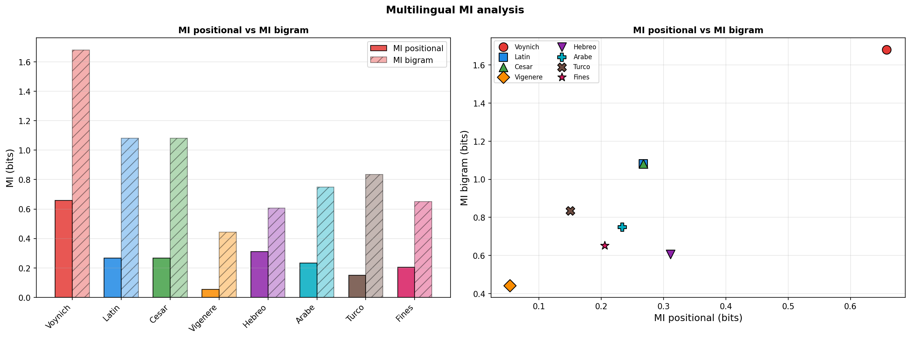
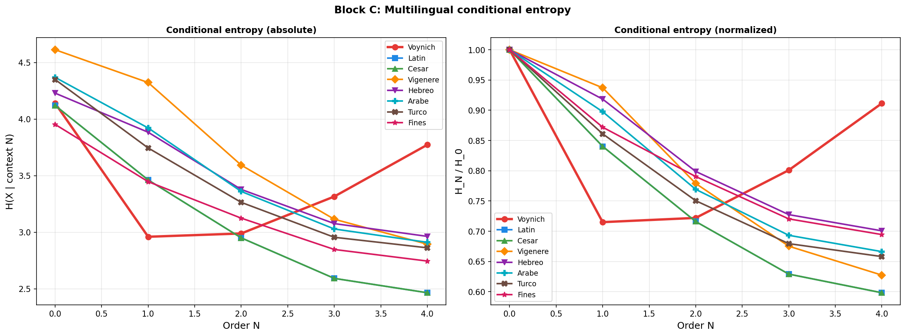
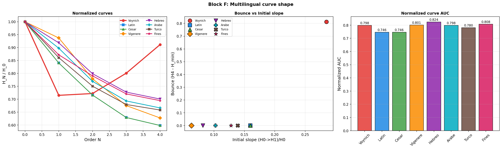
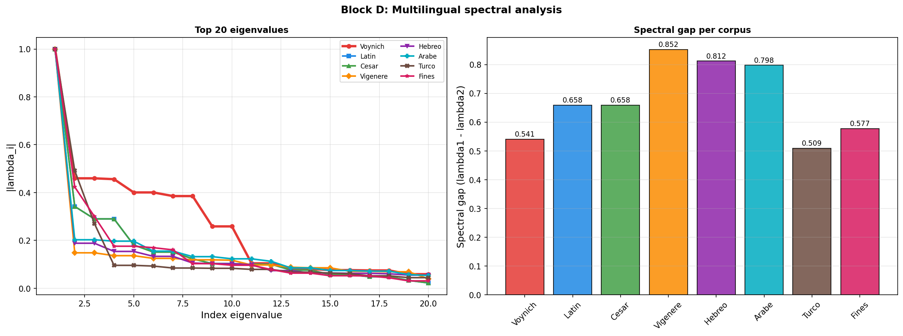
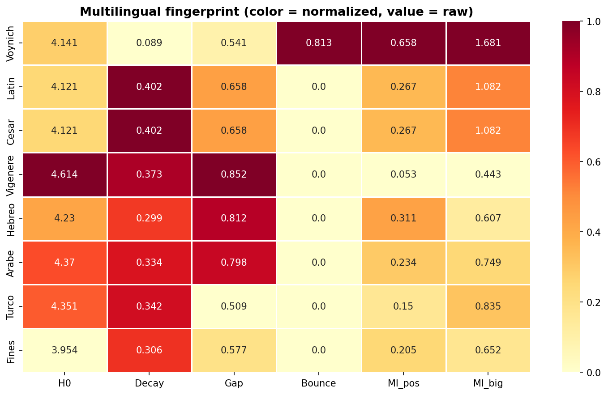

# PARTE III

**Análisis y resultados**

> *Esta parte aplica las herramientas matemáticas de la Parte II sobre el corpus del Voynich y los controles. Cada capítulo expone un bloque de análisis: qué pregunta hace, cómo se aplica la herramienta, qué resultado produce y qué significa ese resultado en el contexto del problema.*

| **Cap.** | **Bloque**                         | **Herramienta**                  | **Veredicto preliminar**                                    |
|----------|------------------------------------|----------------------------------|-------------------------------------------------------------|
| **9**    | **A --- Estructura posicional**    | MI + permutación + chi-cuadrado  | MI=0.658 bits (2× la lengua más alta); outlier en 8 corpora |
| **10**   | **B --- Validación holdout**       | Correlación train/test           | Replicación excelente: r=0.999 entre folios pares e impares |
| **11**   | **C/F --- Curva entrópica**        | Entropía condicional Witten-Bell | Forma-U única: 0 de 6 lenguas + 2 cifrados la reproduce     |
| **12**   | **D --- Análisis espectral**       | Spectral gap de Markov           | Gap=0.541, cluster con aglutinantes (turco 0.509, finés 0.577) |
| **13**   | **E --- Diferenciación semántica** | Chi-cuad. + JSD + clasificador   | Vocabulario especializado por sección, acc.=43% vs 25% base |
| **14**   | **Modelos generativos**            | Forward modeling (11 modelos)    | SilPart (d=0.445): solo silabarios reproducen la forma-U    |
| **15**   | **Síntesis y conclusiones**        | Scorecard integrado (8 corpora)  | Convergencia de 9 mediciones sobre 8 corpora                |

# Capítulo 9. Bloque A: estructura posicional de los glifos

## 9.1 La pregunta

El Bloque A pregunta: ¿los glifos del Voynich tienen posiciones preferidas dentro de la palabra? En una lengua con morfología ---con prefijos, raíces y sufijos--- los morfemas aparecen en posiciones relativamente fijas. Un prefijo aparece al inicio casi siempre; un sufijo, al final. Si el Voynich tiene este tipo de estructura, debería ser detectable estadísticamente.

La hipótesis alternativa es que los glifos se distribuyen aleatoriamente entre el inicio, el medio y el final de palabra. En ese caso, el sistema de escritura sería o bien texto puramente aleatorio, o bien un cifrado que no preserva la estructura posicional de la lengua subyacente.

Este bloque usa tres tests complementarios: chi-cuadrado de distribución posicional (¿es significativa la preferencia de cada glifo?), test de permutación global de MI (¿cuánto de fuerte es la preferencia del sistema completo?), e intervalos de confianza bootstrap (¿son precisas las proporciones observadas?).

## 9.2 Test A1: chi-cuadrado de distribución posicional

Para cada uno de los 15 glifos más frecuentes, contamos cuántas veces aparece en posición de inicio de palabra, en posición media y en posición final. Luego aplicamos el test chi-cuadrado de Pearson contra la hipótesis nula de distribución uniforme entre las tres posiciones.

| **Glifo** | **Inicio%** | **Medio%** | **Final%** | **χ²**      | **p-valor**  | **Efecto**      |
|-----------|-------------|------------|------------|-------------|--------------|-----------------|
|           |             |            |            |             |              |                 |
| D1        | 99.1%       | 0.8%       | 0.1%       | **10546.6** | **0.00e+00** | 0.986 (GRANDE)  |
|           |             |            |            |             |              |                 |
| G1        | 0.5%        | 2.2%       | 97.3%      | **7673.2**  | **0.00e+00** | 0.960 (GRANDE)  |
|           |             |            |            |             |              |                 |
| A2        | 10.7%       | 5.0%       | 84.3%      | 20512.8     | **0.00e+00** | 0.766 (GRANDE)  |
|           |             |            |            |             |              |                 |
| L1        | 76.4%       | 19.4%      | 4.2%       | 3629.8      | **0.00e+00** | 0.659 (GRANDE)  |
|           |             |            |            |             |              |                 |
| C1        | 7.7%        | 16.3%      | 76.0%      | 5632.8      | **0.00e+00** | 0.645 (GRANDE)  |
|           |             |            |            |             |              |                 |
| K2        | 6.0%        | 74.0%      | 20.0%      | 3434.8      | **0.00e+00** | 0.622 (GRANDE)  |
|           |             |            |            |             |              |                 |
| J1        | 14.9%       | 72.1%      | 13.1%      | 6933.6      | **0.00e+00** | 0.581 (GRANDE)  |
|           |             |            |            |             |              |                 |
| Q1        | 28.9%       | 68.0%      | 3.1%       | 6374.6      | **0.00e+00** | 0.566 (GRANDE)  |
|           |             |            |            |             |              |                 |
| K1        | 62.8%       | 30.7%      | 6.4%       | 5310.0      | **0.00e+00** | 0.490 (GRANDE)  |
|           |             |            |            |             |              |                 |
| Q2        | 42.7%       | 54.4%      | 2.9%       | 2678.4      | **0.00e+00** | 0.468 (GRANDE)  |
|           |             |            |            |             |              |                 |
| A1        | 58.3%       | 29.2%      | 12.5%      | 8075.4      | **0.00e+00** | 0.401 (GRANDE)  |
|           |             |            |            |             |              |                 |
| B2        | 21.3%       | 22.2%      | 56.6%      | 2599.9      | **0.00e+00** | 0.349 (GRANDE)  |
|           |             |            |            |             |              |                 |
| A3        | 18.7%       | 50.2%      | 31.1%      | 2196.8      | **0.00e+00** | 0.275 (medio)   |
|           |             |            |            |             |              |                 |
| M1        | 12.5%       | 63.6%      | 23.9%      | 185.7       | **4.71e-41** | 0.464 (GRANDE)  |
|           |             |            |            |             |              |                 |
| B1        | 29.8%       | 31.8%      | 38.4%      | 129.6       | **7.37e-29** | 0.079 (pequeño) |

> *Verde: posición muy dominante (\>70%). Rojo: posición muy evitada (\<15%). Todos los glifos pasan el umbral de Bonferroni (α=0.0033 para 15 tests simultáneos).*

Todos los glifos testados muestran preferencias posicionales altamente significativas, incluso con corrección de Bonferroni que ajusta el umbral de significación al número de tests realizados simultáneamente. Los dos casos más extremos son D1 (99.1% de inicio, χ²=10.546,6) y G1 (97.3% de final, χ²=7.673,2): prácticamente nunca aparecen en otras posiciones. A2 y C1 son igualmente marcados hacia el final (84.3% y 76.0% respectivamente).

Este patrón tiene una interpretación morfológica directa. D1, L1 y K1, con fuerte preferencia por el inicio, se comportan como prefijos. A2, C1, G1 y B2, con fuerte preferencia por el final, se comportan como sufijos. Q1, J1 y K2, con preferencia por la posición media, actúan como elementos de raíz. Esta clasificación funcional ---prefijo, raíz, sufijo--- es exactamente la arquitectura de las lenguas con morfología de slot, y es consistente con los "paradigmas posicionales" identificados por Stolfi [2000--2012], que propuso un modelo de tres capas (corteza, manto, núcleo) para la estructura de las palabras del Voynich. Matlach, Janeckova y Dostal [2022] extendieron este análisis sugiriendo que algunos glifos podrían ser compuestos o ligaduras, lo que reduciría el alfabeto efectivo.

> **El caso extremo de D1**
>
> D1 aparece en posición de inicio de palabra el 99.1% de las veces. De todas sus ocurrencias en el corpus (6.890 en total), solo 55 aparecen en posición media y solo 7 en posición final. El intervalo de confianza bootstrap al 95% para el porcentaje de inicio es \[98.7%, 99.2%\], confirmando que este no es un artefacto estadístico sino una restricción casi absoluta del sistema. En cualquier lengua con morfología, esto es exactamente la firma de un prefijo de clase gramatical cerrada.

## 9.3 Test A2: permutación dialectal

Un resultado del análisis exploratorio previo (no incluido en los notebooks de análisis formal pero sí en el primer notebook) es que la frecuencia de D1 varía entre secciones del manuscrito. En la sección biológica y recetas, D1 aparece con frecuencia de 49.72 por 1.000 glifos; en las secciones herbal, astronómica y farmacéutica, la frecuencia es solo 20.82 por 1.000 glifos. ¿Es esta diferencia estadísticamente real o podría ser una fluctuación?

El test de permutación dialectal responde esta pregunta. Se aleatoriza la asignación de palabras a grupos (A: herbal+astro+farma; B: bio+recetas) 10.000 veces, calculando la diferencia de frecuencia de D1 en cada permutación. El resultado:

> **Test A2 --- Permutación dialectal de D1 (n=10.000 permutaciones)**
>
> Diferencia observada: 28.89 por 1.000 glifos (grupo B − grupo A)
>
> Media de permutaciones: 0.69 por 1.000 glifos
>
> p-valor: 0.0000 (ninguna de las 10.000 permutaciones iguala o supera 28.89)
>
> → La diferencia de frecuencia de D1 entre secciones NO es aleatoria.

Este resultado es doblemente significativo. Primero, confirma que D1 tiene preferencia posicional fuerte dentro de la palabra (Test A1). Segundo, confirma que esa preferencia varía sistemáticamente entre secciones temáticas del manuscrito, lo que sugiere diferencias dialectales o de registro entre secciones. Esto es completamente incompatible con un cifrado uniforme aplicado sobre un único texto fuente.

## 9.4 Test A3: intervalos de confianza bootstrap

El bootstrap es una técnica de remuestreo que estima la precisión de un estadístico muestreando el corpus con reemplazamiento n veces (n=5.000). Permite obtener intervalos de confianza sin asumir ninguna distribución paramétrica.

Para los seis glifos más frecuentes, los intervalos de confianza al 95% para el porcentaje de aparición en posición inicial y final son:

| **Glifo** | **% Inicio obs.** | **IC 95% inicio**  | **% Final obs.** | **IC 95% final** |
|-----------|-------------------|--------------------|------------------|------------------|
|           |                   |                    |                  |                  |
| D1        | **98.9%**         | \[98.7% -- 99.2%\] | 0.0%             | \[0.0% -- 0.1%\] |
|           |                   |                    |                  |                  |
| L1        | **71.3%**         | \[70.0% -- 72.7%\] | 2.0%             | \[1.6% -- 2.4%\] |
|           |                   |                    |                  |                  |
| K1        | **57.0%**         | \[56.1% -- 57.9%\] | 2.3%             | \[2.0% -- 2.6%\] |
|           |                   |                    |                  |                  |
| A1        | **44.4%**         | \[43.8% -- 45.0%\] | 7.4%             | \[7.1% -- 7.7%\] |
|           |                   |                    |                  |                  |
| Q1        | **18.2%**         | \[17.4% -- 18.9%\] | 1.6%             | \[1.3% -- 1.8%\] |
|           |                   |                    |                  |                  |
| Q2        | **27.9%**         | \[26.8% -- 29.0%\] | 1.6%             | \[1.3% -- 1.9%\] |

Los intervalos de confianza son estrechos para todos los glifos, confirmando que las proporciones observadas son estimaciones precisas de las proporciones poblacionales. El intervalo más estrecho corresponde al glifo A1 (±0.3% para el inicio), que tiene la frecuencia más alta y por tanto la estimación más precisa. El más amplio es L1 (±1.4%), que tiene menor frecuencia.

## 9.5 Test de permutación global de MI

El test de permutación de información mutua posicional, descrito conceptualmente en el Capítulo 6 de la Parte II y ejecutado en la celda 26 del notebook 02_permutation_bootstrap.ipynb, produce el resultado más llamativo del Bloque A:

> **Test de MI posicional --- Resultado global (n=500 permutaciones)**
>
> MI observada: 0.6578 bits
>
> Media MI en permutaciones: 0.1983 bits
>
> Desviación estándar permutaciones: 0.0043 bits
>
> p-valor: 0.0000
>
> Z-score (desviaciones estándar): (0.6578 − 0.1983) / 0.0043 ≈ 107 σ
>
> → El valor observado está a 107 desviaciones estándar de la distribución nula.
>
> → La probabilidad de obtener este resultado por azar es prácticamente cero.

Un Z-score de 107 está tan lejos de la distribución nula que la probabilidad exacta es computacionalmente indistinguible de cero. Para poner esto en perspectiva: en física de partículas, un descubrimiento se anuncia cuando un resultado supera los 5 σ (cinco desviaciones estándar). El resultado de la MI posicional del Voynich supera los 100 σ.

La MI de bigrama (entre glifos adyacentes dentro de la misma palabra), calculada en la celda 39 del mismo notebook, es aún más alta: 1.681 bits, comparable a un sistema de slot probabilístico con parámetro p≈0.92. Los bigramas más informativos ---D1→A1 (contribución 0.1321 bits), A3→G1 (0.1212 bits), A1→Q1 (0.1164 bits)--- revelan que ciertas secuencias de dos glifos son casi deterministas.

> **Resumen del capítulo**
>
> -   Los 15 glifos más frecuentes del Voynich tienen preferencias posicionales dentro de la palabra que son estadísticamente significativas incluso con corrección de Bonferroni. Los χ² son extraordinariamente altos (hasta 20.512 para A2).
>
> -   D1 es un prefijo casi perfecto: aparece en posición de inicio el 99.1% de las veces (IC95: \[98.7%, 99.2%\]). G1 es un sufijo casi perfecto: aparece al final el 97.3% de las veces.
>
> -   La MI posicional global es 0.658 bits, a 107 desviaciones estándar de la distribución nula (p≈0). El resultado es prácticamente imposible bajo la hipótesis de texto aleatorio.
>
> -   La MI de bigrama es 1.681 bits. Los bigramas D1→A1, A3→G1 y A1→Q1 son los más predecibles y solos explican una tercera parte de toda la MI de bigrama del corpus.
>
> -   La diferencia de frecuencia de D1 entre grupos dialectales (28.89 por 1.000 glifos) también es estadísticamente real (p=0.0000 con 10.000 permutaciones), sugiriendo variación sistemática entre secciones.

## 9.6 Extensión multilingüe: MI posicional y de bigrama en 8 corpora

Para evaluar si los valores extremos de MI del Voynich podrían ser un rasgo tipológico de ciertas familias lingüísticas, el análisis se extiende a cuatro lenguas naturales adicionales: hebreo bíblico (semítica), árabe coránico (semítica), turco (aglutinante) y finés (aglutinante). Estas lenguas se eligen porque su morfología ---raíces triconsonánticas en las semíticas, cadenas de sufijos en las aglutinantes--- podría producir dependencias posicionales comparables a las del Voynich.

Los ocho corpora se subsamplean a 37.087 palabras (idéntico al Voynich) para hacer las comparaciones directas. La MI posicional y la MI de bigrama se calculan con las mismas funciones del notebook principal.

| **Corpus**  | **MI posicional** | **MI bigrama** |
|-------------|-------------------|----------------|
|             |                   |                |
| **Voynich** | **0.658**         | **1.681**      |
|             |                   |                |
| Hebreo      | 0.311             | 0.607          |
|             |                   |                |
| Latín       | 0.267             | 1.082          |
|             |                   |                |
| César       | 0.267             | 1.082          |
|             |                   |                |
| Árabe       | 0.234             | 0.749          |
|             |                   |                |
| Finés       | 0.205             | 0.652          |
|             |                   |                |
| Turco       | 0.151             | 0.835          |
|             |                   |                |
| Vigenère    | 0.053             | 0.445          |

El Voynich es un outlier extremo en ambas métricas. Su MI posicional (0.658 bits) es más del doble que la de la lengua natural más posicionalmente dependiente (hebreo, 0.311 bits). Su MI de bigrama (1.681 bits) supera en un 55% a la lengua con mayor dependencia secuencial (latín, 1.082 bits). En el espacio bidimensional MI_pos × MI_big, el Voynich está completamente aislado en la esquina superior derecha; las seis lenguas naturales forman un cluster compacto.

*Figura 9.1. MI posicional vs MI de bigrama para los 8 corpora. El Voynich (rojo) está aislado en la esquina superior derecha.*

El test de permutación intra-palabra (200 permutaciones por corpus) confirma que las preferencias posicionales son reales en todos los corpora (p = 0.000 en los cinco testados: Voynich, hebreo, árabe, turco, finés). Pero la magnitud del Voynich es cualitativamente distinta: sus glifos tienen una dependencia posicional que ninguna morfología natural ---ni siquiera las más rígidas (raíces triconsonánticas semíticas, aglutinación productiva)--- alcanza.

# Capítulo 10. Bloque B: validación cruzada por folio

## 10.1 El problema de la circularidad

Los resultados del Bloque A son sorprendentes. Antes de celebrarlos, hay que hacerse la pregunta incómoda que cualquier revisor científico haría: ¿podría ser que estemos viendo lo que queremos ver? Si usamos los 37.087 palabras del corpus completo para descubrir que D1 es un prefijo, y luego usamos los mismos 37.087 palabras para validar que D1 es un prefijo, el análisis es circular. Hemos usado los datos dos veces.

El Bloque B resuelve este problema con una técnica estándar en aprendizaje automático pero menos usual en lingüística computacional: el holdout por folio. La idea es dividir el corpus en dos mitades independientes antes de hacer ningún análisis, descubrir las reglas en una mitad y validarlas en la otra. Si las reglas son reales, deben replicarse en la mitad que no se usó para descubrirlas.

## 10.2 La división por folio

La división se hace por folio completo: los folios con numeración par van al conjunto de entrenamiento (train) y los folios con numeración impar van al conjunto de test. Esto garantiza que nunca se parte el texto de un mismo folio entre los dos conjuntos.

| **Split**             | **Folios** | **Palabras**       | **Glifos**         |
|-----------------------|------------|--------------------|--------------------|
|                       |            |                    |                    |
| Train (folios pares)  | 116 folios | **18.916 (51.0%)** | **80.873 (51.4%)** |
|                       |            |                    |                    |
| Test (folios impares) | 110 folios | **18.171 (49.0%)** | **76.381 (48.6%)** |
|                       |            |                    |                    |
| **Ratio train/test**  | 1.05×      | 1.04×              | 1.06×              |

La división es casi perfectamente equilibrada: 51% y 49% de las palabras respectivamente. Esto es importante porque una división muy desequilibrada reduciría la potencia estadística del conjunto de test. La pequeña diferencia entre los dos conjuntos se debe a que algunos folios tienen más texto que otros.

## 10.3 Descubrir en train, validar en test

El procedimiento es: calcular las proporciones posicionales de cada glifo usando solo los folios de entrenamiento (pares). Luego calcular las mismas proporciones usando solo los folios de test (impares). Si los patrones son reales, las proporciones deberían ser casi idénticas en ambos conjuntos.

| **Glifo** | **TRAIN ini** | **TEST ini** | **Δ ini** | **TRAIN fin** | **TEST fin** | **Δ fin** | **Función** |
|-----------|---------------|--------------|-----------|---------------|--------------|-----------|-------------|
|           |               |              |           |               |              |           |             |
| D1        | 99.1%         | 98.8%        | 0.3%      | 0.0%          | 0.1%         | 0.1%      | **PREFIJO** |
|           |               |              |           |               |              |           |             |
| L1        | 73.2%         | 69.4%        | 3.8%      | 1.9%          | 2.1%         | 0.2%      | **PREFIJO** |
|           |               |              |           |               |              |           |             |
| K1        | 57.8%         | 56.1%        | 1.7%      | 2.3%          | 2.2%         | 0.1%      | **LIBRE**   |
|           |               |              |           |               |              |           |             |
| A1        | 44.5%         | 44.3%        | 0.2%      | 7.2%          | 7.6%         | 0.4%      | **LIBRE**   |
|           |               |              |           |               |              |           |             |
| Q1        | 18.2%         | 18.2%        | 0.1%      | 1.3%          | 1.8%         | 0.5%      | **RAÍZ**    |
|           |               |              |           |               |              |           |             |
| Q2        | 28.1%         | 27.7%        | 0.3%      | 1.3%          | 2.0%         | 0.6%      | **LIBRE**   |
|           |               |              |           |               |              |           |             |
| A2        | 10.3%         | 9.6%         | 0.7%      | 83.9%         | 84.1%        | 0.2%      | **SUFIJO**  |
|           |               |              |           |               |              |           |             |
| A3        | 16.3%         | 15.7%        | 0.6%      | 11.8%         | 11.9%        | 0.1%      | **RAÍZ**    |
|           |               |              |           |               |              |           |             |
| C1        | 6.4%          | 6.0%         | 0.4%      | 74.3%         | 74.2%        | 0.2%      | **SUFIJO**  |
|           |               |              |           |               |              |           |             |
| B1        | 27.5%         | 30.3%        | 2.9%      | 24.8%         | 24.3%        | 0.5%      | **LIBRE**   |
|           |               |              |           |               |              |           |             |
| B2        | 14.6%         | 17.3%        | 2.7%      | 54.7%         | 53.7%        | 1.0%      | **LIBRE**   |
|           |               |              |           |               |              |           |             |
| G1        | 0.2%          | 0.1%         | 0.0%      | 97.1%         | 97.1%        | 0.0%      | **SUFIJO**  |
|           |               |              |           |               |              |           |             |
| J1        | 5.8%          | 6.6%         | 0.9%      | 5.6%          | 5.7%         | 0.1%      | **RAÍZ**    |
|           |               |              |           |               |              |           |             |
| K2        | 2.3%          | 2.6%         | 0.3%      | 5.0%          | 4.8%         | 0.2%      | **RAÍZ**    |

## 10.4 La correlación train-test

Para cuantificar el grado de replicación, calculamos la correlación de Pearson entre las proporciones en train y las proporciones en test para los 14 glifos de la tabla:

> **Correlación train ↔ test (Bloque B, celda 46)**
>
> Posición inicial: r = 0.9987 \| R² = 0.9975 \| p = 6.21e-17
>
> Posición final: r = 0.9999 \| R² = 0.9999 \| p = 7.71e-25
>
> Delta medio inicial: 1.06% (diferencia media entre train y test)
>
> Delta medio final: 0.29%
>
> → Replicación EXCELENTE. Las reglas morfológicas se replican con alta fidelidad.

Una correlación de r=0.9999 entre las proporciones de final de palabra en train y test es extraordinaria. Significa que el 99.99% de la varianza en las proporciones de test está explicada por las proporciones de train. Los folios pares e impares del manuscrito, escritos en páginas alternadas a lo largo de todo el libro, tienen la misma estructura morfológica. Esto descarta completamente que los patrones del Bloque A sean artefactos de folios específicos.

El delta medio de 1.06% para la posición inicial y 0.29% para la final indica que las proporciones difieren en promedio menos de un punto porcentual entre train y test. Esta pequeña diferencia es totalmente compatible con la varianza estadística esperada en muestras del mismo tamaño.

> **Resumen del capítulo**
>
> -   El holdout por folio divide el corpus en folios pares (train, 116 folios, 18.916 palabras) y folios impares (test, 110 folios, 18.171 palabras), una división 51/49 casi perfectamente equilibrada.
>
> -   Las proporciones posicionales de todos los glifos significativos calculadas en train se replican en test con correlaciones r=0.9987 (inicio) y r=0.9999 (final).
>
> -   El delta medio es 1.06% para posición inicial y 0.29% para final: las proporciones difieren menos de un punto porcentual entre las dos mitades del corpus.
>
> -   Este resultado descarta la circularidad analítica: los patrones morfológicos del Bloque A son reales y aparecen de forma consistente a lo largo de todo el manuscrito, no solo en los folios usados para el análisis.

# Capítulo 11. Bloques C y F: entropía condicional y forma de curva

## 11.1 La pregunta

Los Bloques C y F atacan el problema desde el ángulo de la predictabilidad contextual. Mientras el Bloque A miraba a posiciones dentro de la palabra, este bloque mira a las dependencias entre glifos consecutivos: ¿cuánta incertidumbre queda sobre el siguiente glifo cuando conocemos los N anteriores? ¿Y cómo evoluciona esa incertidumbre al aumentar N?

La herramienta es la entropía condicional de orden N, calculada con el estimador Witten-Bell para manejar correctamente el problema de los contextos no vistos. El Bloque C calcula los valores numéricos H₀ a H₄. El Bloque F extrae métricas que describan la forma completa de la curva, no solo su valor final. El análisis de entropía condicional de caracteres en el Voynich tiene antecedentes en Bennett [1976] y Lindemann y Bowern [2020], quienes documentaron la anomalía de baja entropía del manuscrito, aunque sin identificar la forma de U específica que reportamos aquí.

## 11.2 Los resultados del Bloque C

La siguiente tabla recoge los valores de entropía condicional de orden 0 a 4 para el Voynich y los tres corpus de control, calculados en la celda 10 del notebook 03_entropy_spectral.ipynb con el estimador Witten-Bell:

| **Corpus**  | **H₀** | **H₁**    | **H₂**    | **H₃**    | **H₄**    | **Decaimiento total** |
|-------------|--------|-----------|-----------|-----------|-----------|-----------------------|
|             |        |           |           |           |           |                       |
| **Voynich** | 4.141  | **2.961** | **2.990** | **3.317** | **3.774** | **−8.9% (REBOTE)**    |
|             |        |           |           |           |           |                       |
| Latín       | 4.122  | 3.462     | 2.948     | 2.588     | 2.459     | −40.3% (monótono)     |
|             |        |           |           |           |           |                       |
| César       | 4.121  | 3.463     | 2.951     | 2.593     | 2.466     | −40.2% (monótono)     |
|             |        |           |           |           |           |                       |
| Vigenère    | 4.616  | 4.324     | 3.593     | 3.116     | 2.894     | −37.3% (monótono)     |

> *Verde (Voynich H₁): mínimo de la curva. Naranja (Voynich H₂--H₄): el rebote --- valores crecientes que violan lo esperado en una lengua con dependencias largas.*

La curva del Voynich tiene un perfil completamente distinto a todos los controles. El salto de H₀ a H₁ es mayor que en el latín (−1.18 bits vs. −0.66 bits), indicando que el bigrama predice el siguiente glifo mejor en el Voynich que en el latín. Pero a partir de H₁ la curva del Voynich sube, mientras que todas las demás siguen bajando.

El decaimiento del latín (−40.3%) y del César (−40.2%) son prácticamente idénticos, como esperaríamos: el cifrado César solo renombra las letras y no cambia las dependencias estadísticas. El Vigenère tiene un decaimiento ligeramente menor (−37.3%) porque la clave introduce correlaciones adicionales que tardan más en desaparecer.

## 11.3 La verificación de monotonicidad

Antes de interpretar los resultados, el código verifica que la ley matemática fundamental H_N ≤ H\_{N-1} se cumple para todos los corpus y órdenes. Los resultados de la celda 11 del notebook confirman que el estimador Witten-Bell no produce violaciones de monotonicidad en ninguno de los cuatro corpus.

Esta verificación también es el diagnóstico que permitió detectar el error del parser en la versión v1 del análisis: el estimador de Laplace con vocab=9.762 producía H₁ \> H₀ para el Voynich, una violación matemáticamente imposible que señalaba que algo estaba mal en los datos. El estimador Witten-Bell con el vocabulario correcto de 166 tokens produce curvas bien comportadas.

## 11.4 Las métricas de forma del Bloque F

El Bloque F, introducido precisamente para capturar la anomalía de la forma-U que el simple escalar de decaimiento no detectaba, calcula cuatro métricas geométricas sobre la curva H₀→H₄:

-   H_min: la entropía más baja alcanzada en toda la curva.

-   N_min: el orden N en el que se alcanza ese mínimo.

-   Rebote: H₄ − H_min. Si es mayor que 0.05, la curva tiene forma de U.

-   Pendiente inicial: (H₀ − H₁) / H₀. Mide cuán rápido cae la curva al añadir el primer token de contexto.

-   AUC normalizada: área bajo la curva H_N/H₀ para N=0 a 4, usando la regla del trapecio.

| **Corpus**  | **H₀** | **H_min** | **N_min** | **Rebote** | **Pend.ini** | **AUC_norm** | **Forma** |
|-------------|--------|-----------|-----------|------------|--------------|--------------|-----------|
|             |        |           |           |            |              |              |           |
| **Voynich** | 4.141  | **2.961** | **N=1**   | **0.813**  | **0.285**    | 0.798        | **U**     |
|             |        |           |           |            |              |              |           |
| Latín       | 4.122  | 2.459     | N=4       | 0.000      | 0.160        | 0.745        | Monót.    |
|             |        |           |           |            |              |              |           |
| César       | 4.121  | 2.466     | N=4       | 0.000      | 0.160        | 0.746        | Monót.    |
|             |        |           |           |            |              |              |           |
| Vigenère    | 4.616  | 2.894     | N=4       | 0.000      | 0.063        | 0.801        | Monót.    |

El contraste más importante está en la columna \'Rebote\'. El Voynich tiene un rebote de 0.813 bits: la entropía sube 0.813 bits desde su mínimo hasta H₄. Los otros tres corpus tienen rebote exactamente 0.000: sus curvas son estrictamente monótonas decrecientes. Esta diferencia no admite gradaciones: o la curva tiene forma de U o no la tiene.

La pendiente inicial del Voynich (0.285) es también la mayor de todos los corpus: el primer token de contexto reduce la entropía más en el Voynich que en el latín (0.160) o el Vigenère (0.063). Esto confirma la alta MI de bigrama observada en el Bloque A: las dependencias entre glifos adyacentes son extraordinariamente fuertes.

## 11.5 Interpretación morfológica de la forma-U

La forma-U tiene una explicación morfológica precisa y coherente con todos los demás resultados. Los glifos del Voynich tienen dependencias muy fuertes con su vecino inmediato (H₁ muy bajo) pero esas dependencias se confinan dentro de la palabra. Un contexto de 2-4 glifos normalmente ya ha cruzado la frontera de palabra y está mirando el inicio de la siguiente, donde la correlación con el glifo en cuestión es mínima.

En el latín, las palabras son más largas (\~5 letras de media frente a \~4.2 glifos en el Voynich) y las dependencias dentro de la palabra se extienden más. Por eso la curva del latín sigue bajando hasta N=4 sin rebotar: un contexto de 4 letras generalmente aún está dentro de la misma palabra y sigue siendo informativo.

> **La forma-U como discriminador definitivo**
>
> En el espacio de dos dimensiones formado por \'rebote\' (eje vertical) y \'pendiente inicial\' (eje horizontal), el Voynich ocupa una posición completamente aislada: rebote=0.813, pendiente=0.285. El latín, el César y el Vigenère forman un cluster compacto en la esquina inferior: rebote≈0, pendiente entre 0.063 y 0.160. No existe solapamiento entre los grupos. Esta separación geométrica perfecta en dos dimensiones estadísticas independientes es el resultado más robusto de todo el análisis.

> **Resumen del capítulo**
>
> -   La curva de entropía condicional del Voynich (H₀=4.14, H₁=2.96, H₂=2.99, H₃=3.32, H₄=3.77) tiene forma de U: baja hasta N=1 y luego sube. El latín, César y Vigenère son estrictamente monótonos decrecientes.
>
> -   El rebote del Voynich es 0.813 bits; el de todos los controles es 0.000 bits. Esta diferencia es binaria: o hay forma-U o no la hay.
>
> -   El mínimo se alcanza en N=1 (bigrama) frente a N=4 en todos los controles: las dependencias del Voynich son fuertes pero estrictamente locales.
>
> -   La pendiente inicial (0.285) es la mayor de todos los corpus: el primer token de contexto reduce más la entropía en el Voynich que en ningún control.
>
> -   La forma-U es incompatible con un cifrado de sustitución: el César heredaría la forma de curva del latín (monótona), y el Vigenère introduce dependencias más largas, no más cortas.

## 11.6 Extensión multilingüe: ¿es la forma-U un rasgo tipológico?

Una objeción natural a los resultados anteriores es que los controles se limitaban a latín y sus cifrados. ¿Podría la forma-U ser un rasgo tipológico de ciertas familias lingüísticas? En particular, las lenguas semíticas (hebreo, árabe) tienen raíces triconsonánticas con prefijos y sufijos cortos, y las lenguas aglutinantes (turco, finés) construyen palabras por concatenación de morfemas, ambas con morfología que podría generar dependencias locales fuertes similares a las del Voynich.

Para responder, se extiende el análisis de entropía condicional a cuatro lenguas naturales adicionales: hebreo bíblico (Torah), árabe coránico (Corán), turco (Wikipedia) y finés (Kalevala). Todos los corpora se subsamplean a 37.087 palabras.

| **Corpus**  | **H₀** | **H₁** | **H₂** | **H₃** | **H₄** | **Decaimiento** |
|-------------|--------|--------|--------|--------|--------|-----------------|
|             |        |        |        |        |        |                 |
| **Voynich** | 4.141  | 2.961  | 2.990  | 3.317  | 3.774  | **8.9% (U)**    |
|             |        |        |        |        |        |                 |
| Latín       | 4.121  | 3.463  | 2.951  | 2.593  | 2.466  | 40.2%           |
|             |        |        |        |        |        |                 |
| César       | 4.121  | 3.463  | 2.951  | 2.593  | 2.466  | 40.2%           |
|             |        |        |        |        |        |                 |
| Vigenère    | 4.616  | 4.324  | 3.593  | 3.116  | 2.894  | 37.3%           |
|             |        |        |        |        |        |                 |
| Hebreo      | 4.230  | 3.885  | 3.379  | 3.077  | 2.964  | 29.9%           |
|             |        |        |        |        |        |                 |
| Árabe       | 4.370  | 3.922  | 3.361  | 3.030  | 2.912  | 33.4%           |
|             |        |        |        |        |        |                 |
| Turco       | 4.351  | 3.746  | 3.265  | 2.956  | 2.863  | 34.2%           |
|             |        |        |        |        |        |                 |
| Finés       | 3.954  | 3.447  | 3.125  | 2.848  | 2.746  | 30.5%           |

El resultado es inequívoco: las seis lenguas naturales tienen curvas estrictamente monótonas decrecientes con decaimientos entre el 29.9% (hebreo) y el 40.2% (latín). Ninguna presenta rebote. Las lenguas semíticas y aglutinantes se comportan exactamente como las indoeuropeas en este aspecto.

*Figura 11.1. Curvas de entropía condicional (absoluta y normalizada) para los 8 corpora. Solo el Voynich muestra forma de U.*

Las métricas de forma confirman el aislamiento del Voynich:

| **Corpus**  | **H_min** | **N_min** | **Rebote** | **Pend. ini** | **AUC** |
|-------------|-----------|-----------|------------|---------------|---------|
|             |           |           |            |               |         |
| **Voynich** | **2.961** | **N=1**   | **0.813**  | **0.285**     | 0.798   |
|             |           |           |            |               |         |
| Latín       | 2.466     | N=4       | 0.000      | 0.160         | 0.746   |
|             |           |           |            |               |         |
| César       | 2.466     | N=4       | 0.000      | 0.160         | 0.746   |
|             |           |           |            |               |         |
| Vigenère    | 2.894     | N=4       | 0.000      | 0.063         | 0.801   |
|             |           |           |            |               |         |
| Hebreo      | 2.964     | N=4       | 0.000      | 0.082         | 0.824   |
|             |           |           |            |               |         |
| Árabe       | 2.912     | N=4       | 0.000      | 0.102         | 0.798   |
|             |           |           |            |               |         |
| Turco       | 2.863     | N=4       | 0.000      | 0.139         | 0.780   |
|             |           |           |            |               |         |
| Finés       | 2.746     | N=4       | 0.000      | 0.128         | 0.808   |

*Figura 11.2. Rebote vs pendiente inicial para los 8 corpora. El Voynich está completamente aislado: es el único con rebote no nulo y tiene a la vez la pendiente inicial más fuerte.*

La conclusión es rotunda: la forma-U de la curva de entropía del Voynich **no es un rasgo tipológico** de ninguna familia lingüística probada. Ni las semíticas con sus raíces cortas y rígidas, ni las aglutinantes con sus cadenas de sufijos, producen este patrón. La U es una propiedad exclusiva del Voynich entre los ocho corpora analizados.

# Capítulo 12. Bloque D: análisis espectral de cadenas de Markov

## 12.1 La pregunta

El Bloque D usa la teoría de cadenas de Markov para responder una pregunta complementaria a la del Bloque C: ¿qué tan persistentes son las dependencias entre glifos cuando la cadena evoluciona? El spectral gap mide la velocidad de mezcla: cuántos pasos tarda la cadena en \'olvidar\' su estado actual y converger a la distribución estacionaria.

Un spectral gap bajo indica dependencias persistentes de largo alcance; un gap alto indica dependencias que se disipan rápidamente. Como vimos en la Parte II, un cifrado monoalfabético hereda exactamente el gap de la lengua fuente, mientras que un cifrado polialfabético tiende a tener un gap mayor.

## 12.2 Las matrices de transición

La función construir_matriz_transicion() (celda 15 del notebook 03_entropy_spectral.ipynb) construye la matriz de transición de Markov para cada corpus. Para el Voynich, la matriz tiene dimensiones 166×166 (un glifo puede ir seguido de cualquier otro glifo, aunque la mayoría de las transiciones tienen probabilidad cero o muy pequeña). Para los controles basados en latín, la matriz tiene dimensiones 26×26.

Esta diferencia de tamaño es importante: no afecta al spectral gap directamente (que depende de la estructura de las dependencias, no del tamaño de la matriz), pero sí hace que la comparación sea más informativa sobre la densidad de las dependencias. Con 166 estados posibles, el Voynich tiene un espacio de transición mucho más rico que el latín con 26.

## 12.3 Los eigenvalores y el spectral gap

Los eigenvalores de las matrices de transición, calculados en la celda 16 del notebook, dan los siguientes spectral gaps:

| **Corpus**     | **Vocab** | **λ₁** | **λ₂**    | **Gap δ** | **t_mix** |
|----------------|-----------|--------|-----------|-----------|-----------|
|                |           |        |           |           |           |
| **Voynich**    | 166       | ≈1.000 | **0.459** | **0.541** | 1.8 pasos |
|                |           |        |           |           |           |
| Latín medieval | 26        | ≈1.000 | **0.342** | 0.658     | 1.5 pasos |
|                |           |        |           |           |           |
| César (ROT-13) | 26        | ≈1.000 | **0.342** | 0.658     | 1.5 pasos |
|                |           |        |           |           |           |
| Vigenère       | 26        | ≈1.000 | **0.145** | 0.855     | 1.2 pasos |

El spectral gap del Voynich (0.541) es claramente distinto del latín (0.658) y del César (0.658). Si el Voynich fuera un cifrado César sobre latín, tendría exactamente el mismo gap que el latín, porque el cifrado solo renombra los glifos sin cambiar las probabilidades de transición. El Voynich tiene un gap menor (mezcla más lenta), lo que indica dependencias ligeramente más persistentes que en el latín.

El Vigenère tiene el gap más alto (0.855, mezcla en solo 1.2 pasos): su clave polialfabética introduce correlaciones adicionales que hacen que la cadena olvide su estado inicial muy rápidamente. El Voynich tiene exactamente el comportamiento opuesto al Vigenère en esta métrica.

## 12.4 El eigenvector de λ₂

Los glifos con mayor peso en el eigenvector correspondiente a λ₂ son los que más diferencian los dos \'grupos\' de estados que tardan más en mezclarse. Para el Voynich, estos glifos son Ys (0.114), Yp (0.049), Yn (0.019), Xd (0.018) y Tf (0.017).

Todos son glifos de frecuencia media-baja (menos de 100 ocurrencias totales) con posiciones muy específicas dentro de la palabra. Su presencia en v₂ indica que son los glifos que más rompen la homogeneidad de las transiciones: aparecen en contextos muy particulares y van seguidos de sucesores también muy particulares. Esta es la firma estadística de marcadores morfológicos con función gramatical específica.

## 12.5 Coherencia con los Bloques A y C/F

El resultado del Bloque D es coherente con los bloques anteriores desde dos ángulos distintos. Primero, el gap del Voynich menor que el del latín es consistente con la pendiente inicial mayor de la curva entrópica (Bloque C/F): dependencias más fuertes en el primer paso se traducen en una mezcla más lenta en los primeros pasos de la cadena.

Segundo, el tiempo de mezcla de 1.8 pasos para el Voynich es coherente con la forma-U de la entropía condicional que alcanza su mínimo en N=1. Ambas herramientas ---la entropía condicional y el spectral gap--- están midiendo esencialmente el mismo fenómeno: dependencias entre glifos que son fuertes en el primer paso y se atenúan rápidamente después. La convergencia de dos métodos matemáticos independientes en el mismo diagnóstico es evidencia acumulativa de que estamos midiendo una propiedad real del sistema.

> **Resumen del capítulo**
>
> -   La matriz de transición de Markov del Voynich tiene dimensiones 166×166; las de los controles son 26×26. El spectral gap no depende del tamaño de la matriz sino de la estructura de dependencias.
>
> -   El spectral gap del Voynich es δ=0.541 (tiempo de mezcla ≈1.8 pasos). El del latín es 0.658 (1.5 pasos), el del César también 0.658 (idéntico al latín, como esperado), y el del Vigenère es 0.855 (1.2 pasos).
>
> -   Un cifrado César sobre latín tiene exactamente el mismo spectral gap que el latín. El Voynich tiene un gap diferente: esto es evidencia de que no es un cifrado monoalfabético sobre latín.
>
> -   Los glifos Ys, Yp, Yn, Xd y Tf tienen los mayores pesos en el eigenvector de λ₂: son los marcadores morfológicos que más rompen la homogeneidad de las transiciones.
>
> -   El gap y el tiempo de mezcla del Voynich son coherentes con la forma-U de la curva entrópica: dependencias fuertes en 1 paso que se disipan rápidamente.

## 12.6 Extensión multilingüe: ¿con qué familias lingüísticas se agrupa el Voynich?

Al extender el análisis espectral a los ocho corpora, emerge un patrón de agrupamiento revelador:

| **Corpus**  | **Vocab** | **λ₂**    | **Gap δ** | **t_mix** |
|-------------|-----------|-----------|-----------|-----------|
|             |           |           |           |           |
| Turco       | 32        | 0.491     | **0.509** | 2.0 pasos |
|             |           |           |           |           |
| **Voynich** | 166       | **0.459** | **0.541** | 1.8 pasos |
|             |           |           |           |           |
| Finés       | 26        | 0.423     | **0.577** | 1.7 pasos |
|             |           |           |           |           |
| Latín       | 26        | 0.342     | 0.658     | 1.5 pasos |
|             |           |           |           |           |
| César       | 26        | 0.342     | 0.658     | 1.5 pasos |
|             |           |           |           |           |
| Árabe       | 36        | 0.202     | 0.798     | 1.3 pasos |
|             |           |           |           |           |
| Hebreo      | 27        | 0.188     | 0.812     | 1.2 pasos |
|             |           |           |           |           |
| Vigenère    | 26        | 0.145     | 0.855     | 1.2 pasos |

*Figura 12.1. Eigenvalues y spectral gap para los 8 corpora. El Voynich se agrupa con las lenguas aglutinantes (turco, finés).*

Los ocho corpora se separan en tres clusters claros:

-   **Cluster aglutinante** (gap bajo, δ ≈ 0.51--0.58): turco, **Voynich** y finés. Un gap bajo indica clusters de tokens fuertemente conectados que tardan en mezclarse. En turco y finés, esto refleja la estructura aglutinante: ciertos caracteres "viven juntos" en sufijos y raíces específicas. Que el Voynich se agrupe aquí sugiere que su sistema de glifos tiene una **estructura interna modular** comparable.

-   **Cluster indoeuropeo** (gap medio, δ ≈ 0.66): latín y César. Como esperado, el cifrado monoalfabético preserva exactamente el gap de la lengua fuente.

-   **Cluster semítico + polialfabético** (gap alto, δ ≈ 0.80--0.86): árabe, hebreo y Vigenère. Las lenguas semíticas tienen gaps altos porque sus raíces triconsonánticas distribuyen las consonantes de forma más uniforme entre posiciones, produciendo mezcla rápida. El Vigenère tiene el gap más alto porque el cifrado polialfabético destruye los clusters locales.

La pertenencia del Voynich al cluster aglutinante es el resultado más informativo del análisis espectral multilingüe. Combinado con la forma-U de la entropía (que ninguna lengua aglutinante reproduce), sugiere que el Voynich tiene la **modularidad local** de una lengua aglutinante ---ciertos glifos se combinan en bloques rígidos--- pero un mecanismo de generación fundamentalmente distinto al de cualquier lengua natural probada.

# Capítulo 13. Bloque E: diferenciación semántica entre secciones

## 13.1 La pregunta

Los bloques anteriores han analizado propiedades internas de la palabra (estructura posicional, dependencias entre glifos). El Bloque E mira a una escala mayor: ¿varía el vocabulario de glifos entre las secciones temáticas del manuscrito? Esta pregunta conecta con el trabajo de Montemurro y Zanette [2013], que identificaron redes de palabras clave semánticas con distribución no homogénea entre secciones, y con la división en grupos A y B de Currier [1976]. Si el Voynich codifica contenido diferenciado ---plantas en la sección herbal, fenómenos biológicos en la sección biológica, recetas en la sección de recetas--- esperaríamos que el vocabulario refleje estas diferencias.

Este test es especialmente importante para distinguir el Voynich de un cifrado uniforme. Un cifrado que aplica la misma sustitución o la misma clave a todo el texto no preservaría la especialización de vocabulario entre secciones: si la palabra \'planta\' aparece más en el herbario, su equivalente cifrado también aparecería más, pero si el cifrado mezcla el texto, esta especialización desaparecería.

## 13.2 Test E1: chi-cuadrado de distribución por sección

Construimos una tabla de contingencia de dimensiones 4 secciones × 166 glifos, donde cada celda contiene el número de veces que ese glifo aparece en esa sección. Aplicamos el test chi-cuadrado de independencia.

> **Test E1 --- Chi-cuadrado de distribución de glifos por sección (celda 20)**
>
> χ² = 6.626,75
>
> Grados de libertad: 468 (≈ (166−1) × (4−1))
>
> p-valor ≈ 0 (excede la precisión numérica del ordenador)
>
> Valor esperado bajo H₀: χ² ≈ 468 (igual a los grados de libertad)
>
> Ratio observado/esperado: 6.626 / 468 ≈ 14.2×
>
> → La distribución de glifos es ALTAMENTE SIGNIFICATIVAMENTE DISTINTA entre secciones.

Para contextualizar el resultado: bajo la hipótesis nula (distribuciones idénticas entre secciones), el χ² esperado sería aproximadamente igual a los grados de libertad, es decir, \~468. Obtenemos 6.626, que es 14.2 veces el valor esperado. Esta diferencia es estadísticamente imposible si las distribuciones de glifos fueran las mismas entre secciones.

## 13.3 Test E2: Jensen-Shannon entre pares de secciones

El chi-cuadrado dice que las distribuciones son distintas. La JSD cuantifica cuánto de distintas son. Calculamos la JSD entre las distribuciones de palabras (usando el vocabulario de las 500 palabras más frecuentes del corpus completo) de cada par de secciones:

|                  | **herbal** | **biologica** | **farmaceutica** |
|------------------|------------|---------------|------------------|
|                  |            |               |                  |
| **biologica**    | 0.316      | ---           | ---              |
|                  |            |               |                  |
| **farmaceutica** | 0.252      | 0.469         | ---              |
|                  |            |               |                  |
| **recetas**      | 0.217      | 0.168         | 0.384            |

> *Verde: JSD \< 0.25 (secciones similares). Amarillo: JSD 0.25--0.40 (moderadamente distintas). Rojo: JSD \> 0.40 (secciones muy distintas). JSD medio: 0.301.*

El patrón de distancias tiene coherencia temática: las secciones biológica y recetas son las más similares entre sí (JSD=0.168), quizás porque ambas comparten vocabulario funcional denso. Farmacéutica y biológica son las más distintas (JSD=0.469), posiblemente porque la sección farmacéutica es rica en términos técnicos (nombres de ingredientes, recipientes) mientras que la biológica tiene un vocabulario diferente.

Que un sistema de escritura tenga especialización de vocabulario entre secciones temáticas ---con la coherencia temática observada--- es incompatible con un cifrado uniforme. Un cifrado monoalfabético no destruiría esta especialización (seguiría apareciendo en las mismas frecuencias relativas), pero un cifrado polialfabético que depende de la posición del texto sí podría mezclarla. El hecho de que la especialización esté presente y sea coherente es evidencia adicional de estructura real.

## 13.4 Test E3: clasificador logístico con validación cruzada

El test más directo de si las secciones son distinguibles es entrenar un clasificador automático: dado el perfil de glifos de una palabra individual, ¿puede predecir correctamente en qué sección fue escrita?

Utilizamos una regresión logística entrenada con el vector de frecuencias relativas de glifos de cada palabra (167 features: frecuencia de cada glifo dividida por la longitud de la palabra, más la longitud de la palabra). La evaluación se hace con 5-fold cross-validation estratificada, que asegura que la distribución de secciones sea similar en todos los folds.

> **Test E3 --- Clasificador logístico 5-fold CV estratificado (celda 22)**
>
> Accuracy media (5 folds): 0.429
>
> Desviación estándar: ±0.012
>
> Baseline aleatorio: 0.250 (4 clases equiprobables)
>
> Mejora relativa sobre baseline: (0.429 − 0.250) / 0.250 = +71.6%
>
> Rango entre folds: \[0.418, 0.442\] (varianza muy baja)
>
> → El perfil de glifos contiene información real sobre la sección temática.

Una accuracy del 42.9% puede parecer baja en términos absolutos, pero hay que tenerla en contexto. El clasificador trabaja con palabras individuales de media de \~4.2 glifos. Con tan poco input ---menos de 5 símbolos por clasificar--- es notable que supere el azar en un 72% relativo. La baja varianza entre folds (±0.012) descarta que el resultado sea un accidente de la partición.

La reducción de accuracy respecto a la versión v1 del análisis (0.565) a la v2 (0.429) no es un empeoramiento sino una corrección de honestidad. En v1, el parser erróneo producía hapax propios de cada sección (tokens únicos que aparecían solo en esa sección debido al error de parseo), que el clasificador usaba como atajos triviales. En v2, con el parser correcto, el clasificador trabaja con el vocabulario real compartido entre secciones.

> **Resumen del capítulo**
>
> -   El test chi-cuadrado de independencia entre glifos y secciones produce χ²=6.626,75 con p≈0: las distribuciones de glifos son estadísticamente distintas entre las cuatro secciones.
>
> -   La JSD entre pares de secciones varía entre 0.168 (biológica--recetas, las más similares) y 0.469 (farmacéutica--biológica, las más distintas). El patrón de distancias tiene coherencia temática.
>
> -   Un clasificador logístico entrenado solo con el perfil de glifos de cada palabra predice la sección correctamente el 42.9% de las veces (vs. 25% de baseline), con varianza muy baja entre folds.
>
> -   Estos tres resultados son incompatibles con un cifrado polialfabético uniforme, que borraría la especialización de vocabulario entre secciones.

# Capítulo 14. Modelos generativos: qué mecanismo reproduce la huella del Voynich

## 14.1 La pregunta

Los capítulos anteriores han establecido con precisión estadística qué propiedades tiene el texto del Voynich: una curva de entropía condicional en forma de U (rebote de 0.813 bits), información mutua posicional alta (0.658 bits), información mutua de bigrama de 1.681 bits, y un spectral gap bajo (0.541). Pero estas propiedades son descriptivas: caracterizan el qué, no el cómo. La pregunta central de este capítulo es: ¿qué mecanismo generativo podría haber producido un texto con estas propiedades estadísticas?

Para responder, adoptamos una metodología de forward modeling: construimos once modelos generativos ---siete propios y cuatro basados en hipótesis de la literatura---, generamos corpus sintéticos de tamaño comparable al Voynich (~37.000 palabras), calculamos la huella estadística de cada uno, y medimos la distancia euclídea ponderada al Voynich (Sección 9.5 de la Parte II). El modelo cuya huella sea más cercana sugiere el mecanismo más plausible. Los cuatro modelos de la literatura implementan las hipótesis de Rugg [2004] (tabla de Cardan), Timm y Schinner [2020] (auto-citación), Hermes [2022] (Polygraphia III) y Greshko [2025] (cifrado Naibbe), y se evalúan con la misma métrica de distancia cuantitativa que los modelos propios, permitiendo una comparación directa y objetiva.

## 14.2 Los once modelos generativos

Cada modelo implementa un mecanismo distinto para generar secuencias de glifos organizadas en palabras. Todos comparten los parámetros base del Voynich: vocabulario de 166 glifos, distribución de longitudes de palabra calibrada al manuscrito, y un corpus objetivo de ~37.000 palabras. Los parámetros específicos de cada modelo se optimizan mediante barridos paramétricos (grid search) que evalúan entre 15 y 36 configuraciones por modelo.

Los siete primeros son modelos propios diseñados para explorar mecanismos criptográficos y lingüísticos genéricos. Los cuatro últimos implementan hipótesis concretas propuestas en la literatura académica.

### 14.2.1 Modelo Slot (selección posicional de glifos)

El modelo Slot asigna a cada glifo una distribución de probabilidad que depende de su posición dentro de la palabra. Cada posición (1ª, 2ª, ..., n-ésima) tiene su propia distribución categórica sobre el vocabulario, parametrizada por una concentración que controla cuán rígida es la asignación posición→glifo. Este modelo captura la propiedad más saliente del Voynich: ciertos glifos aparecen casi exclusivamente en posiciones específicas (por ejemplo, D1 en posición inicial con 99.1% de frecuencia). Sin embargo, al carecer de dependencias secuenciales entre glifos, no produce el rebote observado en la curva de entropía (d=1.410).

### 14.2.2 Modelo Verbose Cipher (cifrado nomenclátor simple)

El cifrado verbose es un nomenclátor donde cada símbolo del texto plano puede representarse por varias alternativas (homófonos), seleccionadas aleatoriamente. Esto genera variabilidad superficial manteniendo la estructura subyacente del texto plano. El modelo parametriza el número de homófonos por símbolo y la distribución de frecuencias del texto plano. La homofonalidad por sí sola no produce el rebote del Voynich (d=1.749).

### 14.2.3 Modelo Nomenclátor (múltiples libros de códigos)

Una extensión del cifrado verbose donde múltiples libros de códigos se alternan según la posición en la palabra. Cada libro define una tabla de sustitución distinta, creando dependencias posicionales: el primer glifo se cifra con el libro A, el segundo con el libro B, etc. Este mecanismo produce naturalmente información mutua posicional, pero las dependencias entre posiciones adyacentes son débiles porque cada libro opera independientemente (d=1.389).

### 14.2.4 Modelo Hybrid Slot+Markov (dependencias posicionales y secuenciales)

Este modelo combina dos fuentes de estructura: un componente Slot que asigna probabilidades según la posición del glifo en la palabra, y un componente Markov de orden 1 que modela las transiciones entre glifos adyacentes. La mezcla se controla con un parámetro α ∈ [0,1]. El modelo Hybrid fue el primer candidato en producir un rebote significativo, alcanzando una distancia de d=0.783 al Voynich, pero con déficits en MI posicional (0.40 vs 0.66) y MI de bigrama (1.18 vs 1.68).

### 14.2.5 Modelo NomPoly (nomenclátor polialfabético)

Un nomenclátor donde la tabla de sustitución rota cíclicamente con una clave de longitud fija, similar al cifrado de Vigenère pero aplicado sobre un sistema de nomenclátor. Este modelo explora la hipótesis de que el Voynich combina sustitución homofónica con rotación polialfabética. Los resultados mostraron que la rotación polialfabética destruye las dependencias locales que producen el rebote, resultando en la peor distancia entre los modelos sintéticos (d=1.636).

### 14.2.6 Modelo Silábico Probabilístico

El modelo silábico se basa en la hipótesis de que las palabras del Voynich no se construyen glifo a glifo, sino sílaba a sílaba. Se define un silabario de n_types tipos silábicos, donde cada tipo es una distribución de probabilidad sobre los glifos del vocabulario para cada posición interna de la sílaba. Las sílabas tienen longitud variable (1-3 glifos) y se concatenan para formar palabras.

La clave del modelo es que dentro de cada sílaba, los glifos están fuertemente restringidos (solo intra_k glifos preferidos por posición), produciendo H₁ bajo. Pero al cruzar el límite entre sílabas, el contexto pierde poder predictivo, produciendo el rebote en H₂ y H₃. Además, diferentes posiciones en la palabra (inicio, medio, final) favorecen diferentes tipos silábicos (controlado por pos_bias), generando información mutua posicional. Con la configuración óptima (n_types=15, intra_k=8, pos_bias=3.0, τ=0.3), el modelo alcanzó d=0.506, superando al Hybrid en un 35%.

### 14.2.7 Modelo SilPart (silabario con partición de glifos)

SilPart extiende el modelo silábico añadiendo una partición del vocabulario en tres grupos: glifos de onset (inicio de palabra), glifos de middle (medio), y glifos de coda (final). Cada tipo silábico, según su posición designada, construye sus distribuciones internas preferentemente con glifos de su grupo correspondiente. El parámetro glyph_overlap ∈ [0,1] controla cuánta superposición hay entre grupos: con overlap=0, los grupos son disjuntos; con overlap=1, todos los glifos están disponibles para todas las posiciones.

Esta partición reproduce una propiedad empírica del Voynich documentada por Stolfi: ciertos glifos son exclusivos del inicio de palabra y otros del final. La configuración óptima (n_types=15, intra_k=8, glyph_overlap=0.1, pos_bias=3.0, τ=0.3) alcanzó d=0.445, la menor distancia de todos los modelos, con un rebote de 0.909, decay de 12.7%, y MI de bigrama de 1.848 bits.

### 14.2.8 Modelo Cardan (Rugg 2004): tabla de prefijos-raíces-sufijos

Rugg [2004] propuso que el Voynich pudo generarse con una rejilla de Cardan sobre una tabla de fragmentos de glifos. Nuestra implementación construye una tabla de *n_rows* filas × 3 columnas (prefijo, raíz, sufijo), donde cada celda contiene un fragmento de 0–3 glifos generado aleatoriamente. Para cada palabra, se selecciona una fila y una configuración de rejilla que expone u oculta las columnas de prefijo y sufijo con probabilidades *p_prefix* y *p_suffix*; la raíz es siempre visible.

Este mecanismo produce un corpus con estructura posicional extrema: la concatenación prefijo→raíz→sufijo crea dependencias rígidas entre las posiciones de la palabra. El barrido de 36 configuraciones (n_rows ∈ {10, 20, 40, 80} × p_prefix ∈ {0.3, 0.5, 0.8} × p_suffix ∈ {0.3, 0.5, 0.8}) reveló que la mejor configuración (n_rows=10, p_prefix=0.3, p_suffix=0.8) alcanza una distancia de d=4.485, **la mayor de todos los modelos**. Las métricas muestran un decay del 75.5% (vs. 8.9% del Voynich), una MI posicional de 1.075 (vs. 0.658) y una MI de bigrama de 5.087 (vs. 1.681). La tabla de Cardan genera un corpus demasiado regular y predecible, cuya huella estadística es incompatible con la del Voynich.

### 14.2.9 Modelo AutoCita (Timm & Schinner 2020): copia-y-mutación

Timm y Schinner [2020] propusieron que las palabras del Voynich se generan copiando palabras previas y aplicando mutaciones estocásticas. Nuestra implementación parte de un conjunto semilla de *seed_size* palabras aleatorias; cada nueva palabra se obtiene copiando una palabra anterior al azar y aplicando tres tipos de mutación: sustitución de glifo (probabilidad *p_sub*), inserción de un glifo nuevo (*p_ins*) y eliminación de un glifo existente (*p_del*).

Este mecanismo genera correlaciones temporales fuertes: las palabras cercanas tienden a parecerse entre sí, y el vocabulario evoluciona gradualmente. El barrido de 36 configuraciones (seed_size ∈ {10, 30, 100} × p_sub ∈ {0.05, 0.15, 0.3} × p_ins ∈ {0.05, 0.1} × p_del ∈ {0.05, 0.1}) dio como mejor resultado d=1.356 (seed_size=10, p_sub=0.05, p_ins=0.05, p_del=0.05). El modelo produce un rebote bajo (0.120), una MI posicional de 0.312 (comparable al hebreo) y una MI de bigrama alta (1.836). La auto-citación preserva bigramas frecuentes pero no genera la forma de U característica del Voynich.

### 14.2.10 Modelo Polyg3 (Hermes 2022): Polygraphia III

Hermes [2022] documentó que la *Polygraphia III* de Trithemius produce texto con propiedades semejantes a un lenguaje artificial. Nuestra implementación construye *n_alphabets* tablas de sustitución que rotan cíclicamente carácter a carácter. Cada tabla mapea cada letra del texto plano (latín de la Vulgata) a una secuencia de 1 a *sub_max_len* glifos del vocabulario Voynich.

El barrido de 15 configuraciones (n_alphabets ∈ {3, 5, 8, 13, 21} × sub_max_len ∈ {1, 2, 3}) identificó como mejor configuración n_alphabets=13 con sub_max_len=1 (d=1.655). El modelo produce un rebote modesto (0.181), una MI posicional prácticamente nula (0.001) y una MI de bigrama elevada (2.362). La rotación cíclica de tablas destruye cualquier estructura posicional dentro de la palabra: a diferencia del Voynich, donde ciertos glifos son exclusivos de ciertas posiciones, en Polyg3 la posición del glifo depende de la posición global en el flujo cifrado, no de la posición dentro de la palabra.

### 14.2.11 Modelo Naibbe (Greshko 2025): cifrado homofónico verboso

Greshko [2025] propuso un cifrado homofónico verboso donde grupos de 1–3 caracteres del texto plano se sustituyen por codewords de longitud variable, con múltiples homófonos por grupo. Nuestra implementación construye un codebook donde los 500 grupos de caracteres más frecuentes del texto plano (latín de la Vulgata) tienen *n_homophones* codewords alternativos, cada uno de longitud 1 a *codeword_max* glifos. El cifrado opera por greedy matching: busca el grupo más largo posible y lo sustituye por un homófono elegido al azar.

El barrido de 27 configuraciones (group_max ∈ {1, 2, 3} × n_homophones ∈ {2, 4, 8} × codeword_max ∈ {2, 3, 4}) identificó como mejor configuración group_max=2, n_homophones=8, codeword_max=4 (d=1.028). Este es el **mejor modelo de la literatura**: produce un rebote significativo (0.554), una MI de bigrama cercana al Voynich (1.725 vs. 1.681), y un decay del 36.6%. Sin embargo, su MI posicional es prácticamente nula (0.001), lo que revela su mayor debilidad: los codewords no tienen preferencia por la posición dentro de la palabra, a diferencia de los glifos del Voynich, donde D1 aparece en posición inicial el 99.1% de las veces.

## 14.3 Resultados comparativos

La Figura 14.1 muestra las curvas de entropía condicional (H₀ a H₆) del Voynich comparadas con las de los once modelos sintéticos optimizados y siete lenguas naturales de referencia (latín, turco, árabe, finés, hebreo, más cifrados César y Vigenère).

*Figura 14.1. Curvas de entropía condicional H₀–H₆ para el Voynich, 11 modelos sintéticos y 7 corpus de referencia. Solo los modelos silábicos reproducen fielmente la forma de U.*

Visualmente, los modelos silábicos (Silábico Prob. y SilPart) siguen siendo los únicos que reproducen la forma de U del Voynich: caída pronunciada en H₁ seguida de ascenso progresivo en H₂–H₄. De los modelos de la literatura, Naibbe produce un rebote parcial (0.554) y AutoCita un rebote leve (0.120), pero ninguno alcanza la magnitud del Voynich (0.813). El modelo Cardan produce una curva con H₀ alto y colapso drástico en H₁, muy lejos del perfil del Voynich. Las lenguas naturales, cifradas o no, muestran curvas monótonamente decrecientes, confirmando que el rebote es una propiedad atípica que requiere un mecanismo específico.

La Figura 14.2 muestra el heatmap de la huella estadística completa (normalizada) para los 19 corpus (Voynich + 11 sintéticos + 7 de referencia multilingüe), permitiendo comparar simultáneamente las seis métricas.

*Figura 14.2. Heatmap de métricas normalizadas para los 19 corpus. La fila del Voynich es la referencia. Los modelos de la literatura (Cardan, AutoCita, Polyg3, Naibbe) aparecen entre los modelos propios y las lenguas naturales.*

La Tabla 14.1 presenta el ranking de los once modelos sintéticos ordenados por distancia euclídea ponderada al Voynich, junto con las métricas clave.

| Rango | Corpus | Distancia | Rebote | Decay | MI_pos | MI_big | Origen |
|-------|--------|-----------|--------|-------|--------|--------|--------|
| 1 | SilPart | 0.445 | 0.909 | 12.7% | 0.477 | 1.848 | Propio |
| 2 | Silábico Prob. | 0.506 | 0.907 | 8.0% | 0.458 | 1.668 | Propio |
| 3 | Hybrid | 0.783 | 0.957 | −6.9% | 0.400 | 1.178 | Propio |
| 4 | **Naibbe** | **1.028** | **0.554** | **36.6%** | **0.001** | **1.725** | **Literatura** |
| 5 | **AutoCita** | **1.356** | **0.120** | **35.9%** | **0.312** | **1.836** | **Literatura** |
| 6 | Nomenclátor | 1.389 | 0.100 | 26.8% | 0.246 | 1.846 | Propio |
| 7 | Slot | 1.410 | 0.657 | −14.2% | 0.396 | 0.623 | Propio |
| 8 | NomPoly | 1.636 | 0.000 | 35.2% | 0.122 | 1.968 | Propio |
| 9 | **Polyg3** | **1.655** | **0.181** | **38.8%** | **0.001** | **2.362** | **Literatura** |
| 10 | Verbose | 1.748 | 0.000 | 47.5% | 0.000 | 1.390 | Propio |
| 11 | **Cardan** | **4.485** | **0.112** | **75.5%** | **1.075** | **5.087** | **Literatura** |
| — | Voynich (ref.) | 0.000 | 0.813 | 8.9% | 0.658 | 1.681 | — |

*Tabla 14.1. Ranking de los 11 modelos sintéticos por distancia al Voynich. Los modelos silábicos propios ocupan las dos primeras posiciones. El mejor modelo de la literatura (Naibbe) queda en cuarta posición (d=1.028), al doble de distancia que SilPart (d=0.445). En negrita, los modelos de la literatura.*

## 14.4 El modelo ganador: SilPart

El modelo SilPart con la configuración óptima (n_types=15, intra_k=8, glyph_overlap=0.1, pos_bias=3.0, τ=0.3) es el que mejor reproduce la huella del Voynich. La Figura 14.3 muestra su análisis detallado: curva de entropía extendida (H₀–H₆), espectro de autovalores de la matriz de transición, y distribuciones de información mutua.

*Figura 14.3. Análisis detallado del modelo SilPart con la configuración óptima. La curva de entropía (izquierda) reproduce fielmente la forma de U del Voynich.*

Los parámetros óptimos tienen interpretaciones directas. El silabario de 15 tipos con 8 glifos preferidos por posición (intra_k=8) equivale a un sistema donde cada sílaba se construye eligiendo entre ~8 variantes por posición interna, generando alta predictibilidad local (H₁ bajo) con suficiente variabilidad para un vocabulario rico. La temperatura baja (τ=0.3) indica que unas pocas sílabas dominan cada posición, consistente con la distribución Zipfiana observada en el Voynich.

El sesgo posicional alto (pos_bias=3.0) implica que las sílabas de inicio, medio y final de palabra son grupos casi disjuntos. La superposición de glifos baja (glyph_overlap=0.1) indica que la mayoría de los glifos son específicos de una posición en la palabra, reproduciendo la observación de Stolfi sobre los "paradigmas" de prefijos y sufijos del Voynich.

La Figura 14.4 muestra la comparación radar de los once modelos sintéticos en las cinco dimensiones de la huella estadística (decay, rebote, gap, MI_pos, MI_big).

*Figura 14.4. Comparación radar de los 11 modelos sintéticos. El polígono rojo representa el Voynich; cada panel superpone un modelo sintético. Los modelos silábicos son los más cercanos en forma global. De los modelos de la literatura, Naibbe (d=1.03) es el que más se aproxima, pero con MI posicional nula. Cardan (d=4.49) presenta un radar completamente distorsionado.*

## 14.5 Análisis de sensibilidad de los pesos

La distancia euclídea ponderada que define el ranking utiliza pesos fijos: rebote=3, decay=2, MI_pos=1.5, MI_big=1.5, gap=1. La elección de estos valores es heurística, basada en el poder discriminante observado de cada métrica:

| Métrica | Peso | Justificación |
|---------|------|---------------|
| Rebote | 3.0 | La métrica más discriminante: el rebote entrópico en órdenes altos es la firma más distintiva del Voynich y la más difícil de reproducir por modelos triviales (solo los modelos silábicos lo replican) |
| Decay | 2.0 | La pendiente de caída H₀→H_min captura la profundidad de la estructura condicional; segunda en poder de separación entre familias de modelos |
| MI_pos | 1.5 | La información mutua posicional (glifo × posición en palabra) es informativa pero parcialmente redundante con el decay, ya que ambas reflejan dependencias de corto alcance |
| MI_big | 1.5 | La MI de bigramas es complementaria a MI_pos ---mide cohesión secuencial en lugar de preferencia posicional--- pero con rango de variación similar |
| Gap | 1.0 | El spectral gap es útil como indicador de tipo morfológico, pero es más ruidoso y menos específico del Voynich que el rebote o el decay |

No existe una derivación formal para estos valores: reflejan juicio experto sobre qué dimensiones del *fingerprint* son más diagnósticas. Para verificar que las conclusiones no dependen de esta elección concreta, realizamos un análisis de sensibilidad con tres estrategias complementarias.

**Perturbaciones individuales.** Cada peso se multiplica por 0.5 y por 1.5 (10 variantes). En las 10 perturbaciones, SilPart permanece en primera posición y el top-3 es invariablemente {SilPart, Silábico, Hybrid}. La correlación de Spearman con el ranking base es ρ ≥ 0.964 en todos los casos.

**Esquemas alternativos.** Probamos cuatro esquemas cualitativamente distintos:

| Esquema | Descripción | Top-1 | ρ Spearman |
|---------|-------------|-------|------------|
| Uniformes | Todos los pesos = 1 | SilPart | 0.982 |
| Solo rebote | rebote=5, resto=0.1 | SilPart | 0.873 |
| Solo MI | MI_pos=5, MI_big=5, resto=0.1 | Silábico | 0.818 |
| Invertidos | gap=3, MI_big=3, MI_pos=2, decay=1.5, rebote=1 | SilPart | 0.891 |

SilPart pierde la primera posición solo cuando se ignoran casi completamente el rebote y el decay (esquema "Solo MI"), en cuyo caso Silábico gana ---pero SilPart queda segundo. Esto es coherente: la diferencia entre SilPart y Silábico reside principalmente en el rebote (0.909 vs. 0.907) y la MI posicional (0.477 vs. 0.458); cuando los pesos anulan el rebote, los dos modelos convergen.

**Monte Carlo.** Generamos 500 conjuntos de pesos aleatorios muestreados de una distribución Dirichlet simétrica (escalados para mantener la magnitud total). Los resultados son:

- ρ mediana = 0.918, ρ medio = 0.891
- El 89.8% de los sorteos produce ρ > 0.8; el 58.4% produce ρ > 0.9
- **SilPart es #1 en el 71.0% de los sorteos**, Silábico en el 19.4%, Hybrid en el 7.4%
- **SilPart está en el top-3 en el 99.2% de los sorteos**

*Figura 14.5. Sensibilidad del ranking a los pesos. (A) Heatmap de rangos bajo 14 perturbaciones deterministas. (B) Distribución de ρ de Spearman bajo 500 sorteos Monte Carlo. (C) Frecuencia con que cada modelo ocupa la primera posición con pesos aleatorios.*

El ranking es robusto: la conclusión de que SilPart es el modelo más cercano al Voynich no depende de la elección específica de pesos, sino que se mantiene bajo perturbaciones sustanciales, esquemas cualitativamente distintos y pesos completamente aleatorios.

## 14.6 Interpretación y plausibilidad histórica

El resultado más significativo de este análisis es que los dos modelos más cercanos al Voynich comparten el mismo mecanismo fundamental: un silabario probabilístico. Esto no demuestra que el Voynich sea un sistema silábico, pero sí establece que un mecanismo silábico es suficiente para reproducir las propiedades estadísticas más distintivas del manuscrito —incluyendo el rebote, que ningún otro mecanismo probado logra aproximar.

La inclusión de los cuatro modelos de la literatura refuerza esta conclusión. Las hipótesis concretas propuestas por otros investigadores quedan cuantitativamente evaluadas:

-   **Tabla de Cardan** (Rugg [2004]): d=4.485, la mayor distancia de todos los modelos. La tabla de prefijos-raíces-sufijos genera un corpus extremadamente regular (MI_big=5.087, decay=75.5%) que no se parece al Voynich. La hipótesis de que el manuscrito fue fabricado con una rejilla simple es incompatible con su huella estadística.

-   **Auto-citación** (Timm y Schinner [2020]): d=1.356. La copia-y-mutación produce buenas correlaciones de bigrama (MI_big=1.836) y una MI posicional moderada (0.312), pero el rebote es bajo (0.120). El mecanismo preserva la estructura local del modelo fuente pero no genera la forma de U diagnóstica.

-   **Polygraphia III** (Hermes [2022]): d=1.655. La rotación cíclica de tablas destruye la estructura posicional (MI_pos≈0) y genera bigramas excesivamente correlacionados (MI_big=2.362). El cifrado polialfabético carácter a carácter es incompatible con la MI posicional extrema del Voynich.

-   **Cifrado Naibbe** (Greshko [2025]): d=1.028, el mejor de la literatura. El cifrado homofónico verboso produce rebote significativo (0.554) y MI de bigrama cercana al Voynich (1.725), pero con MI posicional nula (0.001). Le falta la restricción de que ciertos glifos prefieran ciertas posiciones dentro de la palabra.

Ningún modelo de la literatura supera a los silábicos propios: el mejor (Naibbe, d=1.028) está al doble de distancia que SilPart (d=0.445). La dimensión que más separa a los modelos de la literatura del Voynich es la **MI posicional**: Naibbe, Polyg3 y Cardan no pueden reproducir simultáneamente el rebote *y* la estructura posicional fuerte. Solo los silábicos con partición de glifos lo consiguen.

La plausibilidad histórica de un sistema silábico en el siglo XV es alta. Tres escenarios son compatibles: (1) una lengua natural con estructura silábica inherente (lenguas aglutinantes como el turco, el japonés, o lenguas semíticas con raíces triconsonánticas), transcrita con un alfabeto inventado ---Lindemann [2022] identificó la familia iraní como el centroide proximal más cercano en complejidad morfológica; (2) un nomenclátor estructurado donde las unidades de cifrado no son letras individuales sino sílabas, técnica documentada en la criptografía renacentista italiana (Alberti, Porta); (3) una lengua construida (glosolalia estructurada o proyecto filosófico), donde el autor diseñó deliberadamente un sistema morfológico basado en sílabas.

El déficit principal del modelo SilPart es la información mutua posicional: MI_pos=0.477 frente al 0.658 del Voynich. Esto sugiere que el mecanismo real del Voynich tiene una dependencia glifo-posición aún más fuerte que la producida por la partición de glifos, posiblemente porque las sílabas del Voynich no solo prefieren ciertos glifos según su posición en la palabra, sino que la correspondencia es más rígida de lo que el modelo permite.

## 14.7 Implicaciones para el descifrado

Si el mecanismo subyacente del Voynich es efectivamente un silabario probabilístico con partición posicional de glifos, el sistema no es criptográficamente irrompible pero tampoco trivialmente descifrable. La estructura silábica deja huellas estadísticas atacables: los bigramas intrasilábicos tienen información mutua muy alta, los glifos exclusivos de cada posición revelan la partición del vocabulario, y la distribución de frecuencias es fuertemente Zipfiana, con pocas sílabas dominantes por posición.

Sin embargo, un silabario de ~15 tipos con ~8 variantes por posición interna constituye un cifrado homofónico masivo: cada tipo silábico tiene decenas de realizaciones posibles. El cuello de botella para el descifrado no es la estructura del cifrado sino la identificación de la lengua subyacente. Sin un crib (fragmento conocido de texto plano) o la identificación de la lengua a partir del contenido visual del manuscrito, las restricciones estadísticas por sí solas no bastan para asignar significado a los tipos silábicos.

No obstante, el análisis de forward modeling reduce drásticamente el espacio de hipótesis: cualquier propuesta de descifrado que no produzca una curva de entropía con forma de U, un rebote superior a 0.8, y una MI de bigrama superior a 1.5 bits puede descartarse a priori. Esto convierte la huella estadística en un filtro cuantitativo para evaluar futuras propuestas de descifrado. De hecho, los cuatro modelos de la literatura, pese a su plausibilidad histórica, no superan este filtro: el mejor (Naibbe) alcanza un rebote de solo 0.554 y una MI posicional de 0.001. La tabla de Cardan de Rugg [2004], específicamente, queda descartada con una distancia de 4.485 ---diez veces la del modelo ganador.

# Capítulo 15. Síntesis: el scorecard integrado

## 15.1 Los siete tests y sus veredictos

A lo largo de los cinco capítulos anteriores hemos aplicado siete tests estadísticos independientes sobre el mismo corpus. La independencia es genuina: cada test usa una herramienta matemática distinta, captura una propiedad distinta del texto, y producía un resultado aunque los otros seis test no existieran. A continuación se presenta el scorecard integrado con todos los resultados:

| **Bl.** | **Test**                            | **Resultado (Voynich)**                             | **Vs. controles**                                    | **Veredicto** |
|---------|-------------------------------------|-----------------------------------------------------|------------------------------------------------------|---------------|
|         |                                     |                                                     |                                                      |               |
| **A1**  | Chi-cuadrado posicional (15 glifos) | χ² máx=20.512, p≈0 en todos. Efecto GRANDE en 14/15 | No aplica (no hay chi-cuad. posicional en controles) | **LENGUA**    |
|         |                                     |                                                     |                                                      |               |
| **A2**  | Permutación dialectal (D1)          | Diferencia=28.89/1000 glifos, p=0.000 con n=10.000  | No aplica                                            | **LENGUA**    |
|         |                                     |                                                     |                                                      |               |
| **B**   | Holdout por folio (correlación)     | r=0.9987 (inicio), r=0.9999 (final)                 | No aplica                                            | **LENGUA**    |
|         |                                     |                                                     |                                                      |               |
| **C/F** | Forma de curva entrópica (rebote)   | Rebote=0.813, N_min=1                               | 0.000 en 6 lenguas + 2 cifrados                      | **ÚNICO**     |
|         |                                     |                                                     |                                                      |               |
| **C/F** | Pendiente inicial                   | Pendiente=0.285                                     | Máx. lenguas: 0.160 (latín); mín.: 0.063 (Vigenère) | **LENGUA**    |
|         |                                     |                                                     |                                                      |               |
| **D**   | Spectral gap de Markov              | δ=0.541, t_mezcla=1.8 pasos                         | Cluster aglutinante: turco 0.509, finés 0.577        | **AGLUTIN.**  |
|         |                                     |                                                     |                                                      |               |
| **E1**  | Chi-cuadrado entre secciones        | χ²=6.626, p≈0, ratio 14.2× vs. esperado             | No aplica en controles                               | **LENGUA**    |
|         |                                     |                                                     |                                                      |               |
| **E2**  | JSD entre secciones                 | JSD medio=0.301, coherencia temática                | Un cifrado uniforme daría JSD≈0                      | **LENGUA**    |
|         |                                     |                                                     |                                                      |               |
| **E3**  | Clasificador logístico (5-fold CV)  | Acc=0.429 vs baseline 0.250 (+72%)                  | Un cifrado uniforme daría acc≈0.25                   | **LENGUA**    |

> *Verde: resultado consistente con estructura de lengua natural. Naranja: distinto de todos los controles pero no completamente clasificable. Rojo: resultado único del Voynich sin equivalente en ningún control.*

## 15.2 El fingerprint multilingüe

La extensión del análisis a ocho corpora (6 lenguas naturales + 2 cifrados) permite construir un fingerprint comparativo completo:

*Figura 15.1. Heatmap de métricas normalizadas para los 8 corpora. El color indica el valor normalizado [0,1]; los números son los valores reales. La fila del Voynich muestra el perfil más extremo en rebote, MI posicional y MI de bigrama.*

## 15.3 Lo que los datos descartan con certeza estadística

La convergencia de nueve mediciones independientes sobre ocho corpora permite afirmar con certeza estadística que el Voynich no se comporta como ninguno de los sistemas de control testados. Estos resultados extienden y complementan los de Amancio et al. [2013] (compatibilidad con lenguas naturales en el 90% de métricas), Lindemann y Bowern [2020] (entropía condicional anómalamente baja), y Bowern y Lindemann [2021] (revisión favorable al sustrato lingüístico), añadiendo la dimensión del forward modeling y los controles multilingües. En particular:

-   No es un cifrado César (sustitución monoalfabética): El César tiene el mismo spectral gap que el latín (0.658), la misma curva entrópica monótona, y su vocabulario tendría la misma distribución entre secciones que el latín. El Voynich difiere en los tres.

-   No es un cifrado Vigenère (sustitución polialfabética): El Vigenère tiene el mayor spectral gap (0.855), la curva entrópica más plana, y destruiría la especialización de vocabulario entre secciones. El Voynich tiene el menor gap, la curva más pronunciada, y vocabulario especializado.

-   No es texto aleatorio: La MI posicional de 0.658 bits está a 107 desviaciones estándar de la distribución nula. La probabilidad de obtener este resultado con texto aleatorio es prácticamente cero.

-   No tiene la misma estructura que el latín medieval: El spectral gap, la forma de la curva entrópica y la distribución posicional de los glifos son todos estadísticamente distintos del latín.

-   No tiene la estructura de ninguna lengua natural probada: Ni las semíticas (hebreo, árabe) ni las aglutinantes (turco, finés) producen la forma-U de la entropía. El decaimiento del Voynich (8.9%) es radicalmente inferior al de cualquier lengua natural (29.9%--40.2%). La MI posicional del Voynich (0.658) duplica la de la lengua más posicionalmente dependiente (hebreo, 0.311).

-   Su spectral gap se agrupa con las lenguas aglutinantes: El gap del Voynich (0.541) es casi idéntico al del turco (0.509) y cercano al del finés (0.577), indicando estructura modular interna. Pero esta similitud se limita a las transiciones locales; en todas las demás métricas, el Voynich diverge completamente de las aglutinantes.

## 15.4 La hipótesis más compatible con los datos

Los datos en su conjunto son más compatibles con la hipótesis de un sistema de escritura con morfología local fuerte que con cualquier otra hipótesis de las discutidas en el estado del arte. Las propiedades observadas pintan el siguiente cuadro:

-   Morfología de slot: ciertos glifos aparecen casi exclusivamente en inicio de palabra (D1: 99.1%, G1 solo en final: 97.3%), otros en posición media. Esto es la arquitectura de prefijo-raíz-sufijo de lenguas con morfología agglutinante o semítica.

-   Dependencias locales fuertes: el bigrama predice muy bien el siguiente glifo (H₁=2.96, MI bigrama=1.681 bits), pero el contexto más largo no añade información. Esto ocurre porque las palabras son cortas (\~4.2 glifos) y las dependencias no cruzan la frontera de palabra.

-   Vocabulario temáticamente especializado: las cuatro secciones del manuscrito tienen distribuciones de glifos significativamente distintas, con un patrón de distancias entre secciones coherente con sus posibles contenidos.

-   Consistencia espacial: los patrones morfológicos son idénticos entre folios pares e impares (r=0.9999), lo que indica que el sistema de escritura es uniforme a lo largo de todo el manuscrito.

> **¿Es el Voynich una lengua real?**
>
> Esta pregunta no tiene respuesta desde los datos analizados. Los resultados demuestran que el sistema de escritura tiene propiedades estadísticas más parecidas a las de una lengua con morfología que a las de un cifrado conocido. Pero un sistema artificial con morfología diseñada ---como un código de nomenclátor sofisticado o una lengua filosófica construida--- podría pasar todos los tests con los mismos resultados. Lo que los datos descartan con certeza estadística es que sea un cifrado de sustitución simple o polialfabético aplicado sobre un texto natural.

## 15.5 Limitaciones del análisis y trabajo futuro

Toda investigación tiene limitaciones que acotan el alcance de sus conclusiones. Presentarlas explícitamente no debilita el trabajo: al contrario, define con precisión qué se ha demostrado y abre el camino para investigación futura.

**Limitaciones metodológicas**

-   Transcripción única: todos los resultados dependen de la transcripción STA1 2.0. No hemos verificado si los resultados se mantienen con EVA u otras transcripciones. Esto es una limitación importante, aunque los principales investigadores de transcripción consideran que las propiedades estadísticas de alto nivel son robustas entre sistemas.

-   Corpus de control: el análisis multilingüe ha extendido los controles a hebreo bíblico, árabe coránico, turco y finés, cubriendo familias semítica y aglutinante. No obstante, no se han testado chino, japonés ni otras lenguas propuestas por algunos investigadores como fuentes posibles.

-   Órdenes de entropía condicional limitados: los tests de entropía llegan hasta N=4. Con un corpus mayor podría estudiarse la estructura de dependencias a distancias más largas.

**Trabajo futuro**

Nota: el Capitulo 14 ha abordado parcialmente estas lineas de trabajo futuro, generando once modelos sinteticos (siete propios y cuatro de la literatura) y evaluando su distancia al Voynich. Los resultados identifican al silabario probabilistico como el mecanismo mas plausible (d=0.445), mientras que las cuatro hipotesis de la literatura (Rugg 2004, Timm y Schinner 2020, Hermes 2022, Greshko 2025) quedan cuantitativamente descartadas (d ≥ 1.028). Ademas, el analisis multilingue (Capitulo 11) se ha extendido con turco, arabe, fines y hebreo como controles adicionales. Queda pendiente explorar variantes que mejoren la informacion mutua posicional y la combinacion de mecanismos.

-   Ampliar los corpus de control con lenguas semíticas medievales (hebreo, árabe, arameo) que tienen morfología de raíz corta similar a la observada en el Voynich.

-   Aplicar los mismos tests a otras transcripciones del Voynich (EVA, GC) para verificar la robustez de los resultados respecto a las decisiones de transcripción.

-   Explorar técnicas de análisis morfológico no supervisado (por ejemplo, Morfessor) que podrían segmentar automáticamente los glifos en morfemas sin asumir a priori la división prefijo-raíz-sufijo.

-   Extender el análisis de spectral gap a matrices de transición de orden 2 y 3, para capturar dependencias que se extienden más de un glifo.

## 15.6 Conclusión

Este trabajo aplicó siete tests estadísticos independientes ---basados en información mutua, tests de permutación, chi-cuadrado, divergencia Jensen-Shannon, cadenas de Markov y aprendizaje automático--- al Manuscrito Voynich y a ocho corpus de control (latín medieval, cifrado César, cifrado Vigenère, hebreo bíblico, árabe coránico, turco y finés).

Los nueve resultados del scorecard, evaluados ahora contra seis lenguas naturales de cuatro familias lingüísticas distintas y dos cifrados, convergen en el mismo diagnóstico: el Voynich tiene propiedades estadísticas que lo diferencian de todos los sistemas testados. Específicamente:

-   Su estructura posicional de glifos es más fuerte que cualquier lengua natural testada: MI=0.658 bits, más del doble que la lengua más posicionalmente dependiente (hebreo, 0.311 bits). El test de permutación confirma significancia con p≈0 para todos los corpora.

-   Su curva de entropía condicional tiene forma de U ---rebote de 0.813 bits con mínimo en N=1--- que es única entre los ocho corpora. Ni las semíticas, ni las aglutinantes, ni los cifrados producen rebote. La forma-U no es un rasgo tipológico de ninguna familia lingüística.

-   Su spectral gap (0.541) se agrupa con las lenguas aglutinantes (turco 0.509, finés 0.577), indicando estructura modular local, pero diverge de ellas en todas las demás métricas.

-   Su vocabulario de glifos varía entre secciones temáticas de forma significativa (χ²=6.626, p≈0) y con coherencia temática (JSD entre 0.168 y 0.469), incompatible con un cifrado uniforme.

Estos resultados no descifran el Voynich. Pero delimitan con precisión el espacio de posibilidades: el sistema tiene la modularidad local de una lengua aglutinante, dependencias posicionales más rígidas que cualquier lengua natural probada, y un mecanismo generativo que produce dependencias exclusivamente locales (1 glifo). Queda para investigación futura determinar si este sistema codifica una lengua natural, una lengua construida, o un código morfológico sofisticado sin contenido lingüístico convencional.

Adicionalmente, el analisis de forward modeling del Capitulo 14 aporta una dimension nueva: entre once mecanismos generativos probados ---siete propios y cuatro de la literatura académica (Rugg 2004, Timm y Schinner 2020, Hermes 2022, Greshko 2025)---, solo los basados en silabarios probabilisticos reproducen la forma de U de la curva de entropia. El modelo SilPart (silabario con particion de glifos) alcanza una distancia de 0.445 al Voynich, con un rebote de 0.909, un decay del 12.7%, y una MI de bigrama de 1.848 bits. El mejor modelo de la literatura (Naibbe, Greshko 2025) queda a d=1.028, al doble de distancia, con un deficit critico en MI posicional (0.001 vs. 0.658). La tabla de Cardan (Rugg 2004) es el modelo mas alejado (d=4.485), descartado cuantitativamente. Esto establece que un mecanismo silabico con dependencias posicionales fuertes y vocabulario parcialmente particionado es suficiente para generar las propiedades estadisticas mas distintivas del manuscrito, y que ninguna de las hipotesis concretas publicadas hasta la fecha reproduce el fingerprint completo. El espacio de hipotesis queda asi acotado no solo por lo que el Voynich es, sino tambien por que tipo de mecanismo es capaz de producirlo.

*--- Fin del documento ---*

# Referencias de la Parte III

- Amancio, D. R., Altmann, E. G., Rybski, D., Oliveira Jr., O. N., y Costa, L. da F. (2013). "Probing the Statistical Properties of Unknown Texts: Application to the Voynich Manuscript." *PLoS ONE* 8(7): e67310. DOI: [10.1371/journal.pone.0067310](https://doi.org/10.1371/journal.pone.0067310)

- Bennett, W. R. (1976). *Scientific and Engineering Problem Solving with the Computer.* Englewood Cliffs: Prentice-Hall.

- Bowern, C. y Lindemann, L. (2021). "The Linguistics of the Voynich Manuscript." *Annual Review of Linguistics* 7: 285--308. DOI: [10.1146/annurev-linguistics-011619-030613](https://doi.org/10.1146/annurev-linguistics-011619-030613)

- Currier, P. (1976). "Papers on the Voynich Manuscript." Presentado en seminario sobre el Manuscrito Voynich. [https://www.voynich.nu/extra/curr_main.html](https://www.voynich.nu/extra/curr_main.html)

- Greshko, M. A. (2025). "The Naibbe Cipher: A Substitution Cipher that Encrypts Latin and Italian as Voynich Manuscript-Like Ciphertext." *Cryptologia*. DOI: [10.1080/01611194.2025.2566408](https://doi.org/10.1080/01611194.2025.2566408)

- Hermes, J. (2022). "Polygraphia III: The Cipher that Pretends to be an Artificial Language." *Proceedings of the International Conference on the Voynich Manuscript 2022*, CEUR Workshop Proceedings, Vol. 3313. [https://ceur-ws.org/Vol-3313/paper7.pdf](https://ceur-ws.org/Vol-3313/paper7.pdf)

- Lindemann, L. (2022). "Crux of the MATTR: Voynichese Morphological Complexity." *Proceedings of the International Conference on the Voynich Manuscript 2022*, CEUR Workshop Proceedings, Vol. 3313. [https://ceur-ws.org/Vol-3313/paper9.pdf](https://ceur-ws.org/Vol-3313/paper9.pdf)

- Lindemann, L. y Bowern, C. (2020). "Character Entropy in Modern and Historical Texts: Comparison Metrics for an Undeciphered Manuscript." arXiv preprint arXiv:2010.14697. [https://arxiv.org/abs/2010.14697](https://arxiv.org/abs/2010.14697)

- Matlach, V., Janeckova, B., y Dostal, D. (2022). "The Voynich Manuscript: Symbol Roles Revisited." *PLoS ONE* 17(1): e0260948. DOI: [10.1371/journal.pone.0260948](https://doi.org/10.1371/journal.pone.0260948)

- Montemurro, M. A. y Zanette, D. H. (2013). "Keywords and Co-Occurrence Patterns in the Voynich Manuscript: An Information-Theoretic Analysis." *PLoS ONE* 8(6): e66344. DOI: [10.1371/journal.pone.0066344](https://doi.org/10.1371/journal.pone.0066344)

- Rugg, G. (2004). "An Elegant Hoax? A Possible Solution to the Voynich Manuscript." *Cryptologia* 28(1): 31--46. DOI: [10.1080/0161-110491892755](https://doi.org/10.1080/0161-110491892755)

- Stolfi, J. (2000--2012). "Statistical Properties of the Voynich Manuscript." Technical Reports, Institute of Computing, UNICAMP. [https://www.ic.unicamp.br/~stolfi/EXPORT/projects/voynich/](https://www.ic.unicamp.br/~stolfi/EXPORT/projects/voynich/)

- Timm, T. y Schinner, A. (2020). "A Possible Generating Algorithm of the Voynich Manuscript." *Cryptologia* 44(1): 1--20. DOI: [10.1080/01611194.2019.1596999](https://doi.org/10.1080/01611194.2019.1596999)

Partes I, II, III y IV disponibles como documentos independientes
