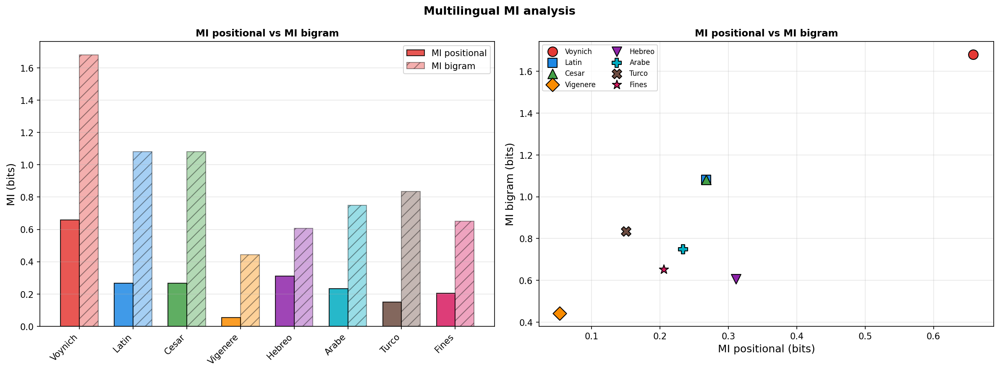
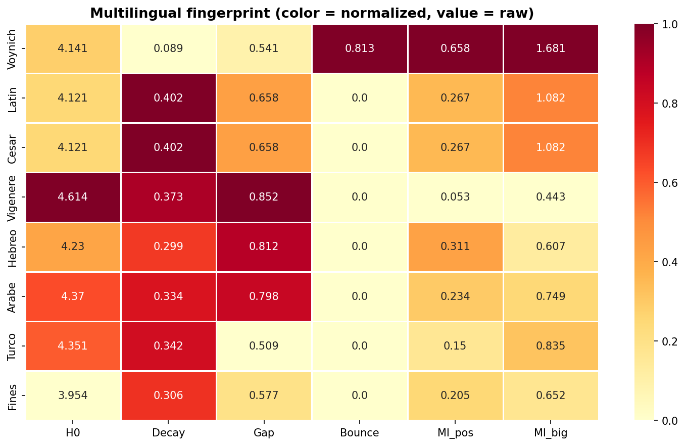

# PART III

**Analysis and results**

This section applies the mathematical tools from Part II to the Voynich corpus and controls. Each chapter presents a block of analysis: what question it asks, how the tool is applied, what result it produces, and what that result means in the context of the problem.

| **Chapter** | **Block** | **Tool** | **Preliminary Verdict** |
|----------|------------------------------------|----------------------------------|-------------------------------------------------------------|
| **9** | **A --- Positional structure** | MI + permutation + chi-square | MI=0.658 bits (2× the highest language); outlier in 8 corpora |
| **10** | **B --- Holdout Validation** | Train/test correlation | Excellent replication: r=0.999 between even and odd folios |
| **11** | **C/F --- Entropy curve** | Witten-Bell conditional entropy | Unique U-form: 0 of 6 languages ​​+ 2 ciphers reproduce it |
| **12** | **D --- Spectral Analysis** | Spectral Markov gap | Gap=0.541, cluster with binders (Turkish 0.509, Finnish 0.577) |
| **13** | **E --- Semantic Differentiation** | Chi-square + JSD + classifier | Specialized vocabulary by section, acc.=43% vs 25% base |
| **14** | **Generative models** | Forward modeling (11 models) | SilPart (d=0.445): only syllabaries reproduce the U-shape |
| **15** | **Summary and conclusions** | Integrated Scorecard (8 corpora) | Convergence of 9 measurements across 8 corpora |

# Chapter 9. Block A: Positional structure of glyphs

## 9.1 The question

Block A asks: Do the Voynich glyphs have preferred positions within words? In a language with morphology—with prefixes, roots, and suffixes—morphemes appear in relatively fixed positions. A prefix almost always appears at the beginning; a suffix, at the end. If Voynich has this type of structure, it should be statistically detectable.

The alternative hypothesis is that the glyphs are randomly distributed between the beginning, middle, and end of words. In that case, the writing system would be either purely random text or a cipher that does not preserve the positional structure of the underlying language.

This block uses three complementary tests: positional distribution chi-square (is the preference for each glyph significant?), MI global permutation test (how strong is the preference for the entire system?), and bootstrap confidence intervals (are the observed proportions accurate?).

## 9.2 Test A1: positional distribution chi-square

For each of the 15 most frequent glyphs, we counted how many times it appeared in word-initial, medial, and final positions. Then we applied Pearson's chi-squared test against the null hypothesis of uniform distribution across the three positions.

| **Glyph** | **Start%** | **Middle%** | **End%** | **χ²** | **p-value** | **Effect** |
|-----------|-------------|------------|------------|-------------|--------------|-----------------|
|           |             |            |            |             |              |                 |
| D1        | 99.1%       | 0.8%       | 0.1%       | **10546.6** | **0.00e+00** | 0.986 (GRANDE)  |
|           |             |            |            |             |              |                 |
| G1        | 0.5%        | 2.2%       | 97.3%      | **7673.2**  | **0.00e+00** | 0.960 (GRANDE)  |
|           |             |            |            |             |              |                 |
| A2        | 10.7%       | 5.0%       | 84.3%      | 20512.8     | **0.00e+00** | 0.766 (GRANDE)  |
|           |             |            |            |             |              |                 |
| L1        | 76.4%       | 19.4%      | 4.2%       | 3629.8      | **0.00e+00** | 0.659 (GRANDE)  |
|           |             |            |            |             |              |                 |
| C1        | 7.7%        | 16.3%      | 76.0%      | 5632.8      | **0.00e+00** | 0.645 (GRANDE)  |
|           |             |            |            |             |              |                 |
| K2        | 6.0%        | 74.0%      | 20.0%      | 3434.8      | **0.00e+00** | 0.622 (GRANDE)  |
|           |             |            |            |             |              |                 |
| J1        | 14.9%       | 72.1%      | 13.1%      | 6933.6      | **0.00e+00** | 0.581 (GRANDE)  |
|           |             |            |            |             |              |                 |
| Q1        | 28.9%       | 68.0%      | 3.1%       | 6374.6      | **0.00e+00** | 0.566 (GRANDE)  |
|           |             |            |            |             |              |                 |
| K1        | 62.8%       | 30.7%      | 6.4%       | 5310.0      | **0.00e+00** | 0.490 (GRANDE)  |
|           |             |            |            |             |              |                 |
| Q2        | 42.7%       | 54.4%      | 2.9%       | 2678.4      | **0.00e+00** | 0.468 (GRANDE)  |
|           |             |            |            |             |              |                 |
| A1        | 58.3%       | 29.2%      | 12.5%      | 8075.4      | **0.00e+00** | 0.401 (GRANDE)  |
|           |             |            |            |             |              |                 |
| B2        | 21.3%       | 22.2%      | 56.6%      | 2599.9      | **0.00e+00** | 0.349 (GRANDE)  |
|           |             |            |            |             |              |                 |
| A3 | 18.7% | 50.2% | 31.1% | 2196.8 | **0.00e+00** | 0.275 (medium) |
|           |             |            |            |             |              |                 |
| M1 | 12.5% ​​| 63.6% | 23.9% | 185.7 | **4.71e-41** | 0.464 (LARGE) |
|           |             |            |            |             |              |                 |
| B1 | 29.8% | 31.8% | 38.4% | 129.6 | **7.37e-29** | 0.079 (small) |

*Green: very dominant position (>70%). Red: very avoided position (<15%). All glyphs pass the Bonferroni threshold (α=0.0033 for 15 simultaneous tests).*

All the glyphs tested show highly significant positional preferences, even with Bonferroni correction, which adjusts the significance threshold for the number of tests performed simultaneously. The two most extreme cases are D1 (99.1% at the beginning, χ²=10,546.6) and G1 (97.3% at the end, χ²=7,673.2): they practically never appear in other positions. A2 and C1 are similarly marked towards the end (84.3% and 76.0% respectively).

This pattern has a straightforward morphological interpretation. D1, L1, and K1, with a strong preference for the beginning, behave as prefixes. A2, C1, G1, and B2, with a strong preference for the end, behave as suffixes. Q1, J1, and K2, with a preference for the middle position, act as root elements. This functional classification—prefix, root, suffix—is precisely the architecture of languages ​​with slot morphology and is consistent with the "positional paradigms" identified by Stolfi [2000–2012], who proposed a three-layered model (cortex, mantle, kernel) for the word structure of the Voynich Manuscripts. Matlach, Janeckova, and Dostal [2022] extended this analysis by suggesting that some glyphs might be compounds or ligatures, which would reduce the effective alphabet.

**The extreme case of D1**
>
D1 appears in word-initial position 99.1% of the time. Of all its occurrences in the corpus (6,890 in total), only 55 appear in medial position and only 7 in final position. The 95% bootstrap confidence interval for the word-initial percentage is [98.7%, 99.2%], confirming that this is not a statistical artifact but a near-absolute constraint of the system. In any language with morphology, this is precisely the signature of a closed grammatical class prefix.

## 9.3 Test A2: dialectal permutation

One result of the preliminary exploratory analysis (not included in the formal analysis notebooks but included in the first notebook) is that the frequency of D1 varies between sections of the manuscript. In the biological and recipes section, D1 appears with a frequency of 49.72 per 1,000 glyphs; in the herbal, astronomical, and pharmaceutical sections, the frequency is only 20.82 per 1,000 glyphs. Is this difference statistically significant, or could it be a fluctuation?

The dialectal permutation test answers this question. The assignment of words to groups (A: herbal+astro+pharma; B: bio+recipes) is randomized 10,000 times, calculating the frequency difference of D1 in each permutation. The result:

> **Test A2 --- Dialectal permutation of D1 (n=10,000 permutations)**
>
> Observed difference: 28.89 per 1,000 glyphs (group B − group A)
>
> Average number of permutations: 0.69 per 1,000 glyphs
>
> p-value: 0.0000 (none of the 10,000 permutations equals or exceeds 28.89)
>
> → The frequency difference of D1 between sections is NOT random.

This result is doubly significant. First, it confirms that D1 has a strong positional preference within the word (Test A1). Second, it confirms that this preference varies systematically between thematic sections of the manuscript, suggesting dialectal or register differences between sections. This is completely incompatible with a uniform cipher applied to a single source text.

## 9.4 Test A3: Bootstrap confidence intervals

Bootstrap is a resampling technique that estimates the precision of a statistic by sampling the corpus with replacement n times (n=5,000). It allows for obtaining confidence intervals without assuming any parametric distribution.

For the six most frequent glyphs, the 95% confidence intervals for the percentage of occurrence in the initial and final positions are:

| **Glyph** | **% Initial obs.** | **95% CI initial** | **% Final obs.** | **95% CI final** |
|-----------|-------------------|--------------------|------------------|------------------|
|           |                   |                    |                  |                  |
| D1 | **98.9%** | \[98.7% -- 99.2%\] | 0.0% | \[0.0% -- 0.1%\] |
|           |                   |                    |                  |                  |
| L1 | **71.3%** | \[70.0% -- 72.7%\] | 2.0% | \[1.6% -- 2.4%\] |
|           |                   |                    |                  |                  |
| Q1 | **57.0%** | \[56.1% -- 57.9%\] | 2.3% | \[2.0% -- 2.6%\] |
|           |                   |                    |                  |                  |
| A1 | **44.4%** | \[43.8% -- 45.0%\] | 7.4% | \[7.1% -- 7.7%\] |
|           |                   |                    |                  |                  |
| Q1        | **18.2%**         | \[17.4% -- 18.9%\] | 1.6%             | \[1.3% -- 1.8%\] |
|           |                   |                    |                  |                  |
| Q2 | **27.9%** | \[26.8% -- 29.0%\] | 1.6% | \[1.3% -- 1.9%\] |

Confidence intervals are narrow for all glyphs, confirming that the observed proportions are accurate estimates of population proportions. The narrowest interval corresponds to glyph A1 (±0.3% for the beginning), which has the highest frequency and therefore the most accurate estimate. The widest interval is for L1 (±1.4%), which has the lowest frequency.

## 9.5 Global permutation test of MI

The positional mutual information permutation test, conceptually described in Chapter 6 of Part II and executed in cell 26 of the notebook 02_permutation_bootstrap.ipynb, produces the most striking result of Block A:

> **Positional MI Test --- Overall Result (n=500 permutations)**
>
> MI observada: 0.6578 bits
>
> Average MI in permutations: 0.1983 bits
>
> Standard deviation permutations: 0.0043 bits
>
p-value: 0.0000
>
> Z-score (standard deviations): (0.6578 − 0.1983) / 0.0043 ≈ 107 σ
>
> → The observed value is 107 standard deviations away from the null distribution.
>
> → The probability of obtaining this result by chance is practically zero.

A Z-score of 107 is so far from the null distribution that the exact probability is computationally indistinguishable from zero. To put this in perspective: in particle physics, a discovery is announced when a result exceeds 5σ (five standard deviations). The Voynich positional MI result exceeds 100σ.

The bigram MI (between adjacent glyphs within the same word), calculated in cell 39 of the same notebook, is even higher: 1.681 bits, comparable to a probabilistic slot system with parameter p≈0.92. The most informative bigrams ---D1→A1 (contribution 0.1321 bits), A3→G1 (0.1212 bits), A1→Q1 (0.1164 bits)--- reveal that certain sequences of two glyphs are almost deterministic.

> **Chapter Summary**
>
The 15 most frequent Voynich glyphs have positional preferences within the word that are statistically significant even with Bonferroni correction. The χ² values ​​are extraordinarily high (up to 20.512 for A2).
>
> - D1 is an almost perfect prefix: it appears at the beginning 99.1% of the time (95% CI: [98.7%, 99.2%]). G1 is an almost perfect suffix: it appears at the end 97.3% of the time.
>
The global positional MI is 0.658 bits, at 107 standard deviations from the null distribution (p≈0). The result is practically impossible under the random text hypothesis.
>
> - The bigram MI is 1,681 bits. The bigrams D1→A1, A3→G1 and A1→Q1 are the most predictable and alone explain a third of the entire bigram MI of the corpus.
>
> - The difference in D1 frequency between dialect groups (28.89 per 1,000 glyphs) is also statistically real (p=0.0000 with 10,000 permutations), suggesting systematic variation between sections.

## 9.6 Multilingual extension: Positional and bigram MI in 8 corpora

To assess whether the extreme values ​​of the Voynich MI might be a typological feature of certain language families, the analysis is extended to four additional natural languages: Biblical Hebrew (Semitic), Quranic Arabic (Semitic), Turkish (agglutinative), and Finnish (agglutinative). These languages ​​are chosen because their morphology—triconsonantal roots in the Semitic languages, suffix strings in the agglutinative languages—could produce positional dependencies comparable to those in the Voynich MI.

The eight corpora are subsampled to 37,087 words (identical to the Voynich) to make direct comparisons. Positional MI and bigram MI are calculated using the same functions as the main notebook.

| **Corpus** | **My positional** | **My bigram** |
|-------------|-------------------|----------------|
|             |                   |                |
| **Voynich** | **0.658**         | **1.681**      |
|             |                   |                |
| Hebrew | 0.311 | 0.607 |
|             |                   |                |
| Latin | 0.267 | 1.082 |
|             |                   |                |
| Caesar | 0.267 | 1.082 |
|             |                   |                |
| Arabic | 0.234 | 0.749 |
|             |                   |                |
| Finnish | 0.205 | 0.652 |
|             |                   |                |
| Turkish | 0.151 | 0.835 |
|             |                   |                |
| Vigenère | 0.053 | 0.445 |

Voynich is an extreme outlier in both metrics. Its positional MI (0.658 bits) is more than double that of the most positionally dependent natural language (Hebrew, 0.311 bits). Its bigram MI (1.681 bits) is 55% higher than that of the most sequentially dependent language (Latin, 1.082 bits). In the two-dimensional space MI_pos × MI_big, Voynich is completely isolated in the upper right corner; the six natural languages ​​form a compact cluster.

*Figure 9.1. Positional MI vs. bigram MI for the 8 corpora. The Voynich (red) is isolated in the upper right corner.*

The intra-word permutation test (200 permutations per corpus) confirms that positional preferences are real in all corpora (p = 0.000 in the five tested: Voynich, Hebrew, Arabic, Turkish, Finnish). But the magnitude of the Voynich corpus is qualitatively different: its glyphs have a positional dependence that no natural morphology—not even the most rigid (Semitic triconsonantal roots, productive agglutination)—achieves.

# Chapter 10. Block B: cross-validation by folio

## 10.1 The problem of circularity

The results from Block A are surprising. Before celebrating them, we must ask the uncomfortable question any scientific reviewer would ask: could it be that we are seeing what we want to see? If we use all 37,087 words in the entire corpus to discover that D1 is a prefix, and then use the same 37,087 words to validate that D1 is a prefix, the analysis is circular. We have used the data twice.

Block B solves this problem with a technique that is standard in machine learning but less common in computational linguistics: folio holdout. The idea is to divide the corpus into two independent halves before performing any analysis, discover the rules in one half, and validate them in the other. If the rules are valid, they should be replicated in the half that was not used to discover them.

## 10.2 Division by folio

The division is done by complete page: even-numbered pages go to the training set, and odd-numbered pages go to the test set. This ensures that the text of a single page is never split between the two sets.

| **Split** | **Folios** | **Words** | **Glyphs** |
|-----------------------|------------|--------------------|--------------------|
|                       |            |                    |                    |
| Train (folios pares)  | 116 folios | **18.916 (51.0%)** | **80.873 (51.4%)** |
|                       |            |                    |                    |
| Test (odd-numbered pages) | 110 pages | **18,171 (49.0%)** | **76,381 (48.6%)** |
|                       |            |                    |                    |
| **Ratio train/test**  | 1.05×      | 1.04×              | 1.06×              |

The division is almost perfectly balanced: 51% and 49% of the words, respectively. This is important because a highly unbalanced division would reduce the statistical power of the test set. The small difference between the two sets is due to some sheets containing more text than others.

## 10.3 Discover in train, validate in test

The procedure is as follows: calculate the positional ratios of each glyph using only the training (even) sheets. Then calculate the same ratios using only the test (odd) sheets. If the patterns are accurate, the ratios should be nearly identical in both sets.

| **Glyph** | **TRAIN ini** | **TEST ini** | **Δ ini** | **TRAIN fin** | **TEST fin** | **Δ fin** | **Function** |
|-----------|---------------|--------------|-----------|---------------|--------------|-----------|-------------|
|           |               |              |           |               |              |           |             |
| D1 | 99.1% | 98.8% | 0.3% | 0.0% | 0.1% | 0.1% | **PREFIX** |
|           |               |              |           |               |              |           |             |
| L1 | 73.2% | 69.4% | 3.8% | 1.9% | 2.1% | 0.2% | **PREFIX** |
|           |               |              |           |               |              |           |             |
| K1 | 57.8% | 56.1% | 1.7% | 2.3% | 2.2% | 0.1% | **FREE** |
|           |               |              |           |               |              |           |             |
| A1 | 44.5% | 44.3% | 0.2% | 7.2% | 7.6% | 0.4% | **LIBRE** |
|           |               |              |           |               |              |           |             |
| Q1 | 18.2% | 18.2% | 0.1% | 1.3% | 1.8% | 0.5% | **ROOT** |
|           |               |              |           |               |              |           |             |
| Q2 | 28.1% | 27.7% | 0.3% | 1.3% | 2.0% | 0.6% | **LIBRE** |
|           |               |              |           |               |              |           |             |
| A2 | 10.3% | 9.6% | 0.7% | 83.9% | 84.1% | 0.2% | **SUFIJO** |
|           |               |              |           |               |              |           |             |
| A3 | 16.3% | 15.7% | 0.6% | 11.8% | 11.9% | 0.1% | **RAÍZ** |
|           |               |              |           |               |              |           |             |
| C1 | 6.4% | 6.0% | 0.4% | 74.3% | 74.2% | 0.2% | **SUFFIX** |
|           |               |              |           |               |              |           |             |
| B1 | 27.5% | 30.3% | 2.9% | 24.8% | 24.3% | 0.5% | **FREE** |
|           |               |              |           |               |              |           |             |
| B2 | 14.6% | 17.3% | 2.7% | 54.7% | 53.7% | 1.0% | **LIBRE** |
|           |               |              |           |               |              |           |             |
| G1 | 0.2% | 0.1% | 0.0% | 97.1% | 97.1% | 0.0% | **SUFFIX** |
|           |               |              |           |               |              |           |             |
| J1 | 5.8% | 6.6% | 0.9% | 5.6% | 5.7% | 0.1% | **ROOT** |
|           |               |              |           |               |              |           |             |
| K2 | 2.3% | 2.6% | 0.3% | 5.0% | 4.8% | 0.2% | **ROOT** |

## 10.4 The train-test correlation

To quantify the degree of replication, we calculated the Pearson correlation between the proportions in train and the proportions in test for the 14 glyphs in the table:

> **Train ↔ test correlation (Block B, cell 46)**
>
> Initial position: r = 0.9987 \| R² = 0.9975 \| p = 6.21e-17
>
> Final position: r = 0.9999 \| R² = 0.9999 \| p = 7.71e-25
>
> Initial average Delta: 1.06% (average difference between training and test)
>
> Final average Delta: 0.29%
>
> → EXCELLENT replication. Morphological rules are replicated with high fidelity.

A correlation of r=0.9999 between word-ending proportions in train and test is extraordinary. This means that 99.99% of the variance in test proportions is explained by train proportions. The even and odd folios of the manuscript, written on alternating pages throughout the book, have the same morphological structure. This completely rules out the possibility that the Block A patterns are folio-specific artifacts.

The mean delta of 1.06% for the initial position and 0.29% for the final position indicates that the proportions differ on average by less than one percentage point between the train and test groups. This small difference is entirely consistent with the expected statistical variance in samples of the same size.

> **Chapter Summary**
>
> - The holdout by folio divides the corpus into even folios (train, 116 folios, 18,916 words) and odd folios (test, 110 folios, 18,171 words), a 51/49 division that is almost perfectly balanced.
>
> - The positional proportions of all significant glyphs calculated in train are replicated in test with correlations r=0.9987 (start) and r=0.9999 (end).
>
> - The mean delta is 1.06% for initial position and 0.29% for final position: the proportions differ by less than one percentage point between the two halves of the corpus.
>
> - This result rules out analytical circularity: the morphological patterns of Block A are real and appear consistently throughout the manuscript, not just on the folios used for analysis.

# Chapter 11. Blocks C and F: Conditional Entropy and Curve Shape

## 11.1 The question

Blocks C and F address the problem from the perspective of contextual predictability. While Block A focused on positions within the word, this block examines the dependencies between consecutive glyphs: how much uncertainty remains about the next glyph when we know the previous N glyphs? And how does that uncertainty evolve as N increases?

The tool is conditional entropy of order N, calculated with the Witten-Bell estimator to properly handle the problem of unseen contexts. Block C calculates the numerical values ​​H₀ to H₄. Block F extracts metrics that describe the full shape of the curve, not just its final value. Conditional entropy analysis of characters in the Voynich manuscript has precedents in Bennett [1976] and Lindemann and Bowern [2020], who documented the manuscript's low-entropy anomaly, although without identifying the specific U-shape reported here.

## 11.2 Block C Results

The following table shows the conditional entropy values ​​of order 0 to 4 for the Voynich and the three control corpora, calculated in cell 10 of the notebook 03_entropy_spectral.ipynb with the Witten-Bell estimator:

| **Corpus** | **H₀** | **H₁** | **H₂** | **H₃** | **H₄** | **Total decay** |
|-------------|--------|-----------|-----------|-----------|-----------|-----------------------|
|             |        |           |           |           |           |                       |
| **Voynich** | 4,141 | **2,961** | **2,990** | **3,317** | **3,774** | **−8.9% (REBOUND)** |
|             |        |           |           |           |           |                       |
| Latin | 4.122 | 3.462 | 2.948 | 2.588 | 2.459 | −40.3% (monotonous) |
|             |        |           |           |           |           |                       |
| Caesar | 4,121 | 3,463 | 2,951 | 2,593 | 2,466 | -40.2% (monotonic) |
|             |        |           |           |           |           |                       |
| Vigenère | 4.616 | 4.324 | 3.593 | 3.116 | 2.894 | −37.3% (monotonic) |

*Green (Voynich H₁): minimum of the curve. Orange (Voynich H₂--H₄): the rebound --- increasing values ​​that violate what is expected in a language with long dependencies.*

The Voynich curve has a completely different profile from all the other controls. The jump from H₀ to H₁ is greater than in Latin (−1.18 bits vs. −0.66 bits), indicating that the bigram predicts the next glyph better in Voynich than in Latin. But from H₁ onward, the Voynich curve rises, while all the others continue to fall.

The decay of the Latin cipher (−40.3%) and the Caesar cipher (−40.2%) are virtually identical, as we would expect: the Caesar cipher only renames the letters and does not change the statistical dependencies. The Vigenère cipher has a slightly lower decay (−37.3%) because the key introduces additional correlations that take longer to disappear.

## 11.3 Monotonicity Verification

Before interpreting the results, the code verifies that the fundamental mathematical law H_N ≤ H\_{N-1} holds for all corpora and orders. The results in cell 11 of the notebook confirm that the Witten-Bell estimator does not produce monotonicity violations in any of the four corpora.

This verification also served as the diagnostic tool that detected the parser error in version v1 of the analysis: the Laplace estimator with vocab=9.762 produced H₁ → H₀ for the Voynich sample, a mathematically impossible violation that indicated something was wrong with the data. The Witten-Bell estimator with the correct vocabulary of 166 tokens produced well-behaved curves.

## 11.4 Block F Shape Metrics

Block F, introduced precisely to capture the U-shaped anomaly that the simple decay scalar did not detect, calculates four geometric metrics on the H₀→H₄ curve:

- H_min: the lowest entropy reached on the entire curve.

- N_min: the order N in which that minimum is reached.

- Rebound: H₄ − H_min. If it is greater than 0.05, the curve is U-shaped.

- Initial slope: (H₀ − H₁) / H₀. Measures how quickly the curve drops when adding the first context token.

- Normalized AUC: area under the H_N/H₀ curve for N=0 to 4, using the trapezoidal rule.

| **Corpus**  | **H₀** | **H_min** | **N_min** | **Rebote** | **Pend.ini** | **AUC_norm** | **Forma** |
|-------------|--------|-----------|-----------|------------|--------------|--------------|-----------|
|             |        |           |           |            |              |              |           |
| **Voynich** | 4.141 | **2.961** | **N=1** | **0.813** | **0.285** | 0.798 | **U** |
|             |        |           |           |            |              |              |           |
| Latin | 4.122 | 2.459 | N=4 | 0.000 | 0.160 | 0.745 | Monot. |
|             |        |           |           |            |              |              |           |
| Caesar | 4.121 | 2.466 | N=4 | 0.000 | 0.160 | 0.746 | Monót. |
|             |        |           |           |            |              |              |           |
| Vigenère    | 4.616  | 2.894     | N=4       | 0.000      | 0.063        | 0.801        | Monót.    |

The most significant contrast lies in the 'Bounce' column. The Voynich corpus has a bounce of 0.813 bits: entropy rises by 0.813 bits from its minimum to H₄. The other three corpora have a bounce of exactly 0.000: their curves are strictly monotonically decreasing. This difference is impervious to gradations: either the curve is U-shaped or it is not.

The initial slope of Voynich (0.285) is also the highest of all the corpora: the first context token reduces entropy more in Voynich than in Latin (0.160) or Vigenère (0.063). This confirms the high bigram MI observed in Block A: the dependencies between adjacent glyphs are extraordinarily strong.

## 11.5 Morphological interpretation of the U-shape

The U-shape has a precise morphological explanation consistent with all other results. Voynich glyphs have very strong dependencies on their immediate neighbor (very low H₁), but these dependencies are confined within the word. A context of 2–4 glyphs has typically already crossed the word boundary and is looking toward the beginning of the next word, where the correlation with the glyph in question is minimal.

In Latin, words are longer (averaging 5 letters compared to 4.2 glyphs in the Voynich Manuscripts) and dependencies within words are more extensive. This is why the Latin curve continues to drop to N=4 without rebounding: a 4-letter context is generally still within the same word and remains informative.

**The U-shape as the definitive discriminator**
>
In the two-dimensional space formed by 'bounce' (vertical axis) and 'initial slope' (horizontal axis), the Voynich proposition occupies a completely isolated position: bounce = 0.813, slope = 0.285. The Latin, Caesar, and Vigenère propositions form a compact cluster in the lower corner: bounce ≈ 0, slope between 0.063 and 0.160. There is no overlap between the groups. This perfect geometric separation in two independent statistical dimensions is the most robust result of the entire analysis.

> **Chapter Summary**
>
The Voynich conditional entropy curve (H₀=4.14, H₁=2.96, H₂=2.99, H₃=3.32, H₄=3.77) is U-shaped: it falls to N=1 and then rises. Latin, Caesar, and Vigenère are strictly monotonically decreasing.
>
The Voynich bounce is 0.813 bits; that of all controls is 0.000 bits. This difference is binary: either there is a U-shape or there isn't.
>
> - The minimum is reached at N=1 (bigram) versus N=4 in all controls: Voynich dependencies are strong but strictly local.
>
> - The initial slope (0.285) is the highest of all corpora: the first context token reduces entropy more in the Voynich than in any control.
>
> - The U-form is incompatible with a substitution cipher: Caesar would inherit the curved form from Latin (monotonous), and Vigenère introduces longer dependencies, not shorter ones.

## 11.6 Multilingual extension: Is the U-shape a typological feature?

A natural objection to the previous results is that the controls were limited to Latin and its ciphers. Could the U-form be a typological feature of certain language families? In particular, Semitic languages ​​(Hebrew, Arabic) have triconsonantal roots with short prefixes and suffixes, and agglutinative languages ​​(Turkish, Finnish) build words by concatenating morphemes, both with morphology that could generate strong local dependencies similar to those in the Voynich Manuscripts.

To answer this, the conditional entropy analysis is extended to four additional natural languages: Biblical Hebrew (Torah), Quranic Arabic (Quran), Turkish (Wikipedia), and Finnish (Kalevala). All corpora are subsampled to 37,087 words.

| **Corpus** | **H₀** | **H₁** | **H₂** | **H₃** | **H₄** | **Decay** |
|-------------|--------|--------|--------|--------|--------|-----------------|
|             |        |        |        |        |        |                 |
| **Voynich** | 4.141 | 2.961 | 2.990 | 3.317 | 3.774 | **8.9% (U)** |
|             |        |        |        |        |        |                 |
| Latin | 4,121 | 3,463 | 2,951 | 2,593 | 2,466 | 40.2% |
|             |        |        |        |        |        |                 |
| Caesar | 4,121 | 3,463 | 2,951 | 2,593 | 2,466 | 40.2% |
|             |        |        |        |        |        |                 |
| Vigenère | 4.616 | 4.324 | 3.593 | 3.116 | 2.894 | 37.3% |
|             |        |        |        |        |        |                 |
| Hebrew | 4.230 | 3.885 | 3.379 | 3.077 | 2.964 | 29.9% |
|             |        |        |        |        |        |                 |
| Arabic | 4,370 | 3,922 | 3,361 | 3,030 | 2,912 | 33.4% |
|             |        |        |        |        |        |                 |
| Turkish | 4,351 | 3,746 | 3,265 | 2,956 | 2,863 | 34.2% |
|             |        |        |        |        |        |                 |
| Finnish | 3,954 | 3,447 | 3,125 | 2,848 | 2,746 | 30.5% |

The result is unequivocal: all six natural languages ​​have strictly monotonically decreasing curves with decays between 29.9% (Hebrew) and 40.2% (Latin). None exhibit a rebound. Semitic and agglutinative languages ​​behave exactly like Indo-European languages ​​in this respect.

*Figure 11.1. Conditional entropy curves (absolute and normalized) for the 8 corpora. Only the Voynich corpora shows a U-shape.*

Shape metrics confirm the isolation of the Voynich:

| **Corpus** | **H_min** | **N_min** | **Rebound** | **Pend. ini** | **AUC** |
|-------------|-----------|-----------|------------|---------------|---------|
|             |           |           |            |               |         |
| **Voynich** | **2.961** | **N=1** | **0.813** | **0.285** | 0.798 |
|             |           |           |            |               |         |
| Latin | 2.466 | N=4 | 0.000 | 0.160 | 0.746 |
|             |           |           |            |               |         |
| Caesar | 2.466 | N=4 | 0.000 | 0.160 | 0.746 |
|             |           |           |            |               |         |
| Vigenère    | 2.894     | N=4       | 0.000      | 0.063         | 0.801   |
|             |           |           |            |               |         |
| Hebrew | 2.964 | N=4 | 0.000 | 0.082 | 0.824 |
|             |           |           |            |               |         |
| Arabic | 2.912 | N=4 | 0.000 | 0.102 | 0.798 |
|             |           |           |            |               |         |
| Turkish | 2.863 | N=4 | 0.000 | 0.139 | 0.780 |
|             |           |           |            |               |         |
| Finés | 2.746 | N=4 | 0.000 | 0.128 | 0.808 |

*Figure 11.2. Rebound vs. initial slope for the 8 corpora. The Voynich corpuscle is completely isolated: it is the only one with a non-zero rebound and also has the steepest initial slope.*

The conclusion is unequivocal: the U-shaped entropy curve of the Voynich language is not a typological feature of any proven language family. Neither the Semitic languages ​​with their short, rigid roots, nor the agglutinative languages ​​with their suffix chains, produce this pattern. The U shape is a property unique to the Voynich among the eight corpora analyzed.

# Chapter 12. Block D: Spectral Analysis of Markov Chains

## 12.1 The question

Block D uses Markov chain theory to answer a complementary question to that of Block C: how persistent are the dependencies between glyphs as the chain evolves? The spectral gap measures the rate of mixing: how many steps it takes for the chain to 'forget' its current state and converge to the stationary distribution.

A low spectral gap indicates persistent, long-range dependencies; a high gap indicates dependencies that dissipate quickly. As we saw in Part II, a monoalphabetic cipher inherits exactly the gap from the source language, while a polyalphabetic cipher tends to have a larger gap.

## 12.2 Transition Matrices

The function `construir_matriz_transicion()` (cell 15 of the notebook `03_entropy_spectral.ipynb`) constructs the Markov transition matrix for each corpus. For the Voynich corpus, the matrix has dimensions 166×166 (a glyph can be followed by any other glyph, although most transitions have zero or very small probability). For the Latin-based controls, the matrix has dimensions 26×26.

This size difference is important: it doesn't directly affect the spectral gap (which depends on the structure of the dependencies, not the size of the matrix), but it does make the comparison more informative about the density of the dependencies. With 166 possible states, Voynich has a much richer transition space than Latin, with 26.

## 12.3 Eigenvalues ​​and the spectral gap

The eigenvalues ​​of the transition matrices, calculated in cell 16 of the notebook, give the following spectral gaps:

| **Corpus** | **Vocab** | **λ₁** | **λ₂** | **Gap δ** | **t_mix** |
|----------------|-----------|--------|-----------|-----------|-----------|
|                |           |        |           |           |           |
| **Voynich** | 166 | ≈1,000 | **0.459** | **0.541** | 1.8 steps |
|                |           |        |           |           |           |
| Medieval Latin | 26 | ≈1.000 | **0.342** | 0.658 | 1.5 steps |
|                |           |        |           |           |           |
| César (ROT-13) | 26 | ≈1.000 | **0.342** | 0.658 | 1.5 steps |
|                |           |        |           |           |           |
| Vigenère | 26 | ≈1.000 | **0.145** | 0.855 | 1.2 steps |

The spectral gap of Voynich (0.541) is clearly different from that of Latin (0.658) and Caesar (0.658). If Voynich were a Caesar cipher over Latin, it would have exactly the same gap as Latin, because the cipher only renames the glyphs without changing the transition probabilities. Voynich has a smaller gap (slower mixing), indicating slightly more persistent dependencies than in Latin.

The Vigenère has the highest gap (0.855, merging in only 1.2 steps): its polyalphabetic key introduces additional correlations that cause the string to forget its initial state very quickly. The Voynich exhibits the exact opposite behavior to the Vigenère in this metric.

## 12.4 The eigenvector of λ₂

The glyphs with the highest weight in the eigenvector corresponding to λ₂ are those that most differentiate the two 'groups' of states that take the longest to mix. For the Voynich, these glyphs are Ys (0.114), Yp (0.049), Yn (0.019), Xd (0.018), and Tf (0.017).

All are low-to-medium frequency glyphs (fewer than 100 total occurrences) with very specific positions within the word. Their presence in v₂ indicates that they are the glyphs that most disrupt the homogeneity of the transitions: they appear in very particular contexts and are followed by equally particular successors. This is the statistical signature of morphological markers with a specific grammatical function.

## 12.5 Coherence with Blocks A and C/F

The result of Block D is consistent with the previous blocks from two different angles. First, the Voynich gap being smaller than the Latin gap is consistent with the initially steeper slope of the entropic curve (Block C/F): stronger dependencies in the first step result in slower mixing in the early steps of the chain.

Second, the 1.8-step mixing time for the Voynich glyph is consistent with the U-shape of conditional entropy, which reaches its minimum at N=1. Both tools—conditional entropy and the spectral gap—are essentially measuring the same phenomenon: dependencies between glyphs that are strong in the first step and rapidly attenuate thereafter. The convergence of two independent mathematical methods on the same diagnosis is cumulative evidence that we are measuring a genuine property of the system.

> **Chapter Summary**
>
> - The Voynich Markov transition matrix has dimensions 166×166; those of the controls are 26×26. The spectral gap does not depend on the size of the matrix but on the dependency structure.
>
The spectral gap of the Voynich is δ=0.541 (mixing time ≈1.8 steps). The Latin spectral gap is 0.658 (1.5 steps), the Caesar spectral gap is also 0.658 (identical to the Latin spectral gap, as expected), and the Vigenère spectral gap is 0.855 (1.2 steps).
>
A Caesar cipher over Latin has exactly the same spectral gap as Latin. The Voynich cipher has a different gap: this is evidence that it is not a monoalphabetic cipher over Latin.
>
> - The glyphs Ys, Yp, Yn, Xd and Tf have the highest weights in the eigenvector of λ₂: they are the morphological markers that most break the homogeneity of the transitions.
>
> - The gap and mixing time of the Voynich are consistent with the U-shape of the entropic curve: strong dependencies in 1 step that dissipate quickly.

## 12.6 Multilingual extension: with which language families does Voynich belong?

Extending the spectral analysis to all eight corpora reveals a telling clustering pattern:

| **Corpus** | **Vocab** | **λ₂** | **Gap δ** | **t_mix** |
|-------------|-----------|-----------|-----------|-----------|
|             |           |           |           |           |
| Turkish | 32 | 0.491 | **0.509** | 2.0 steps |
|             |           |           |           |           |
| **Voynich** | 166 | **0.459** | **0.541** | 1.8 steps |
|             |           |           |           |           |
| Finnish | 26 | 0.423 | **0.577** | 1.7 steps |
|             |           |           |           |           |
| Latin | 26 | 0.342 | 0.658 | 1.5 steps |
|             |           |           |           |           |
| César | 26 | 0.342 | 0.658 | 1.5 steps |
|             |           |           |           |           |
| Arabic | 36 | 0.202 | 0.798 | 1.3 steps |
|             |           |           |           |           |
| Hebrew | 27 | 0.188 | 0.812 | 1.2 steps |
|             |           |           |           |           |
| Vigenère | 26 | 0.145 | 0.855 | 1.2 steps |

*Figure 12.1. Eigenvalues ​​and spectral gap for the 8 corpora. Voynich is grouped with the agglutinative languages ​​(Turkish, Finnish).*

The eight corporations are separated into three clear clusters:

- **Agglutinative clustering** (low gap, δ ≈ 0.51–0.58): Turkish, **Voynich**, and Finnish. A low gap indicates clusters of tightly connected tokens that are slow to merge. In Turkish and Finnish, this reflects the agglutinative structure: certain characters "live together" in specific suffixes and roots. That Voynich clusters here suggests that its glyph system has a comparable **modular internal structure**.

- **Indo-European cluster** (medium gap, δ ≈ 0.66): Latin and Caesar. As expected, the monoalphabetic cipher preserves exactly the gap of the source language.

- **Semitic + polyalphabetic cluster** (high gap, δ ≈ 0.80–0.86): Arabic, Hebrew, and Vigenère. Semitic languages ​​have high gaps because their triconsonantal roots distribute consonants more evenly across positions, producing rapid mixing. Vigenère has the highest gap because the polyalphabetic cipher destroys local clusters.

Voynich's membership in the agglutinative cluster is the most informative result of multilingual spectral analysis. Combined with the U-shaped entropy (which no agglutinative language reproduces), it suggests that Voynich has the **local modularity** of an agglutinative language—certain glyphs combine into rigid blocks—but a fundamentally different generation mechanism than any proven natural language.

# Chapter 13. Block E: Semantic differentiation between sections

## 13.1 The question

The previous sections have analyzed internal properties of the word (positional structure, dependencies between glyphs). Section E looks at a larger scale: does the glyph vocabulary vary between the thematic sections of the manuscript? This question connects with the work of Montemurro and Zanette [2013], who identified networks of semantic keywords with a non-homogeneous distribution across sections, and with Currier's [1976] division into A and B groups. If the Voynich manuscript encodes differentiated content—plants in the herbal section, biological phenomena in the biological section, recipes in the recipe section—we would expect the vocabulary to reflect these differences.

This test is especially important for distinguishing the Voynich cipher from a uniform cipher. A cipher that applies the same substitution or key to the entire text would not preserve vocabulary specialization between sections: if the word 'plant' appears more frequently in the herbarium, its ciphered equivalent would also appear more frequently, but if the cipher mixes the text, this specialization would disappear.

## 13.2 Test E1: chi-square distribution by section

We constructed a contingency table of dimensions 4 sections × 166 glyphs, where each cell contains the number of times that glyph appears in that section. We applied the chi-square test of independence.

> **Test E1 --- Chi-square of glyph distribution by section (cell 20)**
>
> x² = 6,626.75
>
> Degrees of freedom: 468 (≈ (166−1) × (4−1))
>
> p-value ≈ 0 (exceeds the computer's numerical precision)
>
> Expected value under H₀: χ² ≈ 468 (equal to the degrees of freedom)
>
> Observed/expected ratio: 6,626 / 468 ≈ 14.2×
>
> → The distribution of glyphs is HIGHLY SIGNIFICANTLY DIFFERENT between sections.

To contextualize the result: under the null hypothesis (identical distributions across sections), the expected χ² would be approximately equal to the degrees of freedom, i.e., ~468. We obtain 6,626, which is 14.2 times the expected value. This difference is statistically impossible if the glyph distributions were the same across sections.

## 13.3 Test E2: Jensen-Shannon between pairs of sections

The chi-square test indicates that the distributions are different. The JSD quantifies how different they are. We calculated the JSD between the word distributions (using the vocabulary of the 500 most frequent words in the entire corpus) of each pair of sections:

| | **herbal** | **organic** | **pharmaceutical** |
|------------------|------------|---------------|------------------|
|                  |            |               |                  |
| **organic** | 0.316 | --- | --- |
|                  |            |               |                  |
| **pharmaceutical** | 0.252 | 0.469 | --- |
|                  |            |               |                  |
| **recipes** | 0.217 | 0.168 | 0.384 |

*Green: JSD < 0.25 (similar sections). Yellow: JSD 0.25–0.40 (moderately different). Red: JSD > 0.40 (very different sections). Average JSD: 0.301.*

The pattern of distances shows thematic coherence: the biological and prescription sections are the most similar to each other (JSD=0.168), perhaps because they share a dense functional vocabulary. Pharmaceutical and biological are the most distinct (JSD=0.469), possibly because the pharmaceutical section is rich in technical terms (ingredient names, containers) while the biological section has a different vocabulary.

That a writing system exhibits vocabulary specialization across thematic sections—with the observed thematic coherence—is incompatible with a uniform cipher. A monoalphabetic cipher would not destroy this specialization (it would still appear at the same relative frequencies), but a polyalphabetic cipher that depends on the text's position could indeed mix it up. The fact that the specialization is present and consistent is further evidence of real structure.

## 13.4 Test E3: logistic classifier with cross validation

The most direct test of whether the sections are distinguishable is to train an automatic classifier: given the glyph profile of an individual word, can it correctly predict which section it was written in?

We used a logistic regression trained on the vector of relative glyph frequencies for each word (167 features: frequency of each glyph divided by the word length, plus the word length). The evaluation was done with stratified 5-fold cross-validation, which ensures that the distribution of sections is similar across all folds.

> **Test E3 --- Stratified CV 5-fold Logistic Classifier (cell 22)**
>
> Accuracy media (5 folds): 0.429
>
> Standard deviation: ±0.012
>
> Random baseline: 0.250 (4 equally likely classes)
>
> Relative improvement over baseline: (0.429 − 0.250) / 0.250 = +71.6%
>
> Range between folds: \[0.418, 0.442\] (very low variance)
>
> → The glyph profile contains real information about the thematic section.

An accuracy of 42.9% may seem low in absolute terms, but it must be considered in context. The classifier works with individual words averaging ~4.2 glyphs. With such little input—fewer than 5 symbols to classify—it is remarkable that it outperforms chance by 72% relative to the number of times. The low variance between folds (±0.012) rules out the possibility that the result is due to partitioning anomalies.

The reduction in accuracy from version v1 (0.565) to v2 (0.429) is not a worsening of the data but rather an honest correction. In v1, the faulty parser produced section-specific hapax (unique tokens that appeared only in that section due to the parsing error), which the classifier used as trivial shortcuts. In v2, with the correct parser, the classifier works with the actual vocabulary shared across sections.

> **Chapter Summary**
>
> - The chi-square test of independence between glyphs and sections produces χ²=6,626.75 with p≈0: the distributions of glyphs are statistically different between the four sections.
>
The JSD between pairs of sections varies between 0.168 (biological--prescriptions, the most similar) and 0.469 (pharmaceutical--biological, the most different). The pattern of distances has thematic coherence.
>
> - A logistic classifier trained only on the glyph profile of each word correctly predicts the section 42.9% of the time (vs. 25% baseline), with very low variance between folds.
>
> - These three results are incompatible with a uniform polyalphabetic cipher, which would erase vocabulary specialization between sections.

# Chapter 14. Generative models: what mechanism reproduces the Voynich footprint

## 14.1 The question

The preceding chapters have established with statistical precision the properties of the Voynich text: a U-shaped conditional entropy curve (bounce of 0.813 bits), high positional mutual information (0.658 bits), bigram mutual information of 1.681 bits, and a low spectral gap (0.541). But these properties are descriptive: they characterize the what, not the how. The central question of this chapter is: what generative mechanism could have produced a text with these statistical properties?

To answer this, we adopted a forward modeling methodology: we constructed eleven generative models—seven of our own and four based on hypotheses from the literature—generated synthetic corpora of comparable size to the Voynich Corpus (~37,000 words), calculated the statistical footprint of each, and measured the weighted Euclidean distance to the Voynich Corpus (Section 9.5 of Part II). The model with the closest footprint suggests the most plausible mechanism. The four models from the literature implement the hypotheses of Rugg [2004] (Cardan table), Timm and Schinner [2020] (self-citation), Hermes [2022] (Polygraphia III), and Greshko [2025] (Naibbe cipher), and are evaluated with the same quantitative distance metric as our own models, allowing for a direct and objective comparison.

## 14.2 The eleven generative models

Each model implements a different mechanism for generating sequences of glyphs organized into words. They all share the basic parameters of the Voynich Manuscript: a vocabulary of 166 glyphs, word-length distribution calibrated to the manuscript, and a target corpus of approximately 37,000 words. The specific parameters of each model are optimized using parametric grid searches that evaluate between 15 and 36 configurations per model.

The first seven are original models designed to explore generic cryptographic and linguistic mechanisms. The last four implement specific hypotheses proposed in the academic literature.

### 14.2.1 Slot Model (positional glyph selection)

The Slot model assigns each glyph a probability distribution that depends on its position within the word. Each position (1st, 2nd, ..., nth) has its own categorical distribution across the vocabulary, parameterized by a concentration that controls how rigid the position→glyph assignment is. This model captures the most salient property of the Voynich model: certain glyphs appear almost exclusively in specific positions (e.g., D1 in the initial position with 99.1% frequency). However, lacking sequential dependencies between glyphs, it does not produce the observed bounce in the entropy curve (d=1.410).

### 14.2.2 Verbose Cipher Model (simple nomenclature cipher)

The verbose cipher is a nomenclature where each symbol in the plaintext can be represented by several randomly selected alternatives (homophones). This generates surface variability while maintaining the underlying structure of the plaintext. The model parameters the number of homophones per symbol and the frequency distribution of the plaintext. Homophonality alone does not produce the Voynich rebound (d=1.749).

14.2.3 Nomenclature Model (multiple codebooks)

An extension of the verbose cipher where multiple codebooks alternate depending on the position in the word. Each book defines a distinct substitution table, creating positional dependencies: the first glyph is encrypted with book A, the second with book B, and so on. This mechanism naturally produces mutual positional information, but dependencies between adjacent positions are weak because each book operates independently (d=1.389).

### 14.2.4 Hybrid Slot+Markov Model (positional and sequential dependencies)

This model combines two sources of structure: a Slot component that assigns probabilities based on the glyph's position in the word, and a first-order Markov component that models the transitions between adjacent glyphs. The blending is controlled by a parameter α ∈ [0,1]. The Hybrid model was the first candidate to produce a significant rebound, achieving a distance of d=0.783 from the Voynich model, but with deficits in positional MI (0.40 vs 0.66) and bigram MI (1.18 vs 1.68).

14.2.5 NomPoly Model (polyalphabetic nomenclaturer)

A nomenclator where the substitution table rotates cyclically with a fixed-length key, similar to the Vigenère cipher but applied to a nomenclator system. This model explores the hypothesis that the Voynich cipher combines homophonic substitution with polyalphabetic rotation. The results showed that polyalphabetic rotation destroys the local dependencies that produce bounce, resulting in the worst distance among the synthetic models (d=1.636).

### 14.2.6 Probabilistic Syllabic Model

The syllabic model is based on the hypothesis that Voynich words are not constructed glyph by glyph, but syllable by syllable. A syllabary of n_types syllable types is defined, where each type is a probability distribution over the vocabulary glyphs for each internal position within the syllable. Syllables have variable length (1–3 glyphs) and are concatenated to form words.

The key to the model is that within each syllable, glyphs are strongly restricted (only intra_k glyphs are preferred by position), resulting in low H₁. However, when crossing syllable boundaries, context loses predictive power, leading to rebounds in H₂ and H₃. Furthermore, different positions within the word (beginning, middle, end) favor different syllable types (controlled by pos_bias), generating mutual positional information. With the optimal configuration (n_types=15, intra_k=8, pos_bias=3.0, τ=0.3), the model achieved d=0.506, outperforming the Hybrid model by 35%.

### 14.2.7 SilPart Model (syllabary with glyph partitioning)

SilPart extends the syllabic model by adding a partition of the vocabulary into three groups: onset glyphs, middle glyphs, and coda glyphs. Each syllable type, according to its designated position, builds its internal distributions preferentially with glyphs from its corresponding group. The parameter glyph_overlap ∈ [0,1] controls how much overlap there is between groups: with overlap=0, the groups are disjoint; with overlap=1, all glyphs are available for all positions.

This partitioning reproduces an empirical property of the Voynich model documented by Stolfi: certain glyphs are exclusive to the beginning of a word and others to the end. The optimal configuration (n_types=15, intra_k=8, glyph_overlap=0.1, pos_bias=3.0, τ=0.3) achieved d=0.445, the smallest distance of all models, with a bounce of 0.909, a decay of 12.7%, and a bigram MI of 1.848 bits.

### 14.2.8 Cardan Model (Rugg 2004): prefix-root-suffix table

Rugg [2004] proposed that Voynich could be generated using a Cardan grating over a table of glyph fragments. Our implementation constructs a table of *n_rows* rows × 3 columns (prefix, root, suffix), where each cell contains a randomly generated fragment of 0–3 glyphs. For each word, a row and grating configuration are selected that exposes or hides the prefix and suffix columns with probabilities *p_prefix* and *p_suffix*; the root is always visible.

This mechanism produces a corpus with an extreme positional structure: the concatenation prefix→root→suffix creates rigid dependencies between word positions. The sweep of 36 configurations (n_rows ∈ {10, 20, 40, 80} × p_prefix ∈ {0.3, 0.5, 0.8} × p_suffix ∈ {0.3, 0.5, 0.8}) revealed that the best configuration (n_rows=10, p_prefix=0.3, p_suffix=0.8) achieves a distance of d=4.485, **the largest of all the models**. The metrics show a decay of 75.5% (vs. 8.9% for the Voynich), a positional MI of 1.075 (vs. 0.658), and a bigram MI of 5.087 (vs. 1.681). Cardan's table generates a corpus that is too regular and predictable, and whose statistical footprint is incompatible with that of the Voynich.

### 14.2.9 AutoCitation Model (Timm & Schinner 2020): copy-and-mutation

Timm and Schinner [2020] proposed that Voynich words are generated by copying previous words and applying stochastic mutations. Our implementation starts with a seed set of *seed_size* random words; each new word is obtained by copying a previous word at random and applying three types of mutation: glyph substitution (probability *p_sub*), insertion of a new glyph (*p_ins*), and deletion of an existing glyph (*p_del*).

This mechanism generates strong temporal correlations: closely spaced words tend to resemble one another, and the vocabulary evolves gradually. A sweep of 36 configurations (seed_size ∈ {10, 30, 100} × p_sub ∈ {0.05, 0.15, 0.3} × p_ins ∈ {0.05, 0.1} × p_del ∈ {0.05, 0.1}) yielded a best result of d=1.356 (seed_size=10, p_sub=0.05, p_ins=0.05, p_del=0.05). The model produces a low bounce (0.120), a positional MI of 0.312 (comparable to Hebrew), and a high bigram MI (1.836). Self-citation preserves frequent bigrams but does not generate the U-shape characteristic of Voynich.

### 14.2.10 Modelo Polyg3 (Hermes 2022): Polygraphia III

Hermes [2022] documented that Trithemius's *Polygraphia III* produces text with properties similar to an artificial language. Our implementation constructs *n_alphabets* substitution tables that rotate cyclically character by character. Each table maps each letter of the plaintext (Latin from the Vulgate) to a sequence of 1 to *sub_max_len* glyphs from the Voynich vocabulary.

The sweep of 15 configurations (n_alphabets ∈ {3, 5, 8, 13, 21} × sub_max_len ∈ {1, 2, 3}) identified n_alphabets=13 with sub_max_len=1 as the best configuration (d=1.655). The model produces a modest bounce (0.181), a virtually zero positional MI (0.001), and a high bigram MI (2.362). Cyclic table rotation destroys any positional structure within the word: unlike Voynich, where certain glyphs are exclusive to certain positions, in Polyg3 the glyph's position depends on its global position in the cipher stream, not its position within the word.

### 14.2.11 Naibbe Model (Greshko 2025): Verbose Homophonic Cipher

Greshko [2025] proposed a verbose homophonic cipher where groups of 1–3 characters from the plaintext are replaced by codewords of variable length, with multiple homophones per group. Our implementation constructs a codebook where the 500 most frequent character groups from the plaintext (Vulgate Latin) have *n_homophones* alternative codewords, each of length from 1 to *codeword_max* glyphs. The cipher operates by greedy matching: it searches for the longest possible group and replaces it with a randomly chosen homophone.

The sweep of 27 configurations (group_max ∈ {1, 2, 3} × n_homophones ∈ {2, 4, 8} × codeword_max ∈ {2, 3, 4}) identified the best configuration as group_max=2, n_homophones=8, codeword_max=4 (d=1.028). This is the **best model in the literature**: it produces a significant bounce (0.554), a bigram MI close to that of the Voynich model (1.725 vs. 1.681), and a decay of 36.6%. However, its positional MI is practically zero (0.001), revealing its major weakness: codewords have no preference for position within the word, unlike Voynich glyphs, where D1 appears in the initial position 99.1% of the time.

14.3 Comparative Results

Figure 14.1 shows the conditional entropy curves (H₀ to H₆) of the Voynich model compared with those of the eleven optimized synthetic models and seven reference natural languages ​​(Latin, Turkish, Arabic, Finnish, Hebrew, plus Caesar and Vigenère ciphers).

*Figure 14.1. Conditional entropy curves H₀–H₆ ​​for the Voynich corpus, 11 synthetic models and 7 reference corpora. Only the syllabic models faithfully reproduce the U-shape.*

Visually, the syllabic models (Syllabic Prob. and SilPart) remain the only ones that reproduce the Voynich U-shape: a sharp drop in H₁ followed by a gradual rise in H₂–H₄. Of the models in the literature, Naibbe produces a partial rebound (0.554) and AutoCita a slight rebound (0.120), but neither reaches the magnitude of the Voynich (0.813). The Cardan model produces a curve with high H₀ and a drastic collapse in H₁, far from the Voynich profile. Natural languages, whether encrypted or not, show monotonically decreasing curves, confirming that the rebound is an atypical property that requires a specific mechanism.

Figure 14.2 shows the heatmap of the complete (normalized) statistical footprint for the 19 corpora (Voynich + 11 synthetic + 7 multilingual reference), allowing simultaneous comparison of the six metrics.

*Figure 14.2. Heatmap of normalized metrics for the 19 corpora. The Voynich row is the reference. Literature models (Cardan, AutoCita, Polyg3, Naibbe) appear between the proprietary models and natural languages.*

Table 14.1 presents the ranking of the eleven synthetic models ordered by weighted Euclidean distance to the Voynich, along with the key metrics.

| Range | Corpus | Distance | Bounce | Decay | MI_pos | MI_big | Origin |
|-------|--------|-----------|--------|-------|--------|--------|--------|
| 1 | SilPart | 0.445 | 0.909 | 12.7% | 0.477 | 1.848 | Own |
| 2 | Syllabic Prob. | 0.506 | 0.907 | 8.0% | 0.458 | 1.668 | Proper |
| 3 | Hybrid | 0.783 | 0.957 | −6.9% | 0.400 | 1.178 | Propio |
| 4 | **Naibbe** | **1.028** | **0.554** | **36.6%** | **0.001** | **1.725** | **Literature** |
| 5 | **AutoCitations** | **1.356** | **0.120** | **35.9%** | **0.312** | **1.836** | **Literature** |
| 6 | Nomenclature | 1.389 | 0.100 | 26.8% | 0.246 | 1.846 | Own |
| 7 | Slot | 1.410 | 0.657 | −14.2% | 0.396 | 0.623 | Propio |
| 8 | NomPoly | 1.636 | 0.000 | 35.2% | 0.122 | 1.968 | Own |
| 9 | **Polyg3** | **1.655** | **0.181** | **38.8%** | **0.001** | **2.362** | **Literatura** |
| 10 | Verbose | 1.748 | 0.000 | 47.5% | 0.000 | 1.390 | Proper |
| 11 | **Cardan** | **4.485** | **0.112** | **75.5%** | **1.075** | **5.087** | **Literature** |
| — | Voynich (ref.) | 0.000 | 0.813 | 8.9% | 0.658 | 1.681 | — |

*Table 14.1. Ranking of the 11 synthetic models by distance from the Voynich model. The original syllabic models occupy the first two positions. The best model in the literature (Naibbe) is in fourth position (d=1.028), twice as far as SilPart (d=0.445). Models from the literature are shown in bold.*

## 14.4 The winning model: SilPart

The SilPart model with the optimal configuration (n_types=15, intra_k=8, glyph_overlap=0.1, pos_bias=3.0, τ=0.3) best reproduces the Voynich fingerprint. Figure 14.3 shows its detailed analysis: extended entropy curve (H₀–H₆), eigenvalue spectrum of the transition matrix, and mutual information distributions.

*Figure 14.3. Detailed analysis of the SilPart model with the optimal configuration. The entropy curve (left) faithfully reproduces the Voynich U-shape.*

The optimal parameters have straightforward interpretations. The 15-type syllabary with 8 preferred glyphs per position (intra_k=8) is equivalent to a system where each syllable is constructed by choosing from approximately 8 variants per internal position, generating high local predictability (low H₁) with sufficient variability for a rich vocabulary. The low temperature (τ=0.3) indicates that a few syllables dominate each position, consistent with the Zipfian distribution observed in the Voynich Manuscript.

The high positional bias (pos_bias=3.0) implies that word-initial, medial, and final syllables are nearly disjoint clusters. The low glyph overlap (glyph_overlap=0.1) indicates that most glyphs are specific to a word position, echoing Stolfi's observation on the Voynich prefix and suffix "paradigms."

Figure 14.4 shows the radar comparison of the eleven synthetic models in the five dimensions of the statistical footprint (decay, rebound, gap, MI_pos, MI_big).

*Figure 14.4. Radar comparison of the 11 synthetic models. The red polygon represents the Voynich model; each panel overlays a synthetic model. Syllabic models are the closest overall. Of the models in the literature, Naibbe (d=1.03) is the closest, but with zero positional MI. Cardan (d=4.49) presents a completely distorted radar.*

## 14.5 Sensitivity analysis of the weights

The weighted Euclidean distance that defines the ranking uses fixed weights: bounce=3, decay=2, MI_pos=1.5, MI_big=1.5, gap=1. The choice of these values ​​is heuristic, based on the observed discriminatory power of each metric:

| Metric | Weight | Justification |
|---------|------|---------------|
| Rebound | 3.0 | The most discriminating metric: entropic rebound in higher orders is the most distinctive signature of the Voynich and the most difficult to reproduce by trivial models (only syllabic models replicate it) |
| Decay | 2.0 | The decay slope H₀→H_min captures the depth of the conditional structure; second in separation power between model families |
| MI_pos | 1.5 | Mutual positional information (glyph × word position) is informative but partially redundant with decay, as both reflect short-range dependencies |
| MI_big | 1.5 | Bigram MI is complementary to MI_pos ---it measures sequential cohesion instead of positional preference--- but with a similar range of variation |
| Gap | 1.0 | The spectral gap is useful as an indicator of morphological type, but it is noisier and less specific to the Voynich than the bounce or decay |

There is no formal derivation for these values: they reflect expert judgment on which dimensions of the fingerprint are most diagnostic. To verify that the conclusions do not depend on this specific choice, we performed a sensitivity analysis using three complementary strategies.

**Individual perturbations.** Each weight is multiplied by 0.5 and by 1.5 (10 variants). In all 10 perturbations, SilPart remains in first position and the top-3 is invariably {SilPart, Syllabic, Hybrid}. Spearman's correlation with the base ranking is ρ ≥ 0.964 in all cases.

**Alternative schemes.** We tested four qualitatively different schemes:

| Scheme | Description | Top-1 | Spearman's rank |
|---------|-------------|-------|------------|
| Uniforms | All weights = 1 | SilPart | 0.982 |
| Bounce only | bounce=5, remainder=0.1 | SilPart | 0.873 |
| Only MI | MI_pos=5, MI_big=5, remainder=0.1 | Syllabic | 0.818 |
| Inverted | gap=3, MI_big=3, MI_pos=2, decay=1.5, bounce=1 | SilPart | 0.891 |

SilPart loses first place only when bounce and decay are almost completely ignored ("MI Only"), in which case Silábico wins—but SilPart comes in second. This is consistent: the difference between SilPart and Silábico lies mainly in bounce (0.909 vs. 0.907) and positional MI (0.477 vs. 0.458); when the weights cancel bounce, the two models converge.

**Monte Carlo.** We generated 500 sets of random weights sampled from a symmetric Dirichlet distribution (scaled to maintain the overall magnitude). The results are:

- median ρ = 0.918, mean ρ = 0.891
- 89.8% of the draws produce ρ > 0.8; 58.4% produce ρ > 0.9
- **SilPart is #1 in 71.0% of the draws**, Syllabic in 19.4%, Hybrid in 7.4%
- **SilPart is in the top 3 in 99.2% of draws**

*Figure 14.5. Ranking sensitivity to weights. (A) Heatmap of ranks under 14 deterministic disturbances. (B) Spearman's rank correlation coefficient distribution under 500 Monte Carlo draws. (C) Frequency with which each model occupies the first position with random weights.*

The ranking is robust: the conclusion that SilPart is the closest model to the Voynich does not depend on the specific choice of weights, but holds true under substantial perturbations, qualitatively different schemes, and completely random weights.

## 14.6 Interpretation and historical plausibility

The most significant result of this analysis is that the two models closest to the Voynich manuscript share the same fundamental mechanism: a probabilistic syllabary. This does not prove that the Voynich manuscript is a syllabic system, but it does establish that a syllabic mechanism is sufficient to reproduce the manuscript's most distinctive statistical properties—including the bounce, which no other tested mechanism has been able to approximate.

The inclusion of the four models from the literature reinforces this conclusion. The specific hypotheses proposed by other researchers are quantitatively evaluated:

- **Cardan Table** (Rugg [2004]): d=4.485, the largest distance of all the models. The prefix-root-suffix table generates an extremely regular corpus (MI_big=5.087, decay=75.5%) that does not resemble the Voynich Manuscript. The hypothesis that the manuscript was fabricated using a simple grid is incompatible with its statistical signature.

- **Self-citation** (Timm and Schinner [2020]): d=1.356. Copy-and-mutation produces good bigram correlations (MI_big=1.836) and a moderate positional MI (0.312), but the rebound is low (0.120). The mechanism preserves the local structure of the source model but does not generate the diagnostic U-shape.

- **Polygraphia III** (Hermes [2022]): d=1.655. Cyclic table rotation destroys the positional structure (MI_pos≈0) and generates excessively correlated bigrams (MI_big=2.362). Character-by-character polyalphabetic ciphering is incompatible with the extreme positional MI of Voynich.

- **Naibbe Cipher** (Greshko [2025]): d=1.028, the best in the literature. The verbose homophonic cipher produces significant bounce (0.554) and a bigram MI close to Voynich (1.725), but with a null positional MI (0.001). It lacks the restriction that certain glyphs prefer certain positions within the word.

No model in the literature outperforms the Voynich syllabic model itself: the best (Naibbe, d=1.028) is twice as far behind as SilPart (d=0.445). The dimension that most separates the models in the literature from the Voynich model is **positional MI**: Naibbe, Polyg3, and Cardan cannot simultaneously reproduce both bounce and strong positional structure. Only glyph-partitioned syllabic models achieve this.

The historical plausibility of a syllabic system in the 15th century is high. Three scenarios are compatible: (1) a natural language with an inherent syllabic structure (agglutinative languages ​​such as Turkish, Japanese, or Semitic languages ​​with triconsonantal roots), transcribed with an invented alphabet—Lindemann [2022] identified the Iranian family as the closest proximal centroid in morphological complexity; (2) a structured nomenclator where the encryption units are not individual letters but syllables, a technique documented in Italian Renaissance cryptography (Alberti, Porta); (3) a constructed language (structured glossolalia or philosophical project), where the author deliberately designed a morphological system based on syllables.

The main shortcoming of the SilPart model is its positional mutual information: MI_pos=0.477 compared to 0.658 for Voynich. This suggests that the actual Voynich mechanism has an even stronger glyph-position dependence than that produced by glyph partitioning, possibly because Voynich syllables not only prefer certain glyphs based on their position in the word, but also because the correspondence is more rigid than the model allows.

## 14.7 Implications for decryption

If the underlying mechanism of Voynich is indeed a probabilistic syllabary with positional partitioning of glyphs, the system is neither cryptographically unbreakable nor trivially decipherable. The syllabic structure leaves attackable statistical traces: intrasyllabic bigrams have very high mutual information, the glyphs exclusive to each position reveal the partitioning of the vocabulary, and the frequency distribution is strongly Zipfian, with few dominant syllables per position.

However, a syllabary of approximately 15 types with approximately 8 variants per internal position constitutes a massive homophonic cipher: each syllable type has dozens of possible realizations. The bottleneck for decryption is not the cipher structure but the identification of the underlying language. Without a crib (a known fragment of plaintext) or the identification of the language from the visual content of the manuscript, statistical constraints alone are insufficient to assign meaning to the syllable types.

However, forward modeling analysis drastically reduces the hypothesis space: any decryption proposal that does not produce a U-shaped entropy curve, a bounce greater than 0.8, and a bigram MI greater than 1.5 bits can be discarded a priori. This turns the statistical fingerprint into a quantitative filter for evaluating future decryption proposals. In fact, the four models in the literature, despite their historical plausibility, fail this filter: the best (Naibbe) achieves a bounce of only 0.554 and a positional MI of 0.001. Rugg's Cardan tableau [2004], specifically, is discarded with a distance of 4.485—ten times that of the winning model.

# Chapter 15. Synthesis: the integrated scorecard

## 15.1 The seven tests and their verdicts

Throughout the previous five chapters, we applied seven independent statistical tests to the same corpus. This independence is genuine: each test uses a different mathematical tool, captures a different property of the text, and would produce a result even if the other six tests did not exist. The integrated scorecard with all the results is presented below:

| **Bl.** | **Test** | **Result (Voynich)** | **Vs. controls** | **Verdict** |
|---------|-------------------------------------|-----------------------------------------------------|------------------------------------------------------|---------------|
|         |                                     |                                                     |                                                      |               |
| **A1** | Positional Chi-square (15 glyphs) | χ² max=20.512, p≈0 in all. LARGE effect in 14/15 | Not applicable (no positional chi-square on controls) | **TONGUE** |
|         |                                     |                                                     |                                                      |               |
| **A2** | Dialectal permutation (D1) | Difference=28.89/1000 glyphs, p=0.000 with n=10.000 | Not applicable | **LANGUAGE** |
|         |                                     |                                                     |                                                      |               |
| **B** | Holdout per folio (correlation) | r=0.9987 (start), r=0.9999 (end) | Not applicable | **LANGUAGE** |
|         |                                     |                                                     |                                                      |               |
| **C/F** | Entropy curve shape (rebound) | Rebound=0.813, N_min=1 | 0.000 in 6 languages ​​+ 2 ciphers | **UNIQUE** |
|         |                                     |                                                     |                                                      |               |
| **C/F** | Initial slope | Slope=0.285 | Max. languages: 0.160 (Latin); min.: 0.063 (Vigenère) | **LANGUAGE** |
|         |                                     |                                                     |                                                      |               |
| **D** | Markov spectral gap | δ=0.541, t_mixing=1.8 steps | Agglutinating cluster: Turkish 0.509, Finnish 0.577 | **AGLUTIN.** |
|         |                                     |                                                     |                                                      |               |
| **E1** | Chi-square between sections | χ²=6,626, p≈0, ratio 14.2× vs. expected | Not applicable to controls | **LANGUAGE** |
|         |                                     |                                                     |                                                      |               |
| **E2** | JSD between sections | Average JSD=0.301, thematic coherence | A uniform cipher would give JSD≈0 | **LANGUAGE** |
|         |                                     |                                                     |                                                      |               |
| **E3** | Logistic classifier (5-fold CV) | Acc=0.429 vs baseline 0.250 (+72%) | A uniform cipher would give acc≈0.25 | **LANGUAGE** |

*Green: result consistent with natural language structure. Orange: distinct from all controls but not fully classifiable. Red: unique Voynich result with no equivalent in any control.*

## 15.2 The multilingual fingerprint

Extending the analysis to eight corpora (6 natural languages ​​+ 2 ciphers) allows for the construction of a complete comparative fingerprint:

*Figure 15.1. Heatmap of normalized metrics for the 8 corpora. The color indicates the normalized value [0,1]; the numbers are the actual values. The Voynich row shows the most extreme profile in rebound, positional MI, and bigram MI.*

## 15.3 What the data rules out with statistical certainty

The convergence of nine independent measurements across eight corpora allows us to state with statistical certainty that the Voynich Maneuver does not behave like any of the tested control systems. These results extend and complement those of Amancio et al. [2013] (compatibility with natural languages ​​in 90% of metrics), Lindemann and Bowern [2020] (anomalously low conditional entropy), and Bowern and Lindemann [2021] (favorable revision of the linguistic substrate), adding the dimension of forward modeling and multilingual controls. In particular:

- It is not a Caesar cipher (monoalphabetic substitution): Caesar has the same spectral gap as Latin (0.658), the same monotonic entropic curve, and its vocabulary would have the same distribution between sections as Latin. Voynich differs in all three.

- It is not a Vigenère cipher (polyalphabetic substitution): The Vigenère cipher has the largest spectral gap (0.855), the flattest entropic curve, and would destroy vocabulary specialization between sections. The Voynich cipher has the smallest gap, the steepest curve, and specialized vocabulary.

- It is not random text: The positional MI of 0.658 bits is 107 standard deviations away from the null distribution. The probability of obtaining this result with random text is practically zero.

- It does not have the same structure as medieval Latin: The spectral gap, the shape of the entropic curve, and the positional distribution of the glyphs are all statistically different from Latin.

- It does not have the structure of any proven natural language: Neither the Semitic languages ​​(Hebrew, Arabic) nor the agglutinative languages ​​(Turkish, Finnish) produce the U-shaped entropy. Voynich's decay (8.9%) is radically lower than that of any natural language (29.9%–40.2%). Voynich's positional MI (0.658) is double that of the most positionally dependent language (Hebrew, 0.311).

- Its spectral gap is grouped with agglutinative languages: The Voynich gap (0.541) is almost identical to that of Turkish (0.509) and close to that of Finnish (0.577), indicating an internal modular structure. But this similarity is limited to local transitions; in all other metrics, Voynich diverges completely from agglutinative languages.

## 15.4 The hypothesis most compatible with the data

The data as a whole are more compatible with the hypothesis of a writing system with strong local morphology than with any of the other hypotheses discussed in the state of the art. The observed properties paint the following picture:

- Slot morphology: certain glyphs appear almost exclusively at the beginning of a word (D1: 99.1%, G1 only at the end: 97.3%), others in the middle. This is the prefix-root-suffix architecture of languages ​​with agglutinative or Semitic morphology.

- Strong local dependencies: the bigram predicts the next glyph very well (H₁=2.96, MI bigram=1.681 bits), but the longer context does not add any information. This occurs because the words are short (~4.2 glyphs) and the dependencies do not cross the word boundary.

- Thematically specialized vocabulary: the four sections of the manuscript have significantly different glyph distributions, with a pattern of distances between sections consistent with their possible contents.

- Spatial consistency: the morphological patterns are identical between even and odd folios (r=0.9999), indicating that the writing system is uniform throughout the manuscript.

Is Voynich a real language?
>
This question cannot be answered by the analyzed data. The results show that the writing system has statistical properties more similar to those of a language with morphology than to those of a known cipher. However, an artificial system with designed morphology—such as a sophisticated nomenclature code or a constructed philosophical language—could pass all the tests with the same results. What the data rules out with statistical certainty is that it is a simple substitution cipher or a polyalphabetic cipher applied to a natural text.

## 15.5 Limitations of the analysis and future work

All research has limitations that restrict the scope of its conclusions. Presenting these limitations explicitly does not weaken the work; on the contrary, it precisely defines what has been demonstrated and paves the way for future research.

**Methodological limitations**

- Single transcription: all results depend on the STA1 2.0 transcription. We have not verified whether the results hold true with EVA or other transcriptions. This is a significant limitation, although leading transcription researchers consider the high-level statistical properties to be robust across systems.

- Control corpus: Multilingual analysis has extended the controls to Biblical Hebrew, Quranic Arabic, Turkish, and Finnish, covering Semitic and agglutinative families. However, Chinese, Japanese, and other languages ​​proposed by some researchers as possible sources have not been tested.

- Limited conditional entropy orders: entropy tests go up to N=4. With a larger corpus, the dependency structure could be studied at longer distances.

**Future work**

Note: Chapter 14 partially addressed these lines of future work, generating eleven synthetic models (seven of our own and four from the literature) and evaluating their distance from the Voynich Manuscript. The results identify the probabilistic syllabary as the most plausible mechanism (d = 0.445), while the four hypotheses from the literature (Rugg 2004, Timm and Schinner 2020, Hermes 2022, Greshko 2025) are quantitatively ruled out (d ≥ 1.028). Furthermore, the multilingual analysis (Chapter 11) was extended to include Turkish, Arabic, Finnish, and Hebrew as additional controls. Further exploration of variants that improve mutual positional information and the combination of mechanisms remains.

- Expand the control corpora with medieval Semitic languages ​​(Hebrew, Arabic, Aramaic) that have short root morphology similar to that observed in the Voynich.

- Apply the same tests to other Voynich transcripts (EVA, GC) to verify the robustness of the results with respect to transcription decisions.

- Explore unsupervised morphological analysis techniques (e.g., Morfessor) that could automatically segment glyphs into morphemes without assuming a priori the prefix-root-suffix split.

- Extend spectral gap analysis to 2nd and 3rd order transition matrices, to capture dependencies that extend beyond one glyph.

## 15.6 Conclusion

This work applied seven independent statistical tests—based on mutual information, permutation tests, chi-square, Jensen-Shannon divergence, Markov chains, and machine learning—to the Voynich Manuscript and eight control corpora (Medieval Latin, Caesar cipher, Vigenère cipher, Biblical Hebrew, Quranic Arabic, Turkish, and Finnish).

The nine scores from the scorecard, now evaluated against six natural languages ​​from four different language families and two ciphers, converge on the same diagnosis: Voynich has statistical properties that differentiate it from all the systems tested. Specifically:

- Its positional glyph structure is stronger than any tested natural language: MI=0.658 bits, more than double that of the most positionally dependent language (Hebrew, 0.311 bits). The permutation test confirms significance with p≈0 for all corpora.

- Its conditional entropy curve is U-shaped—a bounce of 0.813 bits with a minimum at N=1—which is unique among the eight corpora. Neither the Semitic, agglutinative, nor cipher languages ​​produce a bounce. The U-shape is not a typological feature of any language family.

- Its spectral gap (0.541) is grouped with agglutinative languages ​​(Turkish 0.509, Finnish 0.577), indicating local modular structure, but it diverges from them in all other metrics.

- Its vocabulary of glyphs varies significantly between thematic sections (χ²=6,626, p≈0) and with thematic coherence (JSD between 0.168 and 0.469), incompatible with a uniform cipher.

These results do not decipher the Voynich Manuscript. However, they precisely define its possible scope: the system has the local modularity of an agglutinative language, positional dependencies more rigid than any tested natural language, and a generative mechanism that produces exclusively local dependencies (1 glyph). It remains for future research to determine whether this system encodes a natural language, a constructed language, or a sophisticated morphological code without conventional linguistic content.

Additionally, the forward modeling analysis in Chapter 14 adds a new dimension: among eleven generative mechanisms tested—seven of our own and four from the academic literature (Rugg 2004, Timm and Schinner 2020, Hermes 2022, Greshko 2025)—only those based on probabilistic syllabaries reproduce the U-shape of the entropy curve. The SilPart model (glyph-partitioned syllabary) achieves a distance of 0.445 to the Voynich model, with a bounce of 0.909, a decay of 12.7%, and a bigram MI of 1.848 bits. The best model in the literature (Naibbe, Greshko 2025) falls to ad=1.028, twice the distance, with a critical deficit in positional MI (0.001 vs. 0.658). Cardan's table (Rugg 2004) is the most distant model (d=4.485), and has been quantitatively ruled out. This establishes that a syllabic mechanism with strong positional dependencies and a partially partitioned vocabulary is sufficient to generate the manuscript's most distinctive statistical properties, and that none of the specific hypotheses published to date reproduce the complete fingerprint. The hypothesis space is thus limited not only by what the Voynich manuscript is, but also by what type of mechanism is capable of producing it.

*--- End of document ---*

# Part III References

- Amancio, D.R., Altmann, E.G., Rybski, D., Oliveira Jr., ON, y Costa, L. da F. (2013). “Probing the Statistical Properties of Unknown Texts: Application to the Voynich Manuscript.” *PLoS ONE* 8(7): e67310. DOI: [10.1371/journal.pone.0067310](https://doi.org/10.1371/journal.pone.0067310)

- Bennett, W. R. (1976). *Scientific and Engineering Problem Solving with the Computer.* Englewood Cliffs: Prentice-Hall.

- Bowern, C. y Lindemann, L. (2021). "The Linguistics of the Voynich Manuscript." *Annual Review of Linguistics* 7: 285--308. DOI: [10.1146/annurev-linguistics-011619-030613](https://doi.org/10.1146/annurev-linguistics-011619-030613)

- Currier, P. (1976). "Papers on the Voynich Manuscript." Presented at a seminar on the Voynich Manuscript. [https://www.voynich.nu/extra/curr_main.html](https://www.voynich.nu/extra/curr_main.html)

- Greshko, M. A. (2025). "The Naibbe Cipher: A Substitution Cipher that Encrypts Latin and Italian as Voynich Manuscript-Like Ciphertext." *Cryptologia*. DOI: [10.1080/01611194.2025.2566408](https://doi.org/10.1080/01611194.2025.2566408)

- Hermes, J. (2022). "Polygraphia III: The Cipher that Pretends to be an Artificial Language." *Proceedings of the International Conference on the Voynich Manuscript 2022*, CEUR Workshop Proceedings, Vol. 3313. [https://ceur-ws.org/Vol-3313/paper7.pdf](https://ceur-ws.org/Vol-3313/paper7.pdf)

- Lindemann, L. (2022). "Crux of the MATTR: Voynichese Morphological Complexity." *Proceedings of the International Conference on the Voynich Manuscript 2022*, CEUR Workshop Proceedings, Vol. 3313. [https://ceur-ws.org/Vol-3313/paper9.pdf](https://ceur-ws.org/Vol-3313/paper9.pdf)

- Lindemann, L. y Bowern, C. (2020). "Character Entropy in Modern and Historical Texts: Comparison Metrics for an Undeciphered Manuscript." arXiv preprint arXiv:2010.14697. [https://arxiv.org/abs/2010.14697](https://arxiv.org/abs/2010.14697)

- Matlach, V., Janeckova, B., y Dostal, D. (2022). "The Voynich Manuscript: Symbol Roles Revisited." *PLoS ONE* 17(1): e0260948. DOI: [10.1371/journal.pone.0260948](https://doi.org/10.1371/journal.pone.0260948)

- Montemurro, M. A. y Zanette, D. H. (2013). "Keywords and Co-Occurrence Patterns in the Voynich Manuscript: An Information-Theoretic Analysis." *PLoS ONE* 8(6): e66344. DOI: [10.1371/journal.pone.0066344](https://doi.org/10.1371/journal.pone.0066344)

- Rugg, G. (2004). "An Elegant Hoax? A Possible Solution to the Voynich Manuscript." *Cryptologia* 28(1): 31--46. DOI: [10.1080/0161-110491892755](https://doi.org/10.1080/0161-110491892755)

- Stolfi, J. (2000--2012). "Statistical Properties of the Voynich Manuscript." Technical Reports, Institute of Computing, UNICAMP. [https://www.ic.unicamp.br/~stolfi/EXPORT/projects/voynich/](https://www.ic.unicamp.br/~stolfi/EXPORT/projects/voynich/)

- Timm, T. y Schinner, A. (2020). "A Possible Generating Algorithm of the Voynich Manuscript." *Cryptologia* 44(1): 1--20. DOI: [10.1080/01611194.2019.1596999](https://doi.org/10.1080/01611194.2019.1596999)

Parts I, II, III and IV are available as separate documents.